# tch-fpc in UML

Japanese version: [UML_jp.md](UML_jp.md)

Diagrams of what is implemented (milestones 1–3, TorchScript objects, the
milestone 3 layers, GPU devices on ROCm) and of what is planned (dashed):
the CUDA build, which needs an NVIDIA machine, the knowledge package of
DESIGN 7, and the fine-tuning sample of DESIGN 8.
State: 2026-11-17, after design session 10. DESIGN.md stays the source of
truth; this file only draws it.

Contents:
1. [Layers and units](#1-layers-and-units)
2. [Tch: tensor core](#2-tch-tensor-core)
3. [TchNN: store, modules, optimizer](#3-tchnn-store-modules-optimizer)
4. [TchNN: milestone 3 layers](#4-tchnn-milestone-3-layers)
5. [TchJit: values and modules](#5-tchjit-values-and-modules)
6. [Sequence: ForwardIV and ivalue ownership](#6-sequence-forwardiv-and-ivalue-ownership)
7. [Sequence: fine-tuning a TorchScript module](#7-sequence-fine-tuning-a-torchscript-module)
8. [Deployment: CPU, ROCm and CUDA builds](#8-deployment-cpu-rocm-and-cuda-builds)
9. [Knowledge package (planned)](#9-knowledge-package-planned)
10. [Fine-tuning sample (planned)](#10-fine-tuning-sample-planned)
11. [Status](#11-status)

## 1. Layers and units

The C wrapper is the fork of tch-rs's libtch; L2 is raw `external`
declarations, L3 the object layer (DESIGN 0, 3, 4.5).

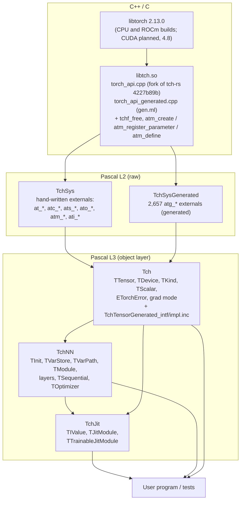

`A --> B` reads "B uses A". `TchJit` uses `TchNN` only for `TModule`,
`TVarPath` and `TNamedTensorArray` (`TTrainableJitModule`).

## 2. Tch: tensor core

`TTensor` is a managed record around a reference-counted interface, so a
tensor is freed deterministically when its last copy goes (DESIGN 4.1).
The 2,657 generated ops are methods of `TTensor` (4.4), not drawn.

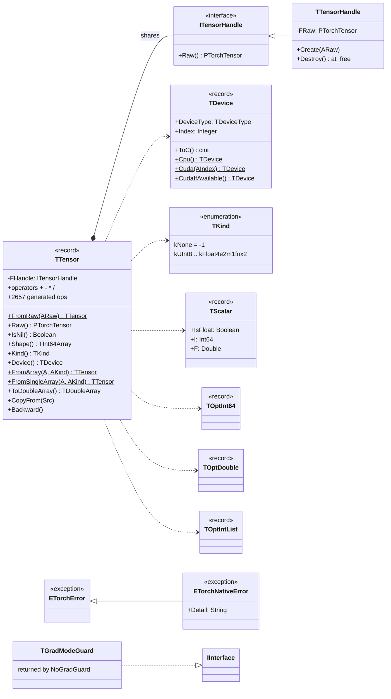

GPU functions of 4.8 (same unit, free functions): `CudnnIsAvailable`,
`CudaManualSeed(All)`, `CudaSynchronize`, `CudnnUserEnabled` /
`SetCudnnUserEnabled`, `SetCudnnBenchmark`, `GpuBackend: TGpuBackend
(gbNone, gbCuda, gbRocm)`, `GpuRuntimeVersion`, `CudnnVersion`,
`TDevice.ToString`. `GpuBackend` is `gbRocm` for "HIP, or CUDA without
CUDART": a ROCm build reports hasHIP False (measured, H35).

## 3. TchNN: store, modules, optimizer

A `TVarStore` owns the variables; `TVarPath` is a cheap naming scope; layers
register their tensors through a path and share the handles; a
`TOptimizer` reads the store's trainable variables and adds new ones lazily
(DESIGN 4.6.1–4.6.7).

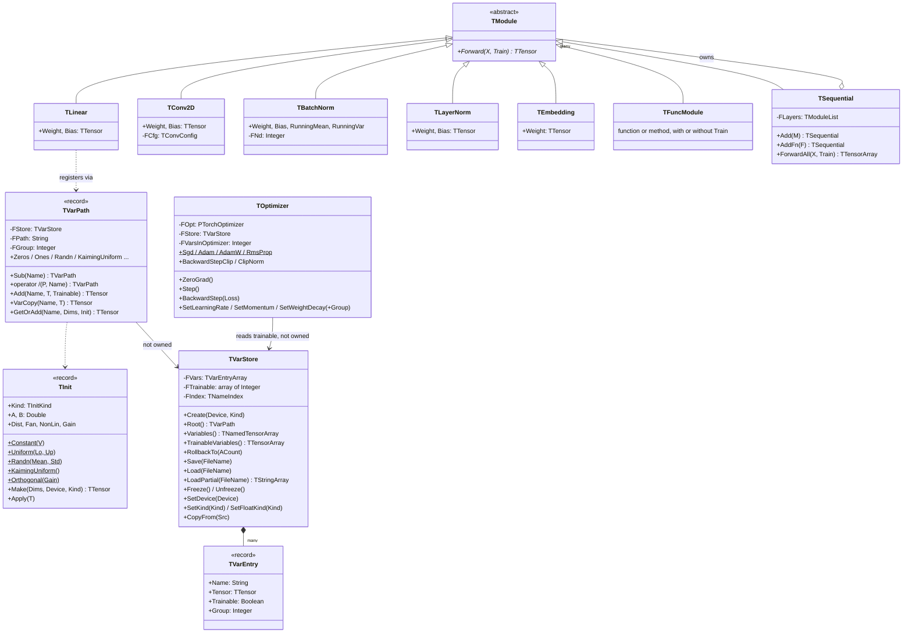

Lifetime rule (DESIGN 4.6): free optimizers first, then layers, then the
store.

## 4. TchNN: milestone 3 layers

DESIGN 4.6.10. `TConv2D` sits under a common `TConvND` with its public
API unchanged; RNNs are not `TModule`s, as in tch-rs.

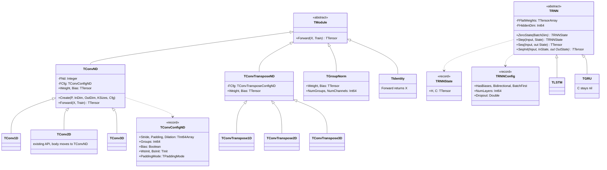

On a GPU store with cuDNN, `TRNN`'s constructor also calls
`_cudnn_rnn_flatten_weight` (4.8, H30); ROCm has no cuDNN, so not there.

## 5. TchJit: values and modules

`TIValue` is a tagged record whose tags equal `ati_tag`'s; `ToC` makes a
C ivalue the caller frees, `FromC` consumes one (DESIGN 4.6.8). Tag 14 is held
by the refcounted object handle (4.6.9).

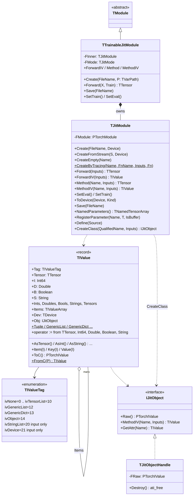

Globals: `JitGetProfilingMode` / `JitSetProfilingMode`,
`JitGetTensorExprFuserEnabled` / `JitSetTensorExprFuserEnabled`,
`JitSetGraphExecutorOptimize`, `JitLiveObjects`,
`JitFuserCudaEnabled` / `SetJitFuserCudaEnabled` (4.8; enabling raises,
nvfuser is removed in libtorch 2.13).

## 6. Sequence: ForwardIV and ivalue ownership

Every C ivalue made on the way in is freed in a `finally`; the result is
consumed by `FromC`, which frees it on every path (DESIGN 4.6.8). A failing
child conversion frees the siblings already made.

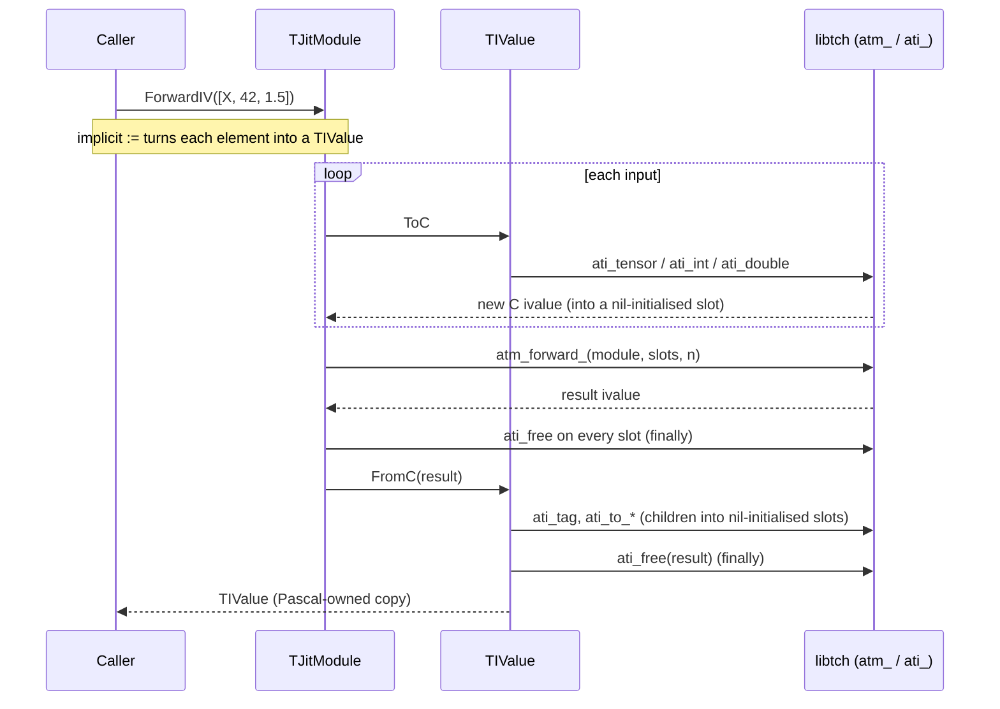

For tag 14, `FromC` keeps the pointer in a `TJitObjectHandle`
instead of freeing it, and `ToC` hands out `ati_clone(Obj.Raw)`.

## 7. Sequence: fine-tuning a TorchScript module

The store entries are the module's parameters (shared handles), so an
optimizer step on the store changes the scripted module in place
(DESIGN 4.6.8, H21 resolved).

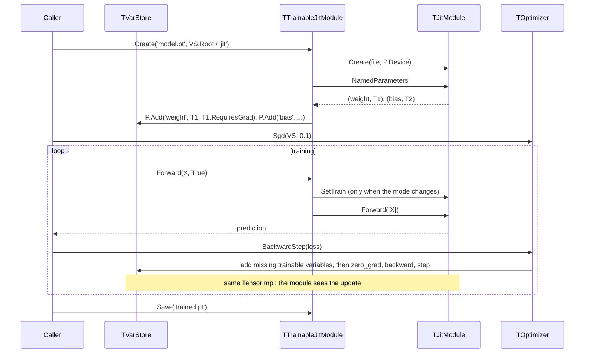

## 8. Deployment: CPU, ROCm and CUDA builds

DESIGN 4.8: one unpacked libtorch and one libtch build directory per
variant; the Pascal units, the C wrapper and the ABI do not change. A ROCm
libtorch reports the AMD GPU as CUDA, so `TDevice.Cuda(0)` selects it.

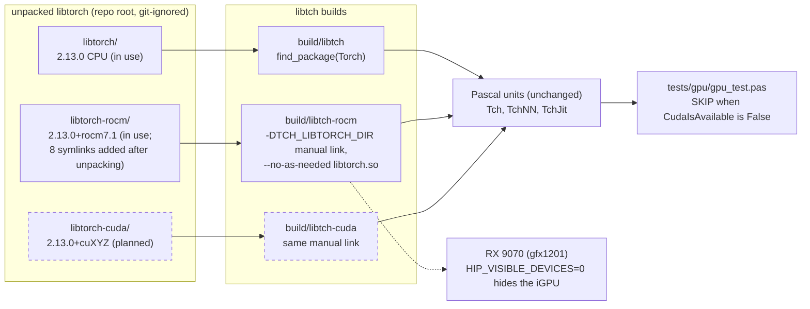

## 9. Knowledge package (planned)

DESIGN 7: a plugin with one skill, loaded by Claude Code through the
repository's marketplace file and by Hermes through
`skills.external_dirs`. No Pascal types are added. The fine-tuning sample
of DESIGN 8 is drawn in section 10.

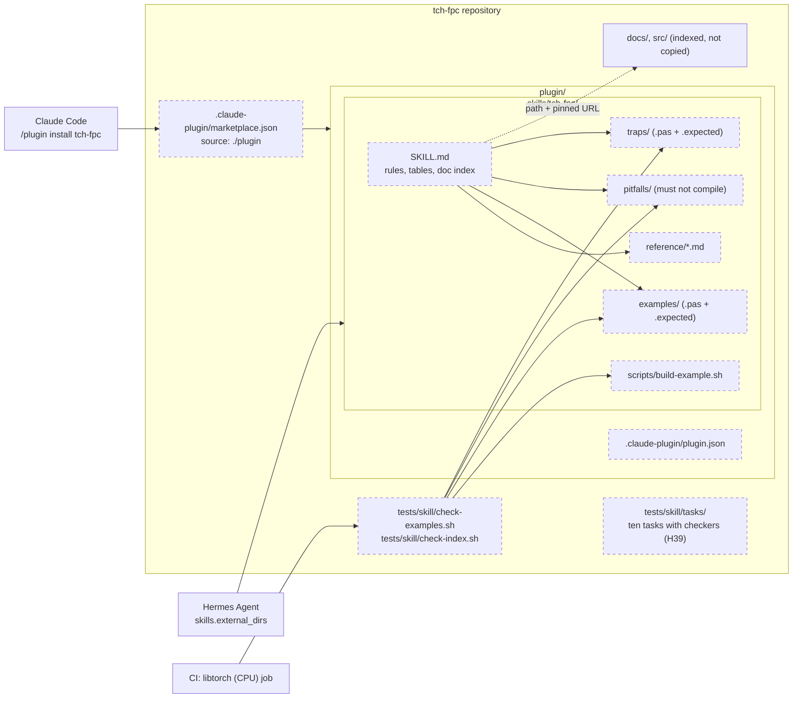

## 10. Fine-tuning sample (planned)

DESIGN 8.9–8.19: the sample `samples/qwen-lora/` that LoRA-fine-tunes
Qwen3.8 27B on the GGUF's packed weights. Everything in this section is
planned; nothing exists yet.

Units and what they need (DESIGN 8.12). The left group is Pascal only, the
right group uses `Tch` / `TchNN`.

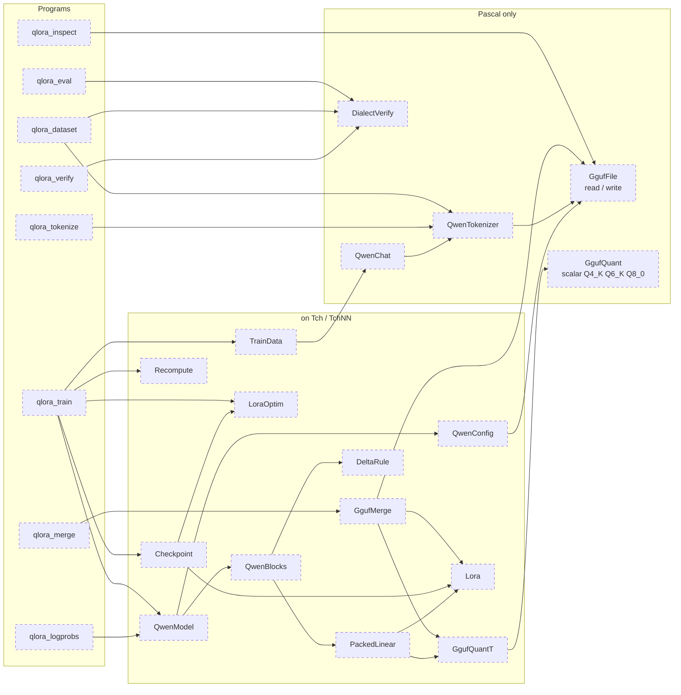

The model and training types (DESIGN 8.13, 8.14).

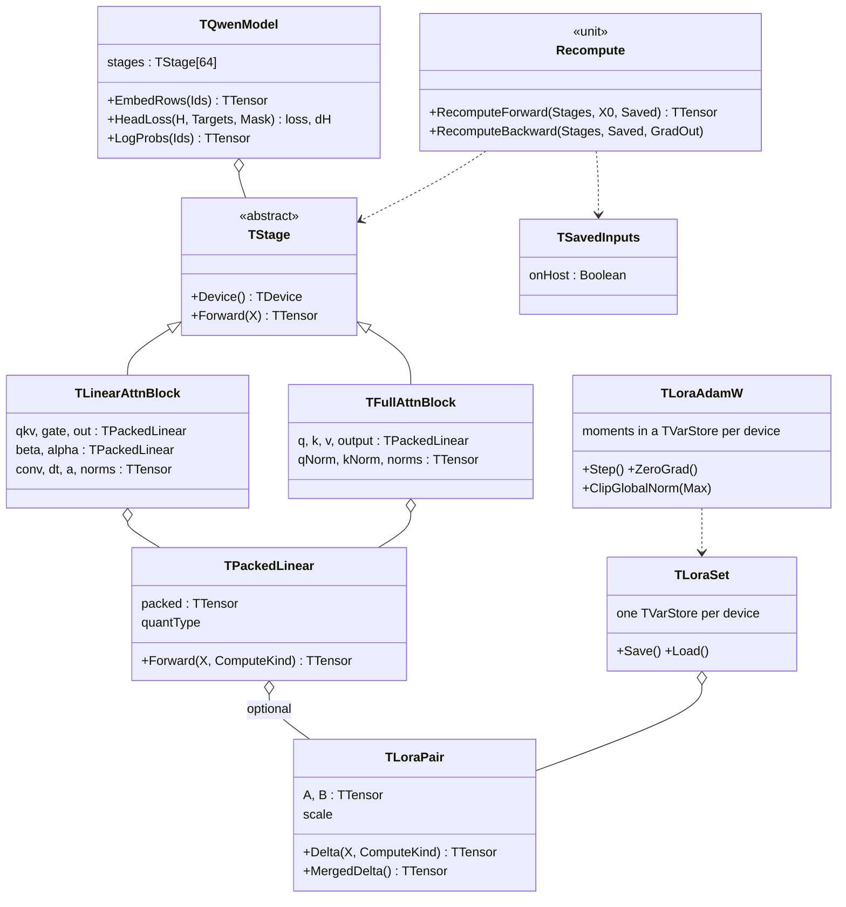

One training step on the two GPUs (DESIGN 8.14).

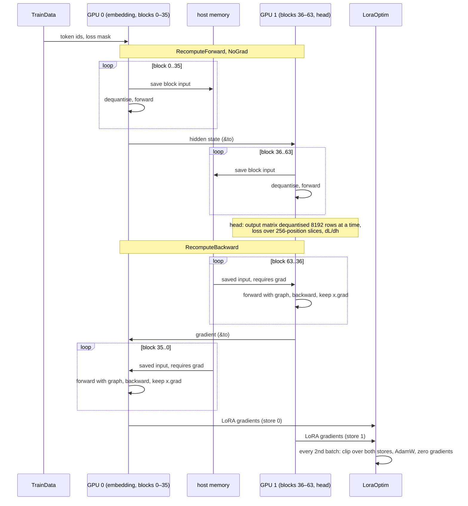

From data specification to the deployed model (DESIGN 8.15–8.17).

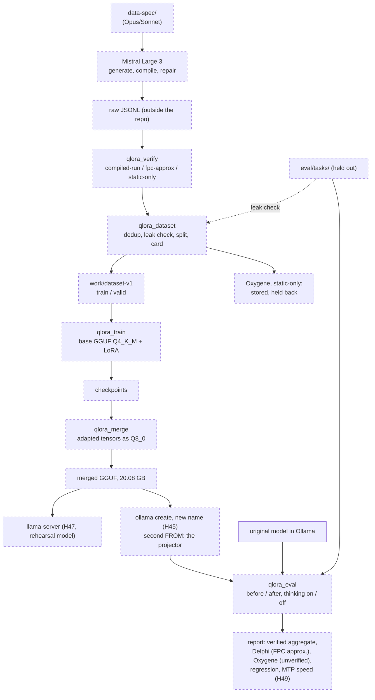
## 11. Status

| Area | DESIGN | State |
|---|---|---|
| C wrapper fork, generator, L2 | 1, 2, 3, 5 | implemented (milestone 1) |
| `TTensor`, data in/out, operators, autograd, `FromArray` revision | 4.1–4.4, 4.7 | implemented (milestone 1, local session 4) |
| `TInit`, `TVarStore`, save/load, optimizers, milestone 2 layers | 4.6.1–4.6.7 | implemented (milestone 2) |
| JIT: `TIValue`, `TJitModule`, `TTrainableJitModule` | 4.6.8 | implemented (milestone 3), H19–H25 hold |
| TorchScript objects (`IJitObject`) | 4.6.9 | implemented (local session 6, 2026-10-12), H26–H28 hold |
| Conv1D/3D, ConvTranspose, GroupNorm, LSTM/GRU, Identity | 4.6.10 | implemented (local session 7, 2026-10-12); H29 (`.ot` interchange with tch-rs) open, needs Rust |
| GPU: ROCm / CUDA builds and API | 4.8 | implemented (local session 8, 2026-10-12); ROCm runs on the RX 9070, H31 and H33 hold, H32 amended (8 symlinks after unpacking), H34 false, H35 answered; CUDA unmeasured |
| Knowledge package: plugin, skill, verified examples | 7 | designed (design session 9, 2026-11-16); not implemented; H37–H39 open |
| Fine-tuning Qwen3.8 27B as a tch-fpc sample | 8 | gate passed (H40–H42 hold); designed in detail (design session 10, 2026-11-17: 8.9–8.19, section 10 here); not implemented; H43, H45–H50 open, H44 off the plan |
