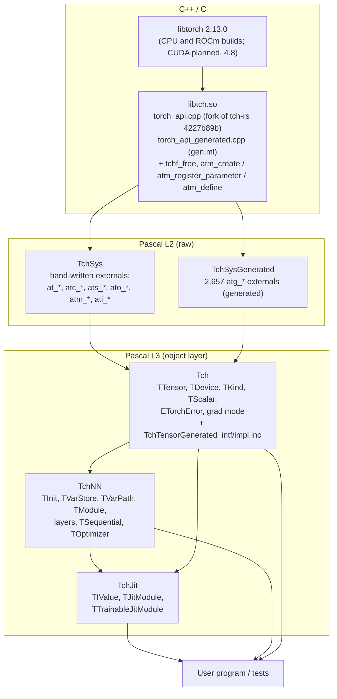
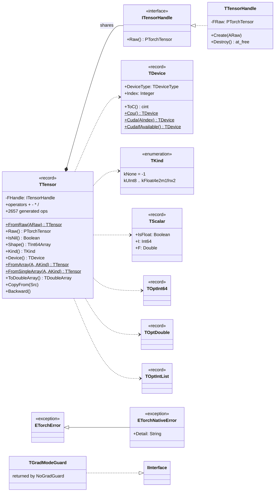
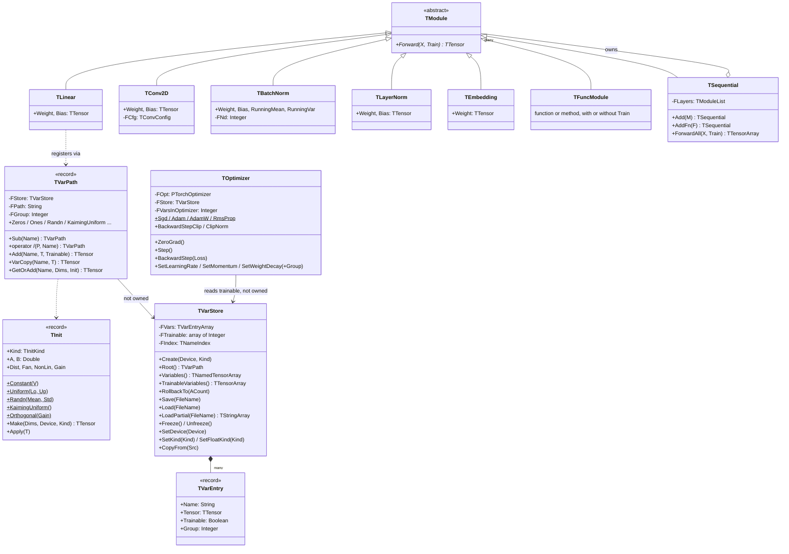
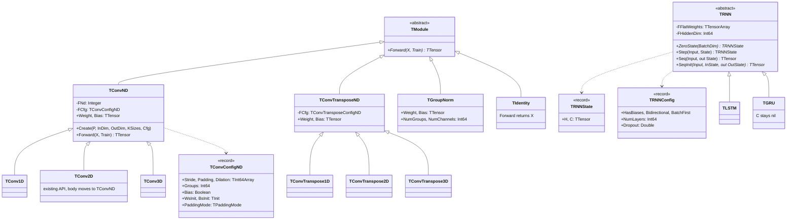
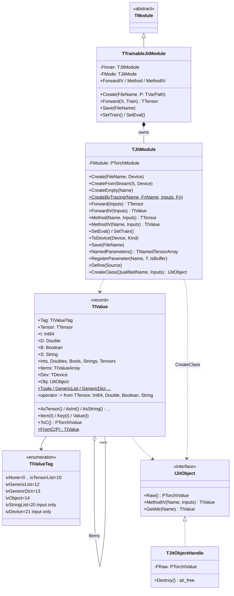
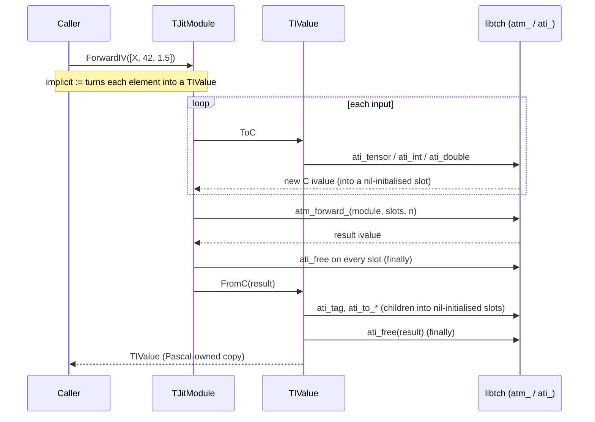
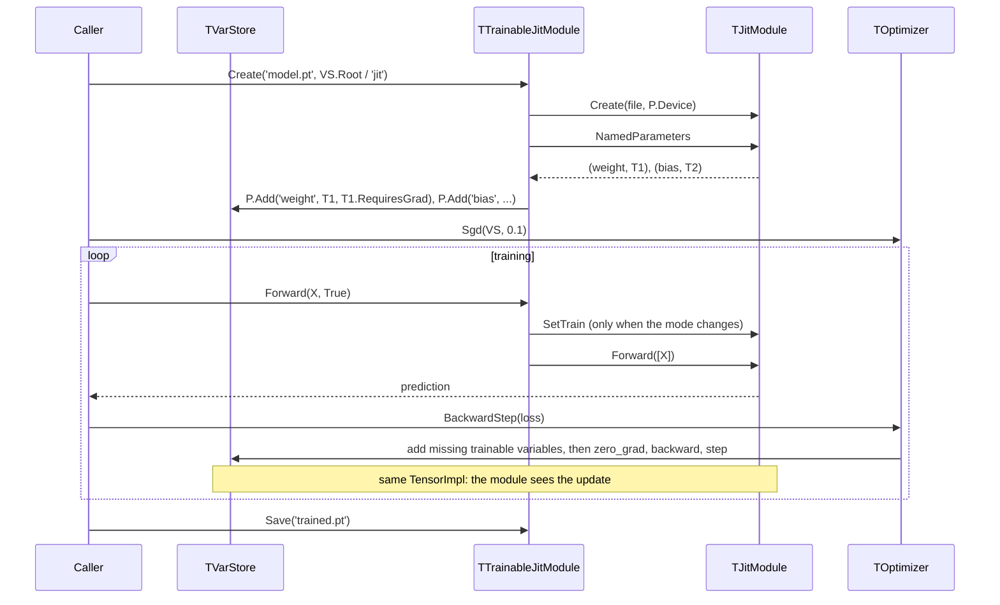
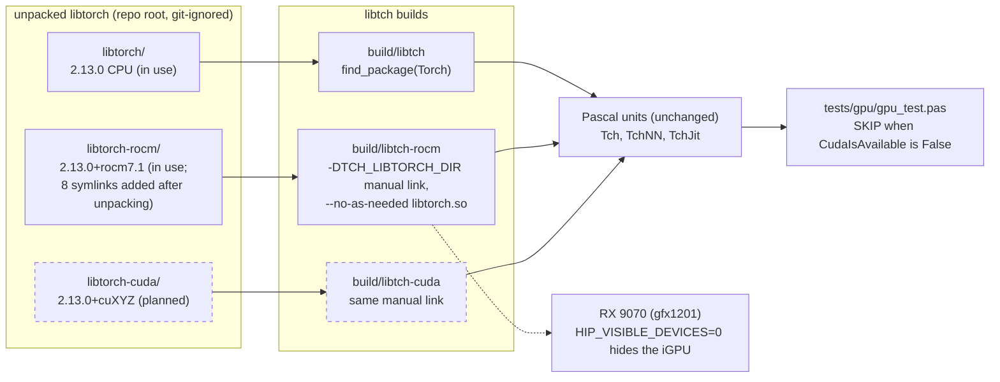

# tch-fpc の UML

（[UML.md](UML.md) の日本語訳です。内容が食い違う場合は英語版が正です。）

実装済みのもの（マイルストーン1〜3、TorchScript のオブジェクト、マイルストーン3の
レイヤー、ROCm での GPU デバイス）の図です。まだ予定なのは CUDA ビルドだけで（破線）、
NVIDIA の機械が要ります。時点：2026-10-12、ローカルセッション8の後。正は
DESIGN.md で、このファイルはそれを図にしただけです。

目次：
1. [層とユニット](#1-層とユニット)
2. [Tch：テンソルの中核](#2-tchテンソルの中核)
3. [TchNN：ストア、モジュール、オプティマイザ](#3-tchnnストアモジュールオプティマイザ)
4. [TchNN：マイルストーン3のレイヤー](#4-tchnnマイルストーン3のレイヤー)
5. [TchJit：値とモジュール](#5-tchjit値とモジュール)
6. [シーケンス：ForwardIV と ivalue の所有権](#6-シーケンスforwardiv-と-ivalue-の所有権)
7. [シーケンス：TorchScript モジュールのファインチューニング](#7-シーケンスtorchscript-モジュールのファインチューニング)
8. [配置：CPU、ROCm、CUDA のビルド](#8-配置cpurocmcuda-のビルド)
9. [状況](#9-状況)

## 1. 層とユニット

C ラッパーは tch-rs の libtch のフォーク。L2 は生の `external` 宣言、L3 はオブジェクト層
（DESIGN 0、3、4.5）。

`A --> B` は「B が A を使う」。`TchJit` が `TchNN` を使うのは `TModule`、`TVarPath`、
`TNamedTensorArray`（`TTrainableJitModule`）だけ。

## 2. Tch：テンソルの中核

`TTensor` は参照カウント付きインターフェースを包む管理型レコードなので、最後のコピーが
消えた時点で決定的に解放される（DESIGN 4.1）。生成された 2,657 個の op は `TTensor` の
メソッド（4.4）で、図には描いていない。

4.8 の GPU 関数（同じユニットの関数）：`CudnnIsAvailable`、`CudaManualSeed(All)`、
`CudaSynchronize`、`CudnnUserEnabled` / `SetCudnnUserEnabled`、`SetCudnnBenchmark`、
`GpuBackend: TGpuBackend (gbNone, gbCuda, gbRocm)`、`GpuRuntimeVersion`、`CudnnVersion`、
`TDevice.ToString`。`GpuBackend` は「HIP、または CUDART なしの CUDA」で `gbRocm`：ROCm
ビルドは hasHIP False を報告する（実測、H35）。

## 3. TchNN：ストア、モジュール、オプティマイザ

`TVarStore` が変数を所有し、`TVarPath` は軽い名前のスコープ。レイヤーはパス経由でテンソル
を登録してハンドルを共有し、`TOptimizer` はストアの学習対象変数を読み、後から増えた変数を
遅延追加する（DESIGN 4.6.1〜4.6.7）。

寿命の規則（DESIGN 4.6）：先にオプティマイザ、次にレイヤー、最後にストアを解放する。

## 4. TchNN：マイルストーン3のレイヤー

DESIGN 4.6.10。`TConv2D` は公開 API を変えずに共通の `TConvND` の下にある。RNN は tch-rs
と同じく `TModule` ではない。

cuDNN のある GPU 上のストアでは、`TRNN` のコンストラクタが
`_cudnn_rnn_flatten_weight` も呼ぶ（4.8、H30）。ROCm には cuDNN がないので呼ばない。

## 5. TchJit：値とモジュール

`TIValue` はタグ付きレコードで、タグの値は `ati_tag` と同じ。`ToC` は呼び出し側が解放する
C の ivalue を作り、`FromC` は受け取った ivalue を消費する（DESIGN 4.6.8）。タグ 14 は
参照カウント付きのオブジェクトハンドルが保持する（4.6.9）。

グローバル：`JitGetProfilingMode` / `JitSetProfilingMode`、
`JitGetTensorExprFuserEnabled` / `JitSetTensorExprFuserEnabled`、
`JitSetGraphExecutorOptimize`、`JitLiveObjects`、
`JitFuserCudaEnabled` / `SetJitFuserCudaEnabled`（4.8。有効化は例外：libtorch 2.13 で
nvfuser は削除済み）。

## 6. シーケンス：ForwardIV と ivalue の所有権

入力側で作った C の ivalue はすべて `finally` で解放され、結果は `FromC` が消費して
どの経路でも解放する（DESIGN 4.6.8）。子の変換が失敗すると、作り終えた兄弟は解放される。

タグ 14 では `FromC` がポインタを解放せず `TJitObjectHandle` に持たせ、
`ToC` は `ati_clone(Obj.Raw)` を渡す。

## 7. シーケンス：TorchScript モジュールのファインチューニング

ストアの項目はモジュールのパラメータそのもの（共有ハンドル）なので、ストア上で
オプティマイザを1ステップ回すとスクリプト化モジュールがその場で変わる（DESIGN 4.6.8、
H21 解決済み）。

## 8. 配置：CPU、ROCm、CUDA のビルド

DESIGN 4.8：変種ごとに展開した libtorch と libtch のビルドディレクトリを1つずつ持つ。
Pascal のユニット、C ラッパー、ABI は変わらない。ROCm 版 libtorch は AMD GPU を CUDA として
見せるので、`TDevice.Cuda(0)` で選べる。

## 9. 状況

| 領域 | DESIGN | 状態 |
|---|---|---|
| C ラッパーのフォーク、生成器、L2 | 1、2、3、5 | 実装済み（マイルストーン1） |
| `TTensor`、データの入出力、演算子、自動微分、`FromArray` の改訂 | 4.1〜4.4、4.7 | 実装済み（マイルストーン1、ローカルセッション4） |
| `TInit`、`TVarStore`、保存と読み込み、オプティマイザ、マイルストーン2のレイヤー | 4.6.1〜4.6.7 | 実装済み（マイルストーン2） |
| JIT：`TIValue`、`TJitModule`、`TTrainableJitModule` | 4.6.8 | 実装済み（マイルストーン3）、H19〜H25 成立 |
| TorchScript のオブジェクト（`IJitObject`） | 4.6.9 | 実装済み（ローカルセッション6、2026-10-12）、H26〜H28 成立 |
| Conv1D/3D、ConvTranspose、GroupNorm、LSTM/GRU、Identity | 4.6.10 | 実装済み（ローカルセッション7、2026-10-12）。H29（tch-rs との `.ot` の相互運用）は未解決、Rust が要る |
| GPU：ROCm / CUDA のビルドと API | 4.8 | 実装済み（ローカルセッション8、2026-10-12）。ROCm は RX 9070 で動作、H31・H33 成立、H32 修正（展開後にシンボリックリンク8つ）、H34 不成立、H35 判明。CUDA は未実測 |
