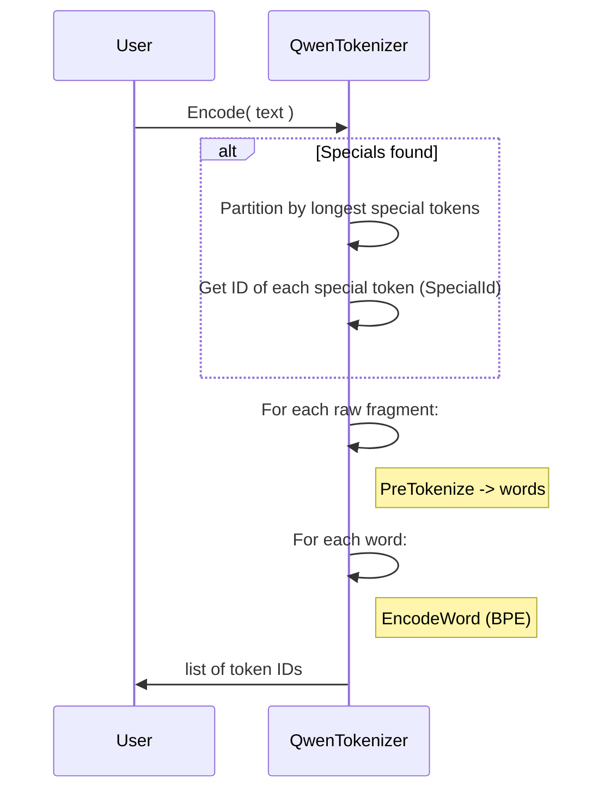

# QwenTokenizer Flow Diagram (T05)

## Encode Pipeline



## PreTokenize Scanner (Qwen35)

```mermaid
stateDiagram-v2
    [*] --> DecodeUTF8
    DecodeUTF8 --> ScanLoop
    ScanLoop --> CheckContract
    CheckContract --> (ASCII contraction?)
    Note left of (ASCII contraction?)
        cp = Cp(Pos); f = F(Pos)
        If cp='\'' and next is [s,t,m,d] -> AddTok(Pos+2)
        Else if next next [r,e] [v,e] [l,l] -> AddTok(Pos+3)
    end
    CheckContract --> (Word?)
    Note left of (Word?)
        if not (CR or LF or f.number) and (f.letter or f.mark or next.letter or next.mark)
            Pos++ until !letter/mark
            AddTok(Pos)
    end
    CheckContract --> (Number?)
    Note left of (Number?)
        if f.number -> Pos++ AddTok(Pos)
    end
    CheckContract --> (Non-space punctuation?)
    Note left of (Non-space punctuation?)
        f2 = F(Pos+1) if cp=' '
        if not (f2.space or f2.letter or f2.mark or f2.number) and f.defined
            if cp=' ' -> Pos++
            while !f2.space/letter/mark/number and f2.defined
                Pos++ ; f2=F(Pos)
            while Cp(Pos) in [CR,LF]: Pos++
            AddTok(Pos)
    end
    CheckContract --> (Spaces?)
    Note left of (Spaces?)
        count spaces (nw)
        track lastRN
        if lastRN>0 -> Pos=lastRN; AddTok(Pos)
        else if nw>1 and Cp(Pos+nw)<>NoCp -> Pos+=nw-1; AddTok(Pos)
        else if nw>0 -> Pos+=nw; AddTok(Pos)
        else Pos++; AddTok(Pos)
    end
    ScanLoop --> [*]
```

## BPE Loop (EncodeWord)

```mermaid
graph TD
    Start((Start))
    N[Set N := Length(word)]
    Init[Sym[i] := ByteToUnicode(word[i]) For i
    Init --> Rank[Rank[i] := merge rank or MaxInt
    Rank --> Loop[While N>1]
    Loop --> FindBest[best=min Rank[i]; bi=index of best (strict <, leftmost on ties)]
    FindBest --> Break[bi<0? stop]
    Break --> Merge[Sym[bi] := Sym[bi] + Sym[bi+1]
    Shift[Shift Sym[bi+2..] left by 1; Rank[bi+2..] left by 1; N--]
    UpdateRanks[Update Rank[bi-1] and Rank[bi] if exist]
    UpdateRanks --> Loop
    Loop --> End((End: Sym[0..N-1] are final tokens)]
```

## Decode Flow

```mermaid
sequenceDiagram
    participant User
    participant Tokenizer

    User->>Tokenizer: Decode( ids )
    Tokenizer->>Tokenizer: For each id
    alt Special
        Add token string to output.
    else
        Split token string into UTF‑8 chars.
        For each char: find byte via inverse map.
        If not found -> error.
        Append byte.
    end
    Tokenizer->>User: concatenated text
```

## RunTokenizeCLI

```mermaid
sequenceDiagram
    participant User
    participant CLI as qlora_tokenize
    participant Tokenizer
    participant File

    User->>CLI: run with args
    CLI->>CLI: parse args
    CLI->>File: Open model file
    CLI->>Tokenizer: Create tokenizer
    CLI->>File: Read input bytes
    alt Plain mode
        Tokenizer->>Tokenizer: Encode(raw)
        CLI->>CLI: output space‑delimited ids
    alt JSONL mode
        File->>File: split lines
        loop for each line
            CLI->>CLI: parse JSON
            alt Success
                Tokenizer->>Tokenizer: Encode(text)
                CLI->>CLI: output id\tids
            else
                CLI->>CLI: error line message
        end
    end
    CLI->>CLI: exit code 0/1/2
```
