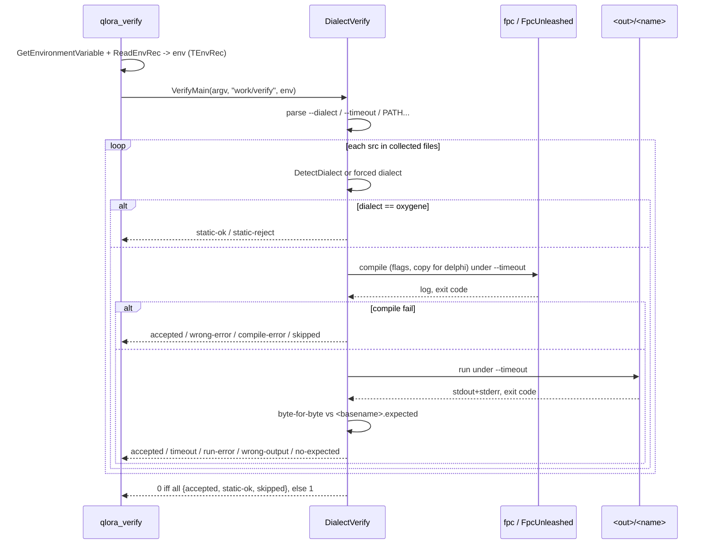

# Program Flow — T06: `qlora_verify` (`DialectVerify`)

Based on: `docs/external-design/T06-external.md`, `docs/system-flow/T06-system.md`,
`tasks/T06-facts.md` (authoritative where it differs),
`docs/detailed-design/T06-detailed.md` (function names below reference its §2).

## 3.1 Flow (ASCII)

```
qlora_verify [--dialect D] [--timeout N] PATH...   (program body, T06c)
  |  GetEnvironmentVariable QLORA_FPC / QLORA_FPC_UNLEASHED / HOME
  |  ReadEnvRec(fpc, fpcUnleashed, home) -> TEnvRec     (the only env reader)
  v
VerifyMain (argv, "work/verify", env)   facts: exit 2 usage / 0 all-good / 1 otherwise
  |  parse options; every other arg is a file or directory
  |  any parse failure, unknown --*, missing PATH, invalid
  |  --dialect/--timeout value ............ -->  usage text, exit 2
  |
  v
CollectPascalFiles per PATH
  |  file ................... itself
  |  dir .................... all *.pas / *.dpr, recursively, sorted by path
  |
  v
for each file:   (env passed through to VerifyFile)
  |
  v
dialect := --dialect D if given, else DetectDialect(text, name)
  |  1. first {$mode objfpc|delphi|unleashed} line -> objfpc / fpc-delphi / unleashed
  |  2. first word "namespace" ................... -> oxygene
  |  3. .dpr extension or {$APPTYPE CONSOLE} ..... -> delphi
  |  4. else ..................................... -> objfpc
  |
  +--> oxygene: static check, nothing is compiled
  |       first word "namespace" ? static-ok : static-reject
  |
  v
ChooseCompiler -> (path, class)   compiled-run / fpc-approx / static-only
  |  path not on disk ............... -->  skipped (not a failure)
  v
fresh <out> under work/verify/   (-vew -l- -FE<out> -FU<out>)
  |
  +--> delphi only: RewriteDelphiUnits -> write copy to <out>/<name>,
  |    compile the copy with the four -M* switches added
  |
  v
CompileStep under --timeout (default 10 s)
  |  start failure / timeout ........ -->  skipped
  |  fail + expect-error text present in log :
  |        text found ?  accepted  :  wrong-error  (detail: first Error:/Fatal: line)
  |  fail, no expect-error ...........-->  compile-error (detail: first Error:/Fatal: line)
  |  success + expect-error ..........-->  compiled-but-should-fail
  v
success, no expect-error
  v
RunStep: <out>/<name>, stdout+stderr together, under --timeout
  |  start failure ................. -->  skipped
  |  timeout ........................-->  timeout  (detail: limit seconds)
  |  exit != 0 ......................-->  run-error  (detail: exit code)
  v
byte-for-byte against <basename>.expected (next to the source)
  |  file missing ................. -->  no-expected
  |  unequal ...................... -->  wrong-output (no partial match)
  |  equal ........................ -->  accepted
  v
print TSV: <path> <dialect> <class> <outcome> <detail>
  (detail <= 200 chars, tabs replaced by spaces, may be empty)
  |
  v
exit 0  iff every file is one of { accepted, static-ok, skipped }
       else 1
```

## 3.2 Sequence (mermaid, optional)



## 3.3 External interfaces (facts, R15/R16)

| Kind | Contract |
|---|---|
| CLI | `qlora_verify [--dialect D] [--timeout N] PATH...` — exit 0/1/2 |
| stdin | not used |
| stdout | one TSV line per file: `<path> <dialect> <class> <outcome> <detail>` (detail ≤ 200 chars, tabs → spaces, may be empty) |
| stderr | usage text on exit 2 only |
| FS (read) | source files, `.expected` siblings, `HOME`/`QLORA_FPC`/`QLORA_FPC_UNLEASHED` env |
| FS (write) | `work/verify/<n>/` per file (compilation outputs, delphi copy) — git-ignored |
| child processes | the chosen compiler, then the compiled program; each bounded by `--timeout` (default 10 s) |
| network | none |
| GPU | none (DESIGN 8.18 oracle runs with the GPUs hidden) |

## 3.4 Change history

| Date | Change |
|---|---|
| 2026-11-17 | Initial program flow |
| 2026-11-17 | Rewritten to the corrected CLI/outcomes: `PATH...` instead of `--dir`/`--expect`, dialect names, TSV outcomes instead of JSON, `skipped` for missing compiler / start failure / timeout, delphi-copy branch, 10 s default timeout |
| 2026-11-18 | `ReadEnvRec` moved to the program `qlora_verify` (the only env reader); `VerifyMain` now receives the `TEnvRec` as a parameter and no longer reads the environment (detailed design §2.1 / §2.19) |
