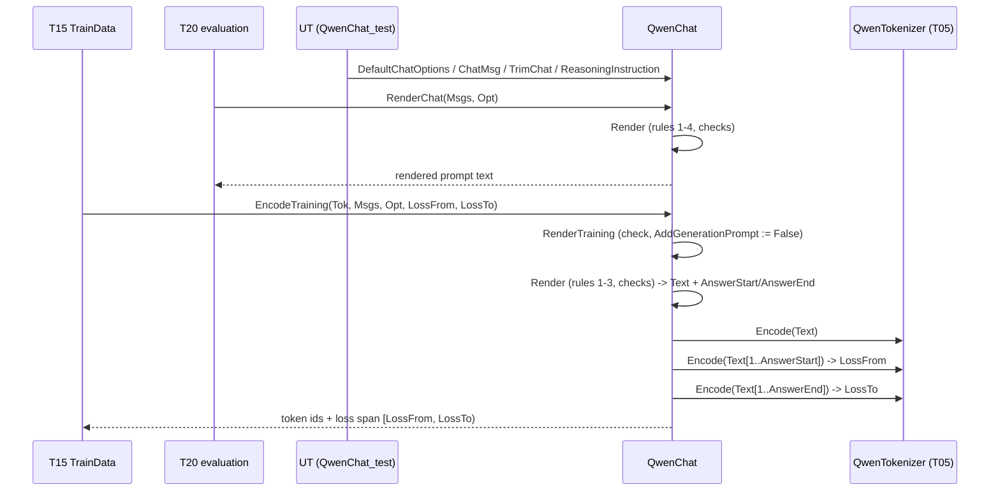
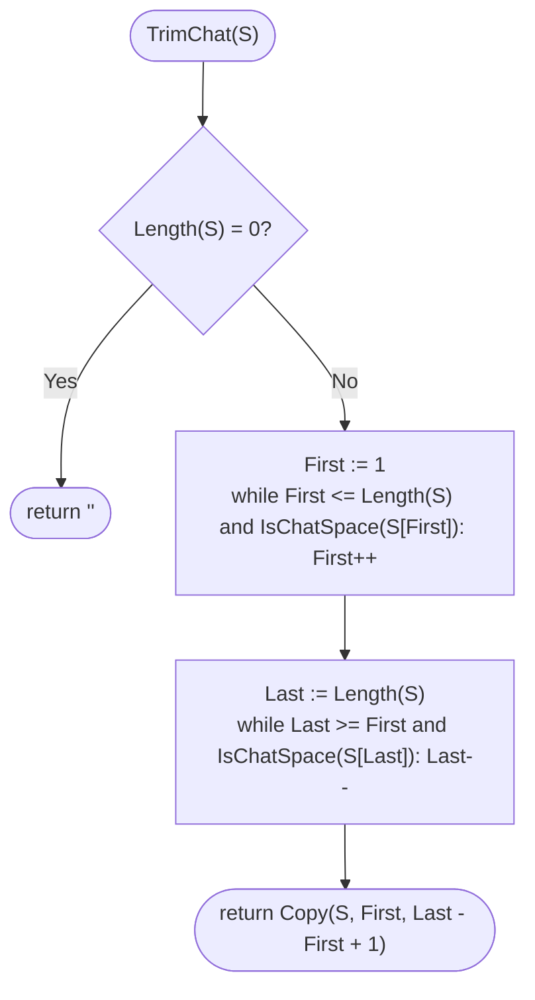
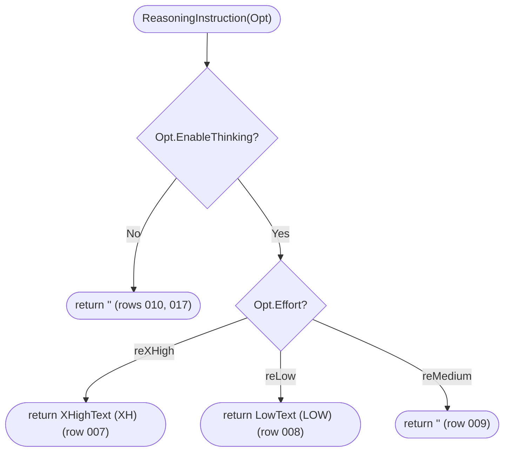
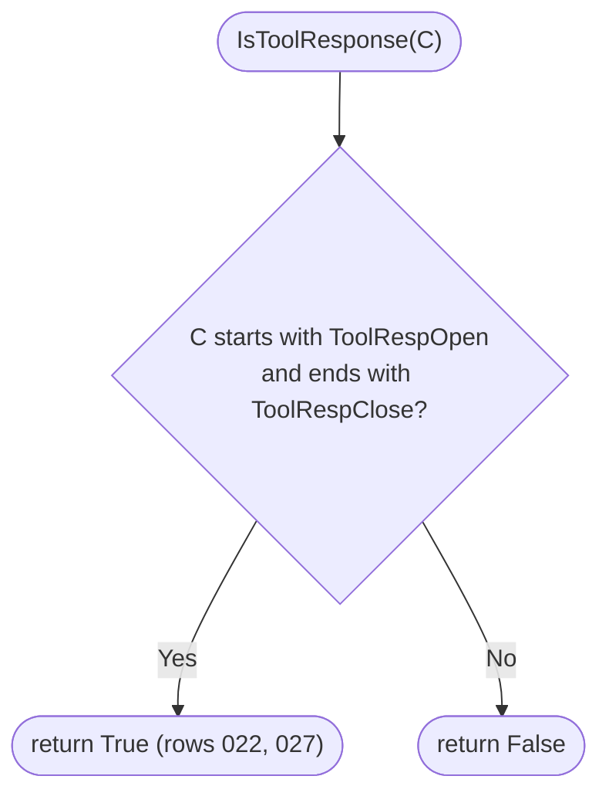
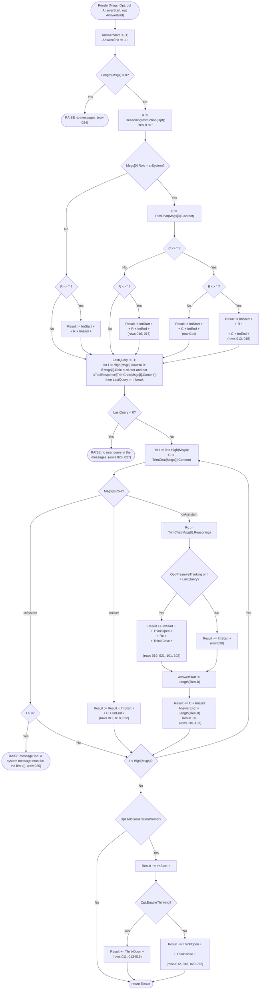
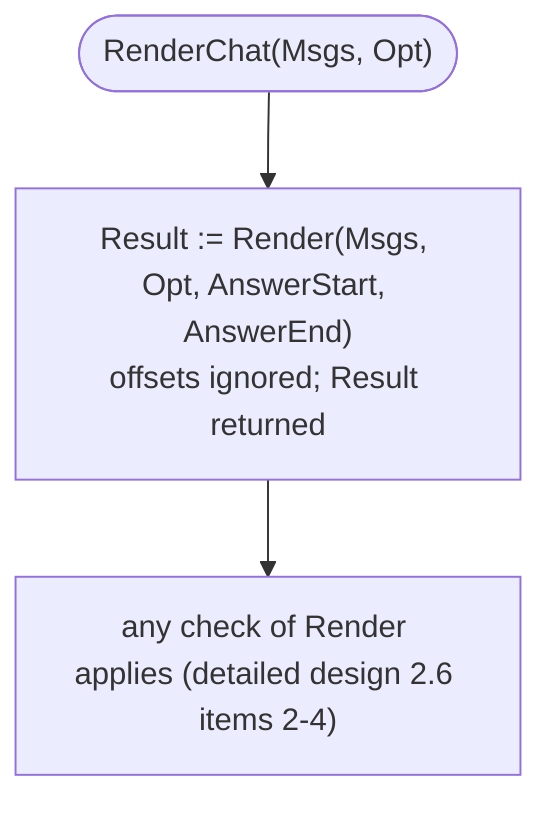
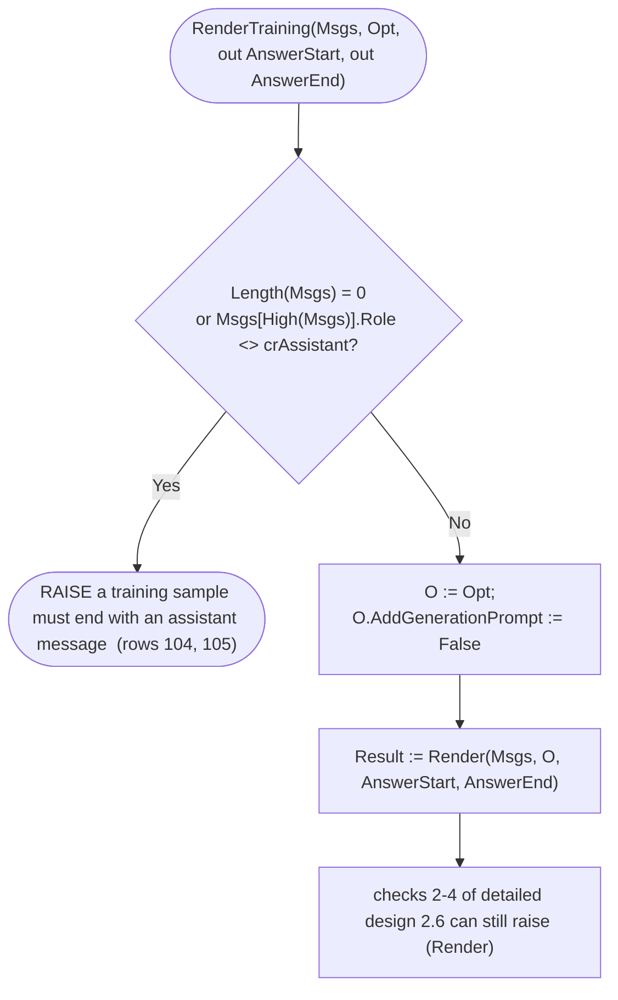
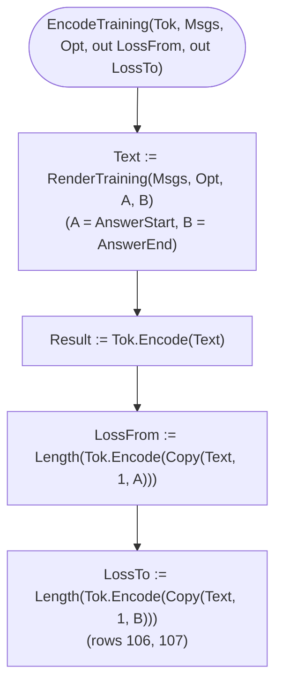

# QwenChat Program Flow (T07)

Call flow of unit `QwenChat` (`src/QwenChat.pas`), per
`docs/detailed-design/T07-detailed.md`. All tags are written by their unit
constants (`ImStart`, `ImEnd`, `ThinkOpen`, `ThinkClose`, `ToolRespOpen`,
`ToolRespClose`); `\n` in labels means #10. Branches are drawn in full:
they are the basis of the UT cases (UT-QwenChat-*) and the line coverage.

## 1. Overall call flow

## 2. `TrimChat` (with private `IsChatSpace`)

`IsChatSpace(C)`: True iff `C in [' ', #9, #10, #11, #12, #13]` — nothing
else is trimmed (U+3000, U+00A0 stay; rows 004–006).

## 3. `ReasoningInstruction`

## 4. `IsToolResponse` (private)

## 5. `Render` (the main rendering function)

Steps 0–4 follow the detailed design 2.3; the branches are drawn exactly,
including every message in the check order of detailed design 2.6.

## 6. `RenderChat`

## 7. `RenderTraining`

## 8. `EncodeTraining` (with the T05 tokenizer)

Why this gives the exact span: the answer always follows a `\n` and ends
with the special token ending the turn, so the pre-tokenizer splits there
and both prefixes are prefixes of the whole encoding.
