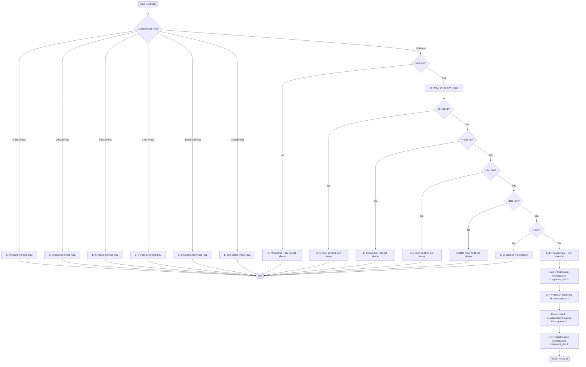
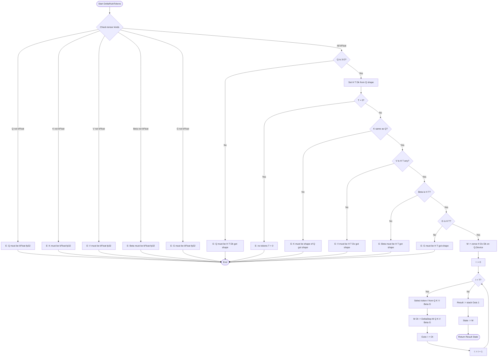

# Program flow — unit `DeltaRule` (T08)

## `DeltaStep` function flow

## `DeltaRuleTokens` function flow

## Branch coverage notes

### `DeltaStep` branches

| Branch | Condition | UT case |
|--------|-----------|---------|
| M not kFloat | M.Kind ≠ kFloat | UT-DeltaRule-009 |
| Q not kFloat | Q.Kind ≠ kFloat | UT-DeltaRule-017 |
| K not kFloat | K.Kind ≠ kFloat | UT-DeltaRule-018 |
| V not kFloat | V.Kind ≠ kFloat | UT-DeltaRule-019 |
| Beta not kFloat | Beta.Kind ≠ kFloat | UT-DeltaRule-020 |
| G not kFloat | G.Kind ≠ kFloat | UT-DeltaRule-010 |
| M not 3-D | len(M.Shape) ≠ 3 | UT-DeltaRule-011 |
| Q wrong shape | Q.Shape ≠ [H, Dk] | UT-DeltaRule-012 |
| K wrong shape | K.Shape ≠ [H, Dk] | UT-DeltaRule-013 |
| V wrong shape | V.Shape ≠ [H, Dv] | UT-DeltaRule-014 |
| Beta wrong shape | Beta.Shape ≠ [H] | UT-DeltaRule-015 |
| G wrong shape | G.Shape ≠ [H] | UT-DeltaRule-016 |

All path combinations with other arguments valid are covered.

### `DeltaRuleTokens` branches

| Branch | Condition | UT case |
|--------|-----------|---------|
| Q not kFloat | Q.Kind ≠ kFloat | UT-DeltaRule-109 |
| K not kFloat | K.Kind ≠ kFloat | UT-DeltaRule-118 |
| V not kFloat | V.Kind ≠ kFloat | UT-DeltaRule-119 |
| Beta not kFloat | Beta.Kind ≠ kFloat | UT-DeltaRule-120 |
| G not kFloat | G.Kind ≠ kFloat | UT-DeltaRule-110 |
| Q not 3-D | len(Q.Shape) ≠ 3 | UT-DeltaRule-111 |
| T = 0 | Q.Shape[1] = 0 | UT-DeltaRule-112 |
| K not same shape | K.Shape ≠ Q.Shape | UT-DeltaRule-113 |
| V wrong H | V.Shape[0] ≠ H | UT-DeltaRule-114 |
| V wrong T | V.Shape[1] ≠ T | UT-DeltaRule-115 |
| Beta wrong shape | Beta.Shape ≠ [H, T] | UT-DeltaRule-116 |
| G wrong shape | G.Shape ≠ [H, T] | UT-DeltaRule-117 |

Loop path (I from 0 to T-1) exercised by:
- T = 0: UT-DeltaRule-112 (error path)
- T = 1: UT-DeltaRule-105 (one iteration)
- T = 2: UT-DeltaRule-008 (two iterations via DeltaStep)
- T = 20, 65, 200: ITa cases (many iterations)
