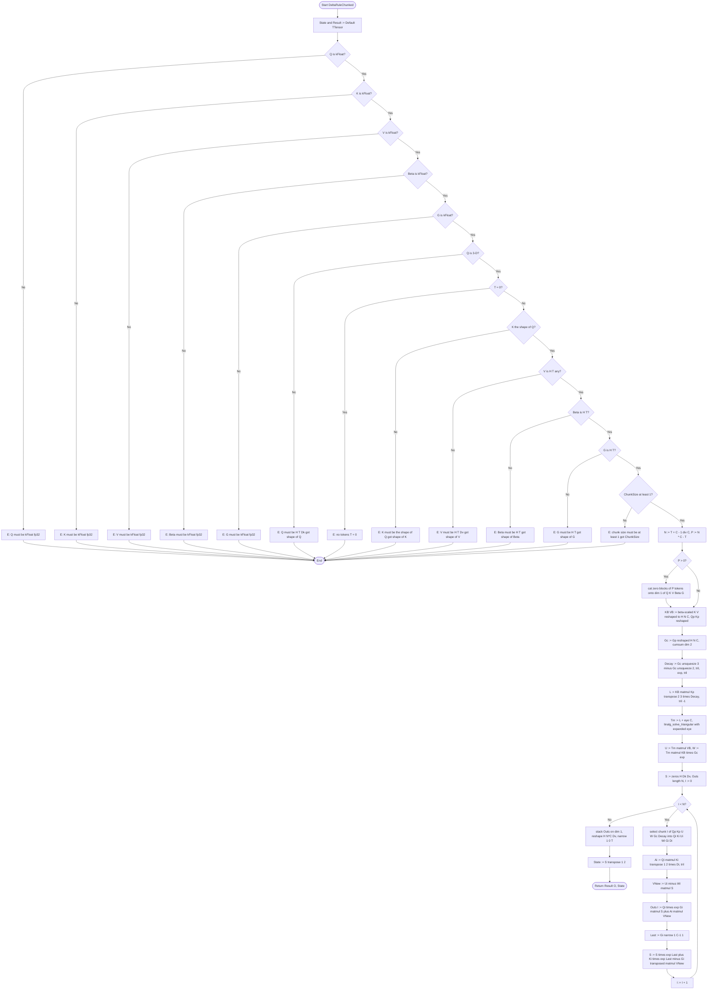

# Program flow — unit `DeltaRule`, `DeltaRuleChunked` (T09)

## `DeltaRuleChunked` function flow

## Branch coverage notes

All branches are listed; every branch has a UT case (the rows of the facts'
"Unit tests" tables, UT-DeltaRule-201 to 224) or an ITa case.

### Check branches

| Branch | Condition | UT case |
|--------|-----------|---------|
| Q not kFloat | Q.Kind ≠ kFloat | UT-DeltaRule-201 |
| K not kFloat | K.Kind ≠ kFloat | UT-DeltaRule-202 |
| V not kFloat | V.Kind ≠ kFloat | UT-DeltaRule-203 |
| Beta not kFloat | Beta.Kind ≠ kFloat | UT-DeltaRule-204 |
| G not kFloat | G.Kind ≠ kFloat | UT-DeltaRule-205 |
| Q not 3-D | len(Q.Shape) ≠ 3 | UT-DeltaRule-206 |
| T = 0 | Q.Shape[1] = 0 | UT-DeltaRule-207 |
| K not the shape of Q | K.Shape ≠ Q.Shape | UT-DeltaRule-208 |
| V not [H, T, any] | V.Shape ≠ [H, T, Dv] | UT-DeltaRule-209 |
| Beta not [H, T] | Beta.Shape ≠ [H, T] | UT-DeltaRule-210 |
| G not [H, T] | G.Shape ≠ [H, T] | UT-DeltaRule-211 |
| ChunkSize < 1 | ChunkSize = 0 | UT-DeltaRule-212 |

All path combinations with other arguments valid are covered (each row uses
Q, K zeros([2, 3, 4]), V zeros([2, 3, 5]), Beta, G zeros([2, 3]) unless the
row says otherwise).

### Body branches

The only branches are `if P > 0` (padding) and the chunk loop; there is no
branch per chunk.

| Branch / path | Condition | UT case |
|---------------|-----------|---------|
| Padding taken (P > 0) | T not a multiple of ChunkSize | UT-DeltaRule-215 (T 5, C 2), 216 (T 5, C 2), 218 (T 50, C 7, padding 6), 221 (T 65, C 64, padding 63) |
| Padding not taken (P = 0) | T a multiple of ChunkSize | UT-DeltaRule-213 (T 2, C 64), 214, 217 (T 50, C 1), 219 (T 1), 220 (T 64) |
| Loop body, one chunk (N = 1) | T ≤ ChunkSize | UT-DeltaRule-213, 214, 219, 220 |
| Loop body, many chunks (N > 1) | T > ChunkSize | UT-DeltaRule-215 (N 3), 216 (N 3), 217 (N 50), 218 (N 8), 221 (N 2), 222, 223, 224 |
| ChunkSize default = explicit | same inputs, with and without the argument | UT-DeltaRule-223 (exact equal O and State) |
| beta all zero | Beta = zeros | UT-DeltaRule-215 (exact zeros) |
| Strong decay | g in (−5, 0] | UT-DeltaRule-222 |
| Gradients of all five inputs | backward on both forms | UT-DeltaRule-224 |

Values against `DeltaRuleTokens` (the oracle of the value rows) are exact for
T08's hand cases (213, 214) and ≤ 1e-6 / 1e-5 otherwise (216–222, 214: 1e-6
limit rows as per the facts). Long sequences: ITa-T09-001 to 006 at the 27B
model's sizes (48 heads, 128 × 128), T = 1, 63, 64, 65, 200, 2048.
