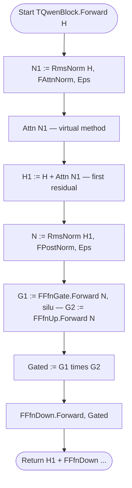
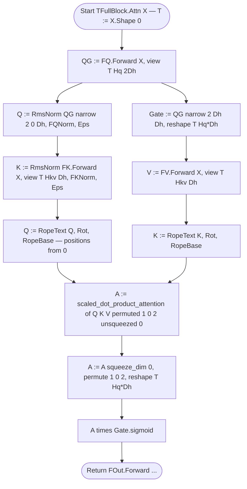
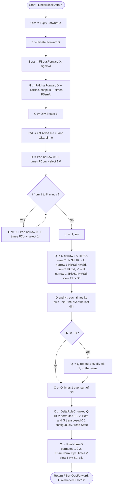

# Program flow — unit `QwenBlocks` (T10)

Step-by-step tensor operations for the three routines; the full tensor-op
lists are in `docs/detailed-design/T10-detailed.md` (§4.6–4.8). Tensors are
managed records (no `Free`); the blocks free their `TPackedLinear` fields in
`Destroy`.

## `TQwenBlock.Forward` flow (the skeleton)

`Attn` dispatches on the class: `TFullBlock.Attn` (next) or
`TLinearBlock.Attn` (third). There is no other branch.

## `TFullBlock.Attn` flow (gated attention)

SDPA arguments: `attn_mask = Default(TTensor)` (no mask), `dropout_p = 0.0`,
`is_causal = True`, `scale = 1.0 / Sqrt(Dh)` (`TOptDouble`),
`enable_gqa = True` — query head h uses KV head h div (Hq / Hkv).

## `TLinearBlock.Attn` flow (Gated DeltaNet)

The convolution tap `I` multiplies the token `I` steps back, so the index
`K − 1` (ConvKernel − 1) multiplies the current token. `DeltaRuleChunked` is
T09's chunked delta rule (chunk 64, zero-padded), with the recurrence state
a fresh local per call; its inputs' `G` must be finite (the caller's
obligation, T09 §6).

## Branch coverage notes

### `TLinearBlock.Attn`

| Branch | Condition | UT / ITa case |
|--------|-----------|---------------|
| Head tiling taken (`Hv <> Hk`) | tiny model: 2 key / 4 value heads | UT-QwenBlocks-211, 212, 213, 214, 215; ITa-T10-003 |
| Head tiling not taken (`Hv = Hk`) | rehearsal model: 16 key / 16 value heads | ITa-T10-001, 002, 004, 005 |
| Convolution loop, all `K − 1` extra taps | tiny model: kernel 4 (taps 1, 2, 3) | UT-QwenBlocks-211, 212 (T 70 = two delta-rule chunks), 213, 214 |
| Convolution loop, rehearsal kernel | kernel from the rehearsal metadata | ITa-T10-001 to 005 |

### `TFullBlock.Attn`

| Path | Where | UT / ITa case |
|------|-------|---------------|
| Fused Q+gate projection, Q/K RMS norm, RoPE | every call | UT-QwenBlocks-201 to 204; ITa-T10-001 to 003 |
| GQA (`Hq > Hkv`), causal SDPA, scale, gate | tiny model 4 query / 2 KV heads, T 8 and T 70 | UT-QwenBlocks-201, 202 (T 70), 203 (causality: first 5 rows agree), 204 (gradients); ITa-T10-001 to 005 |

### `TQwenBlock.Forward`

No branch of its own; the only dispatch is the virtual `Attn`:

| Path | UT / ITa case |
|------|---------------|
| `Attn` → `TLinearBlock` (blk.0, blk.2 of the tiny model; rehearsal blocks 0, 1) | UT-QwenBlocks-211 to 214; ITa-T10-001 to 005 |
| `Attn` → `TFullBlock` (blk.1 of the tiny model; rehearsal blocks 3, …) | UT-QwenBlocks-201 to 204; ITa-T10-001 to 005 |
| `Recompute` stages: input gradient vs ordinary backward | ITa-T10-005 (exact, 0) |

The checks of `TPackedLinear.Create` / `Forward` / `TensorRaw` / `LoadPacked`
and of `KeyInt` / `KeyFloat` are driven by the rows of `tests/ut/cases/
PackedLinear.cases.md` (UT-PackedLinear-001 to 015) and
`QwenBlocks.cases.md` (UT-QwenBlocks-101 to 107, plus 216 for the
`KeyFloat` missing-key raise), per the detailed design §5.
