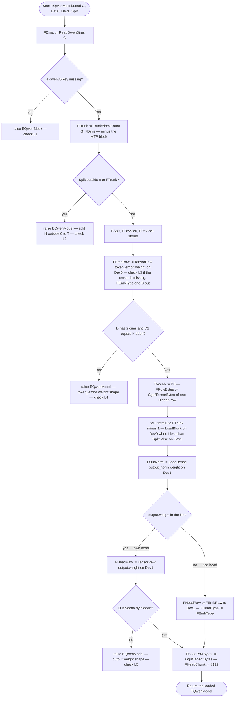
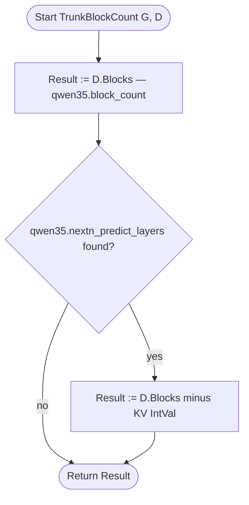
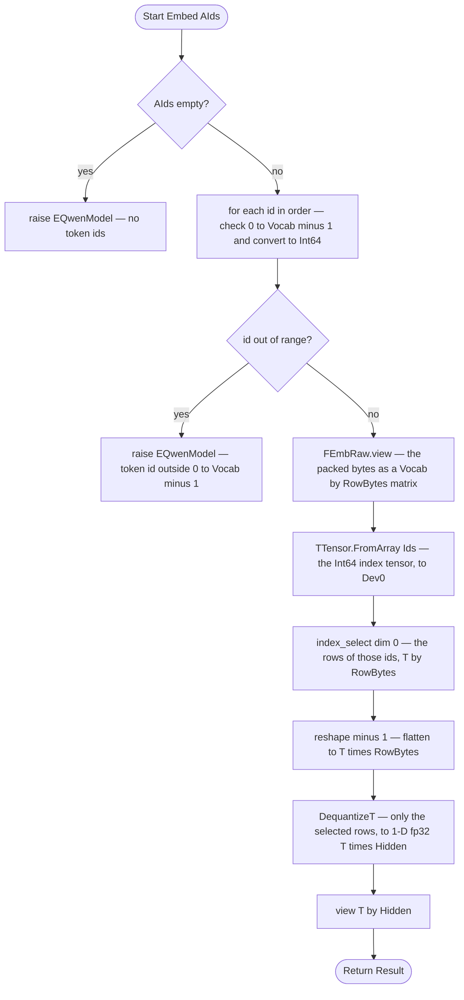
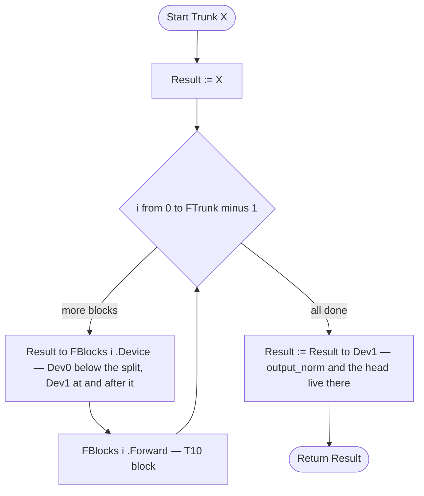
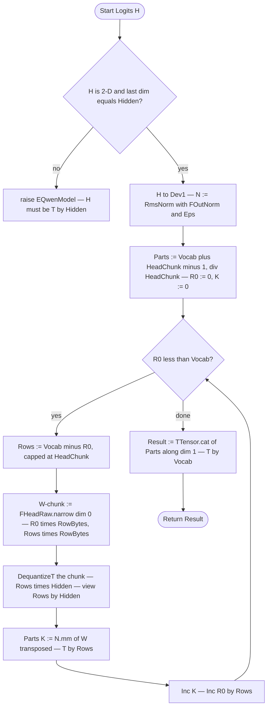
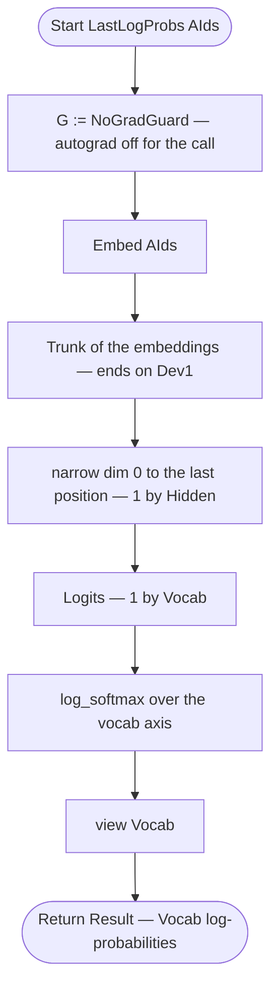

# Program flow — unit `QwenModel` (T11)

Step-by-step control flow of `TQwenModel.Load` (with `TrunkBlockCount`),
`Embed`, `Stages`, `Trunk`, `Logits` and `LastLogProbs`. The full tensor-op
lists are in `docs/detailed-design/T11-detailed.md` (§1–4). Tensors are
managed records (no `Free`); the trunk blocks are freed in `Destroy`.

## `TQwenModel.Load` flow

Checks L1–L5 are the numbered checks of the detailed design §1.2; the exact
messages are in §6.

`ReadQwenDims` reads the 14 `qwen35.*` keys in T10's order, so a keyless file
reports `qwen35.block_count` (facts check L1). The blocks are loaded after
the embedding check but before `output_norm`; if the constructor raises, FPC
calls `Destroy`, which frees the blocks loaded so far.

## `TrunkBlockCount` flow

Rehearsal 0.8B: no key → 24. 27B: 65 − 1 → 64. Tiny fixture `NextN`: 3 − 1 → 2
(`blk.2` is never written).

## `Embed` flow

Checks: an empty array raises first; then each id in order (a raise aborts
before any tensor work).

The embedding stays packed in the file; only the rows of the ids are
dequantised (a row of `Hidden` values is `FRowBytes` bytes, whole blocks for
every type used).

## `Stages` flow

No branch, no tensor ops: `Result := nil`, `SetLength(Result, FTrunk)`, then
`Result[I] := FBlocks[I]` for all blocks. Each `TQwenBlock` inherits `TStage`
(T13 `Recompute`), so the array is a direct view over the same block objects.
Running them as `Recompute` stages gives bit for bit the same output as
`Trunk` (H43 facts; ITa-T11-004, limit 0).

## `Trunk` flow

## `Logits` flow

`HeadChunk` counts **rows of the head** and is 8192 by default (248 320
vocab → 31 chunks); the `HeadChunk` setter raises for a value below 1, and
the UT sets a small value to run several chunks (100, 100, 74 for the tiny
vocab 274).

## `LastLogProbs` flow

## Branch coverage notes

### `TQwenModel.Load`

| Branch / check | Condition in the tiny models | UT / ITa case |
|----------------|------------------------------|---------------|
| L1 missing dimension key | a GGUF without the `qwen35.*` keys | UT-QwenModel-001 to 016, 101 to 110 (the fixtures all carry the keys; the raise path is T10's, driven there) |
| L2 split out of range | split 3 and split −1 on a 2-block model | UT-QwenModel-005, 006 |
| L2 split = 1 and = 2 on one file | 2-block model, both blocks assigned to a device | UT-QwenModel-015 |
| L3 `token_embd` missing | fixture `thNone` (T10's file, no embedding) | UT-QwenModel-007 |
| L4 embedding shape wrong | fixture `thBadEmbd` (32 columns) | UT-QwenModel-008 |
| L5 own head shape wrong | fixture `thBadOutput` (273 rows) | UT-QwenModel-009 |
| Tied head (no `output.weight`) | rehearsal model; tiny `thTied` | UT-QwenModel-001, 010 to 016, 101, 103 to 110; ITa-T11-001 to 004 |
| Own head (`output.weight`) | tiny `thOwn` | UT-QwenModel-002, 102 |
| MTP block excluded (`NextN`) | `block_count` 3, `nextn_predict_layers` 1 | UT-QwenModel-003, 004, 103 |
| `SetHeadChunk` below 1 | `M.HeadChunk := 0` | UT-QwenModel-016 |

### `Embed`

| Branch / check | Condition | UT / ITa case |
|----------------|-----------|---------------|
| empty id array | `M.Embed(<empty>)` | UT-QwenModel-011 |
| id ≥ vocab | `[274]` against vocab 274 | UT-QwenModel-012; `{"tokens": [274]}` through the CLI: UT-LogprobsCli-216 |
| id < 0 | `[5, -1]` | UT-QwenModel-013 |
| happy path, exact rows | `[3, 0, 273]` vs dequantised embedding rows | UT-QwenModel-010; `Ids8` rows 101–110 |

### `Trunk` and `Stages`

| Branch | Condition | UT / ITa case |
|--------|-----------|---------------|
| block below the split on Dev0, the rest on Dev1 | split 0 (all Dev0) in the UT; `--split S` with S > 0 on cuda:0 / cuda:1 | UT-QwenModel-001 to 016, 101 to 110 (split 0); `--split 1` with GPUs hidden: UT-LogprobsCli-217; harness owner's `--split 12` row (1.1e-4, limit 1e-3) |
| `Stages` vs `Trunk` bit-exact | `RecomputeForward(M.Stages, ..)` against `M.Trunk` on chat-130 | ITa-T11-004 (limit 0, measured 0) |

### `Logits`

| Branch / check | Condition | UT / ITa case |
|----------------|-----------|---------------|
| `H` not 2-D / last dim wrong | `zeros([3, 32])` and `zeros([64])` against Hidden 64 | UT-QwenModel-107, 108 |
| single chunk | vocab 274 with `HeadChunk` 8192 | UT-QwenModel-101 to 104, 106, 110 |
| several chunks | `HeadChunk` 100 → 100, 100, 74 rows | UT-QwenModel-105 |

### `LastLogProbs`

No branch of its own (the raises come from `Embed` and `Logits`): one-token
and eight-token inputs, `RequiresGrad` False on the result — UT-QwenModel-106,
110 (≤ 1e-4 against `Lp` of `RefLogits`'s last row).

### `LogprobsCli` (exit codes and branches)

| Branch | UT-LogprobsCli case |
|--------|---------------------|
| `EUsage` (exit 2, two lines in AErr): missing value, `--top` 0/101, `--split` x, `--TOP`, positional count | 203, 204, 205, 206, 207, 202, 208 |
| record: not JSON / not an object / no `tokens` or `text` (exit 1, one line) | 212, 213, 214 |
| record: out-of-range token id (the model's message, exit 1) | 216 |
| model file missing / no CUDA GPUs (exit 1, the unit/libtorch message) | 215, 217 |
| happy path: `tokens`, missing `"id"` (line number), `text` (lazy tokenizer), default top, `--top 3` | 209, 210, 211 |
| `TopLine` JSON escaping and 7-decimal logprob | 201 |
