# Program flow — unit `Lora` and its hooks (T12)

Step-by-step control flow of `LoraPath`, `TLoraPair` (`Create`, `Delta`,
`MergedDelta`), `TLoraSet` (`Create`, `Destroy`, `StoreFor`, `Add`, `Count`,
`Pair`, `Find`, `Stores`, `ParameterCount`, `Save`, `Load`),
`TPackedLinear.SetLora` / `Forward`, `TQwenBlock.Target` / `LoraTargets` and
`TQwenModel.AttachLora`. The full tensor-op lists are in
`docs/detailed-design/T12-detailed.md` (§2–7); the exact error messages are
in §8 there and in the branch/UT/ITa tables below. Tensors are managed
records (no `Free`); a `TLoraSet` frees its pairs and then its stores.

## `LoraPath(P, AName)` flow

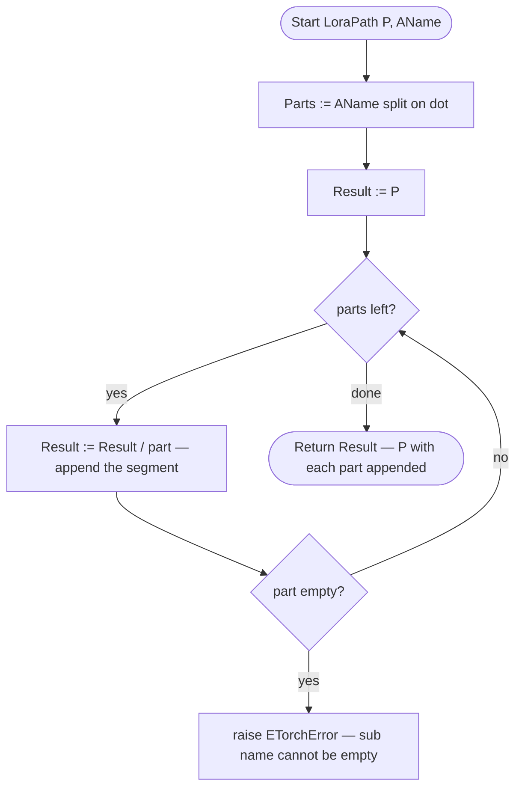

`'blk.3.attn_q'` gives `P / 'blk' / '12' / 'attn_q'` (UT-Lora-001);
`'x'` gives `P / 'x'` (002); `'blk..q'` raises (003, and via `Add` with an
empty name 114).

## `TLoraPair.Create` flow

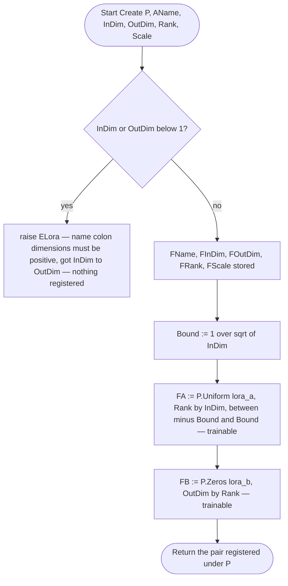

The raise happens before `P.Uniform`, so the store is unchanged (UT-Lora-006,
007: `S.Count` 0). With `B` zero the delta is exactly zero (UT-Lora-008;
ITa-T12-002, limit 0 exact).

## `TLoraPair.Delta(X)` flow

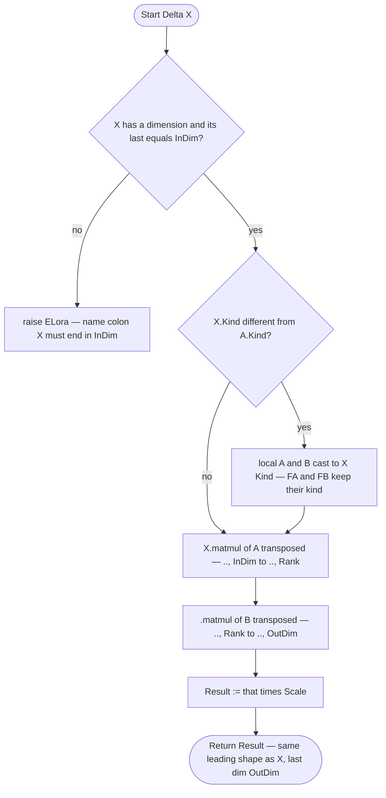

The `* FScale` must be present (mutant caught: UT-Lora-009, 010, 014–016,
UT-PackedLinear-103; ITa-T12-003). The shape raise covers a 0-dim X
(UT-Lora-011, 012). A kDouble X is served with locally cast A/B while
`P.A.Kind` stays kFloat (016).

## `TLoraPair.MergedDelta()` flow

No branch: `G := NoGradGuard`; `Result := FB.mm(FA) * FScale` — [OutDim,
Rank] · [Rank, InDim] → [OutDim, InDim] fp32 without a graph. Equals the
two-product form: `X.matmul(P.MergedDelta.t)` vs `P.Delta(X)` ≤ 1e-5
(UT-Lora-013, 014); a merged GGUF stores `W + MergedDelta` (ITa-T12-003).

## `TLoraSet.Create` flow

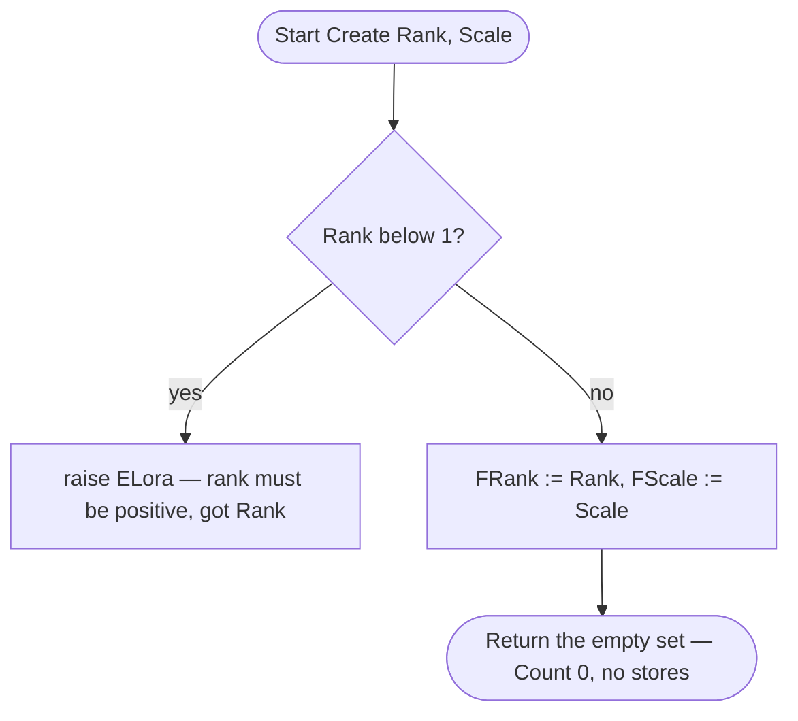

UT-Lora-101 (Rank 4, Scale 2, Count 0, 0 stores, ParameterCount 0), 102 (the
raise).

## `TLoraSet.StoreFor(ADevice)` flow

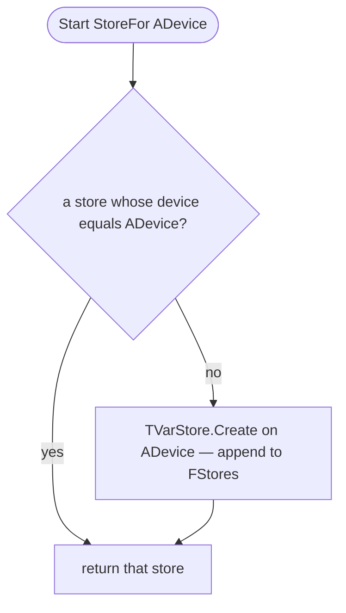

One store per device, in the order their devices first appeared (UT-Lora-103:
two pairs on the CPU → 1 store `cpu`).

## `TLoraSet.Add` flow

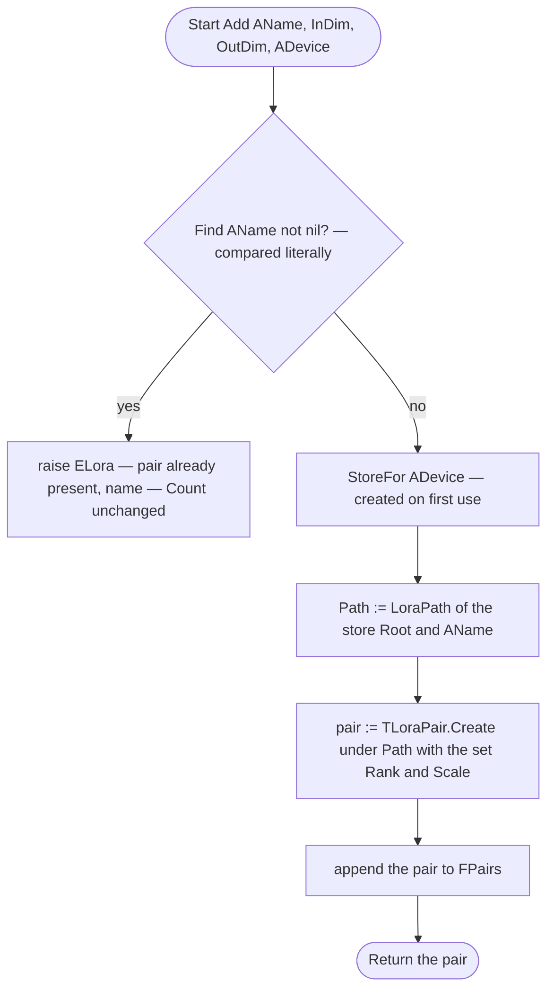

UT-Lora-104 (duplicate, Count stays 2), 105 (case-sensitive `Find`/`Add`:
`BLK.1.ATTN_Q` is a new pair, Count 3).

## `TLoraSet.Pair(I)` flow

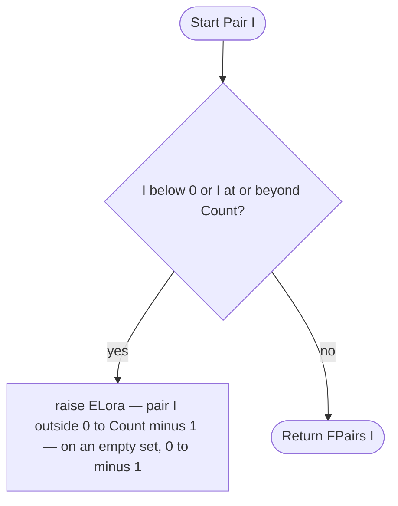

UT-Lora-106 (`pair 2 outside 0..1`, `pair -1 outside 0..1`), 107 (`pair 0
outside 0..-1`). `Find` is a literal-name linear scan returning `nil` when
absent (UT-Lora-105); `Count`, `Stores` (`Copy` of the store array) and
`ParameterCount` (Σ Rank·(InDim + OutDim), UT-Lora-103: 2048) have no branch.

## `TLoraSet.Save` flow

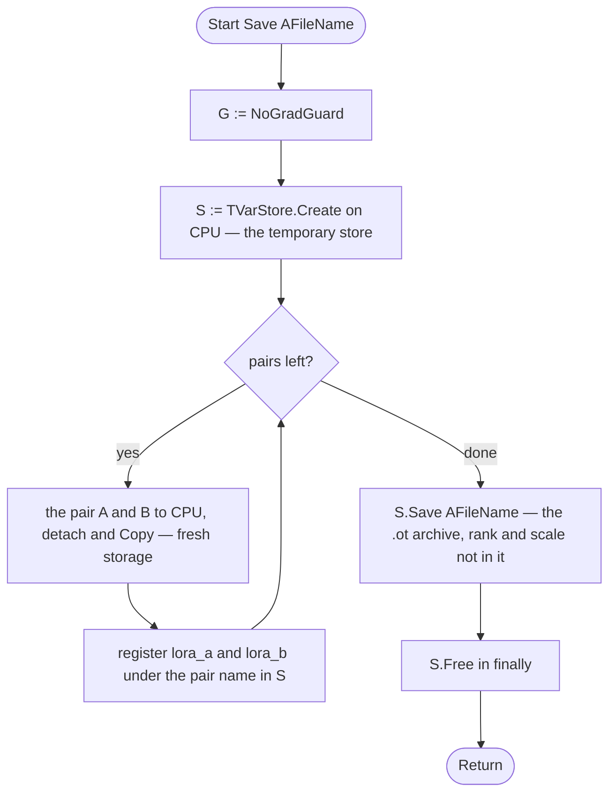

UT-Lora-108 (round trip exact), 112 (relative path: `SetCurrentDir` to a
fresh directory, then `Save('rel.ot')` / `Load('rel.ot')`, old directory
restored in `finally`), 113 (Load keeps the `RequiresGrad` flags and the A
values).

## `TLoraSet.Load` flow

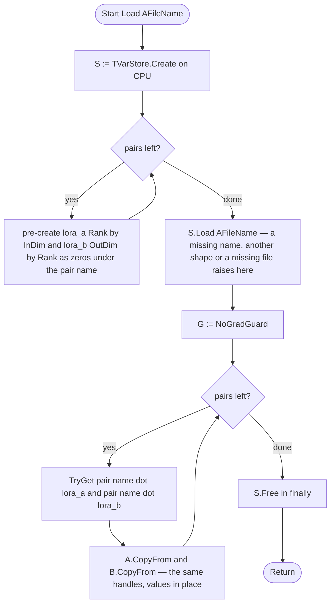

The pre-created zeros are what make a missing variable an `ETorchError
variable <name> not found` (UT-Lora-111), a different shape the size-mismatch
`ETorchNativeError` (109) and a missing file the `errno 2 ... fopen`
`ETorchNativeError` (110). The back-copy (not just the file read) must copy
both A and B (108: a `B` mutant is caught; ITa-T12-005).

## `TPackedLinear.SetLora` flow

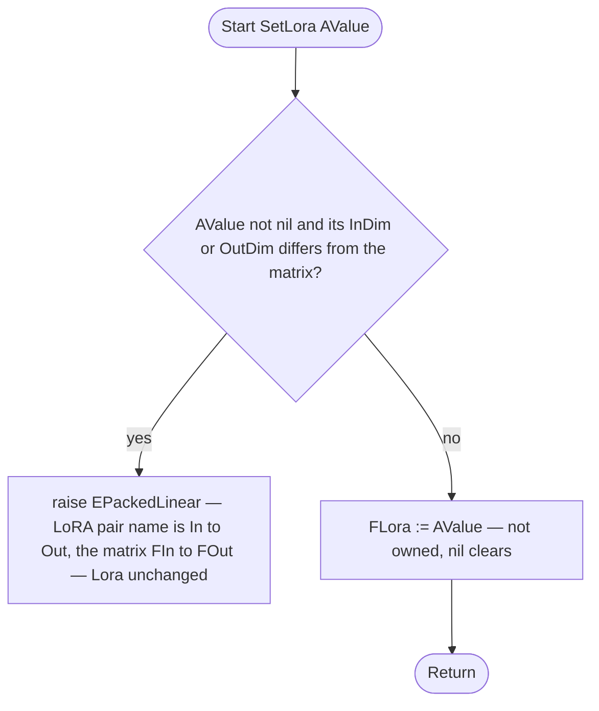

UT-PackedLinear-104, 105 (the two mismatch shapes, `L.Lora` still nil), 101
(nil by default), 106 (`nil` restores the unadapted output, exact).

## `TPackedLinear.Forward` flow

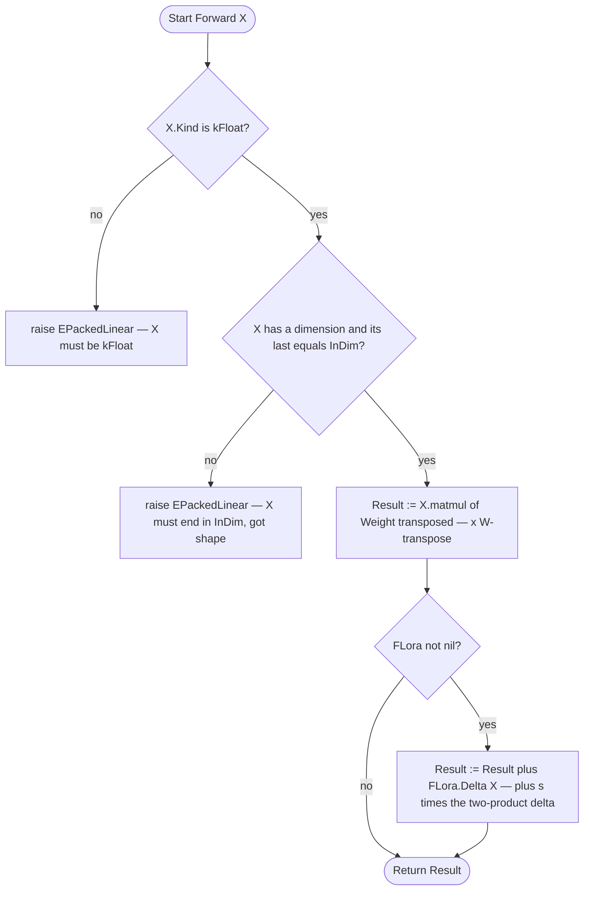

So `y = x·Wᵀ + s·((x·Aᵀ)·Bᵀ)`. With B zero the delta is exactly zero, so the
attached forward equals the unadapted one (UT-PackedLinear-102 exact;
ITa-T12-002). With B set: vs `FixX·Wᵀ + P.Delta` ≤ 1e-6 and vs
`FixX·(W + MergedDelta)ᵀ` ≤ 1e-5, and different from the unadapted output by
> 0.1 (103). Gradients flow to B (max |B.grad| > 0.1) and A has no gradient
while B is zero (107; ITa-T12-004).

## `TQwenBlock.Target` flow (base)

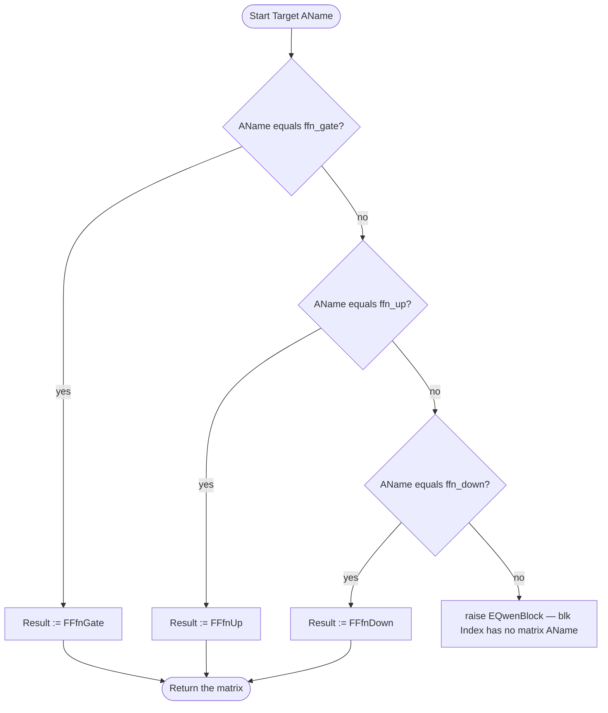

Names compared literally (UT-QwenBlocks-304 `ATTN_Q`, 305 `attn_q.weight`,
306 the empty name).

### `TLinearBlock.Target` override

Checks, in order, against `AName`: `attn_qkv` → `FQkv`; `attn_gate` →
`FGate`; `ssm_beta` → `FBeta`; `ssm_alpha` → `FAlpha`; `ssm_out` →
`FSsmOut`; otherwise `inherited Target(AName)` (the base above — the
`ffn_*` names resolve there, anything else raises).

### `TFullBlock.Target` override

Checks, in order: `attn_q` → `FQ`; `attn_k` → `FK`; `attn_v` → `FV`;
`attn_output` → `FOut`; otherwise `inherited Target(AName)`.

`Target` is deterministic and idempotent: `Target('attn_v') =
Target('attn_v')` and `Target('attn_v') <> Target('attn_k')`
(UT-QwenBlocks-308). `FIndex` is set in `Load` (right after `FDevice :=
ADevice;`) and is the block number in the message (303: `blk.0 has no matrix
attn_q`; 304–306: `blk.1 ...`).

## `LoraTargets` flow

No branch: `TLinearBlock` returns `['attn_qkv', 'attn_gate', 'ssm_out']`,
`TFullBlock` returns `['attn_q', 'attn_k', 'attn_v', 'attn_output']` — the
names DESIGN 8.13 adapts in the kind of block (UT-QwenBlocks-307: joined by
commas).

## `TQwenModel.AttachLora` flow

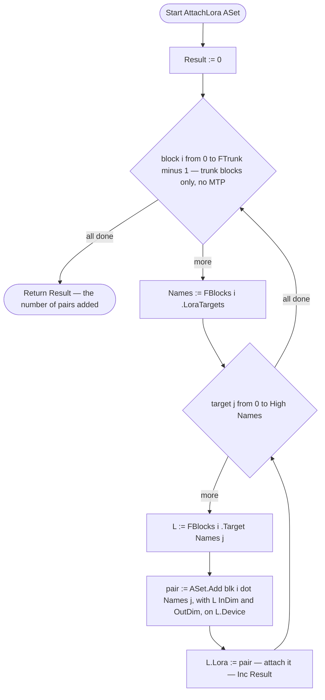

The MTP block is excluded by looping to `FTrunk - 1` (UT-QwenModel-206: the
fixture with an MTP block still gives 7 pairs, `PairNames` = `TinyPairs`).
The pair list on the tiny model (block 0 linear, block 1 full):
`TinyPairs` = `blk.0.attn_qkv,blk.0.attn_gate,blk.0.ssm_out,blk.1.attn_q,
blk.1.attn_k,blk.1.attn_v,blk.1.attn_output` — 7 pairs, ParameterCount 4864
(rank 4), the non-adapter matrices (`ssm_beta`, `ffn_gate`) keep a nil
`Lora` (UT-QwenModel-201; ITa-T12-001: 78 pairs / 4 915 200 parameters on
the rehearsal 0.8B at rank 16). A second call on the same set raises `pair
already present: blk.0.attn_qkv` and the driver stops (205). All devices on
one host: 1 store with 14 variables (207).

## Branch / check coverage (UT and ITa rows)

| Branch / check | Condition in the UTs | UT / ITa case |
|----------------|----------------------|---------------|
| `LoraPath`: multi-part / single-part / empty-segment name | `'blk.3.attn_q'`, `'x'`, `'blk..q'`; empty name via `Add` | UT-Lora-001, 002, 003, 114 |
| `TLoraPair.Create`: non-positive dim, before registration | InDim 0; OutDim −1; `S.Count` stays 0 | UT-Lora-006, 007 |
| `TLoraPair.Create`: shapes, registration, init bounds | `p`, 8 → 6, rank 3; `ManualSeed(1)` | UT-Lora-004, 005 |
| `Delta`: B zero → exact zero delta | `FixX(5, 8)`, max |·| 0 exact | UT-Lora-008; UT-PackedLinear-102, 106; ITa-T12-002 |
| `Delta`: value against Double reference, 1-D and 2-D leading shape | `FixPair`, `FixX(5, 8)`, `FixX(6, 8).view([2,3,8])` | UT-Lora-009, 010 |
| `Delta`: X shape wrong (2-D and 0-dim) | `zeros([5, 7])`; `zeros([5,7]).sum(kNone)` | UT-Lora-011, 012 |
| `Delta`: scale present | the mutants above | UT-Lora-009, 010, 014–016; UT-PackedLinear-103; ITa-T12-003 |
| `Delta`: kind cast (kDouble X, A stays kFloat) | `FixX(5, 8).totype(kDouble)` | UT-Lora-016 |
| `MergedDelta`: shape, no graph, equals s·B·A | `FixPair`, ≤ 1e-6 vs Double | UT-Lora-013 |
| `MergedDelta`: two-product equivalence | `X.matmul(P.MergedDelta.t)` vs `P.Delta(X)` | UT-Lora-014; UT-PackedLinear-103; ITa-T12-003 |
| Gradients of the delta (A none while B zero; B.grad value) | `Backward` on the summed delta | UT-Lora-015; UT-PackedLinear-107 |
| `TLoraSet.Create`: rank check | `Create(0, 2.0)` | UT-Lora-102 |
| `TLoraSet`: store per device, names, ParameterCount | `NewSet` on the CPU | UT-Lora-103; UT-QwenModel-201 |
| `Add`: duplicate name (literal) | same name again / `AttachLora` twice | UT-Lora-104; UT-QwenModel-205 |
| `Find`: literal, case-sensitive, empty name | `'BLK.1.ATTN_Q'`, `''` | UT-Lora-105 |
| `Pair`: index out of range (and empty set) | `Pair(2)`, `Pair(-1)`, `Pair(0)` | UT-Lora-106, 107 |
| `Save`/`Load`: round trip, relative path, handles kept | seeds 3/4, fresh directory | UT-Lora-108, 112, 113; ITa-T12-005 |
| `Load`: missing variable / other shape / missing file | S2 at rank 3; `missing.ot`; extra pair in the set | UT-Lora-109, 110, 111; `Load` B mutant: 108 |
| `SetLora`: nil default, attach, clear, shape mismatch (In and Out) | `NewPair(S, 7, 6)`, `(S, 8, 5)` | UT-PackedLinear-101, 102, 104, 105, 106 |
| `Forward` (adapted): base + delta vs merged form vs unadapted | `ManualSeed(2)`, `SetB(P)` | UT-PackedLinear-103; ITa-T12-003 |
| `Target`: per-kind names, literal compare, `ffn_*` in the base | blocks 0 and 1; `ATTN_Q`; `'attn_q.weight'`; `''` | UT-QwenBlocks-301, 302, 303–306, 308 |
| `Target`: identity of the returned field | `Target('attn_v')` twice / vs `attn_k` | UT-QwenBlocks-308 |
| `LoraTargets`: the two name lists | blocks 0 and 1 joined by commas | UT-QwenBlocks-307 |
| `AttachLora`: 7 pairs, right attachments, ParameterCount | tiny model, rank 4 | UT-QwenModel-201; ITa-T12-001 |
| `AttachLora`: unchanged logits (B zero) vs a second model | exact | UT-QwenModel-202; ITa-T12-002 |
| `AttachLora`: B set moves logits (delta in `Forward` present) | `RandomB(S)`, vs base > 0.1; `RecomputeForward` vs `Trunk` exact | UT-QwenModel-203; ITa-T12-003 |
| `AttachLora`: gradients block-wise vs whole graph | loss backward both ways, `ZeroGrad` | UT-QwenModel-204; ITa-T12-004 |
| `AttachLora`: second call raises | `AttachLora(S)` twice | UT-QwenModel-205 |
| `AttachLora`: MTP block excluded, trunk-only | `NextPath` (an MTP block in the file) | UT-QwenModel-206 |
| `AttachLora`: one store, 14 variables | `Load(G, Cpu, Cpu, 1)` | UT-QwenModel-207 |
