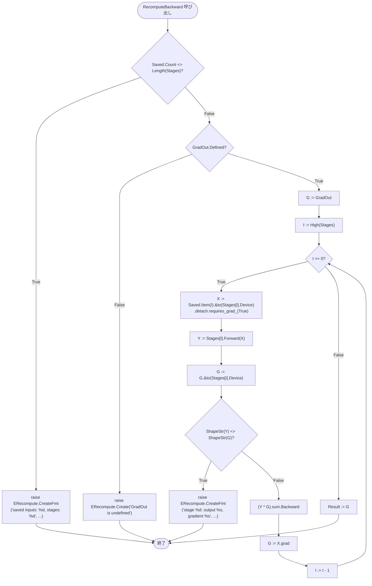

# プログラムフロー — unit `Recompute` (T13)

## TSavedInputs.Add

```mermaid
flowchart TD
    Start([Add 呼び出し]) --> N[\"N := Length(FItems)\"]
    N --> Extend[\"SetLength(FItems, N + 1)\"]
    Extend --> Check{FOnHost?}
    Check -->|True| ToCpu[\"FItems[N] := X.detach.&to(TDevice.Cpu)\"]
    Check -->|False| NoCpu[\"FItems[N] := X.detach\"]
    ToCpu --> End([終了])
    NoCpu --> End
```

## TSavedInputs.Item

```mermaid
flowchart TD
    Start([Item 呼び出し]) --> Check{I < 0 または<br>I >= Count?}
    Check -->|True| RaiseError[\"raise ERecompute.CreateFmt<br>('saved input %d out of range (count %d)',<br>[I, Count])\"]
    Check -->|False| Return[\"Result := FItems[I]\"]
    RaiseError --> End([終了])
    Return --> End
```

## RecomputeForward

```mermaid
flowchart TD
    Start([RecomputeForward 呼び出し]) --> CheckStages{Stages = nil または<br>Length = 0?}
    CheckStages -->|True| RaiseNoStages["raise ERecompute.Create('no stages')"]
    CheckStages -->|False| CheckX0{X0.Defined?}
    CheckX0 -->|False| RaiseX0Undef["raise ERecompute.Create('X0 is undefined')"]
    CheckX0 -->|True| Clear["Saved.Clear"]
    Clear --> Guard["G := NoGradGuard"]
    Guard --> InitX["X := X0"]
    InitX --> InitI["I := 0"]
    InitI --> LoopCheck{I <= High(Stages)?}
    LoopCheck -->|True| ToDevice["X := X.&to(Stages[I].Device)"]
    ToDevice --> SaveInput["Saved.Add(X)"]
    SaveInput --> ForwardCall["X := Stages[I].Forward(X)"]
    ForwardCall --> IncI["I := I + 1"]
    IncI --> LoopCheck
    LoopCheck -->|False| ReturnResult["Result := X"]
    ReturnResult --> End([終了])
    RaiseNoStages --> End
    RaiseX0Undef --> End
```

## RecomputeBackward


