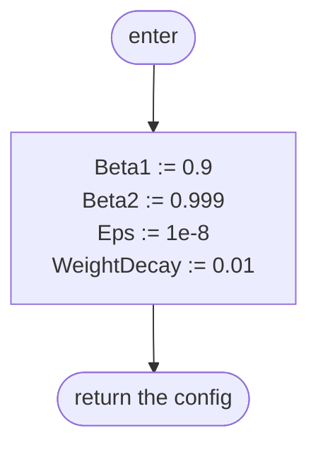
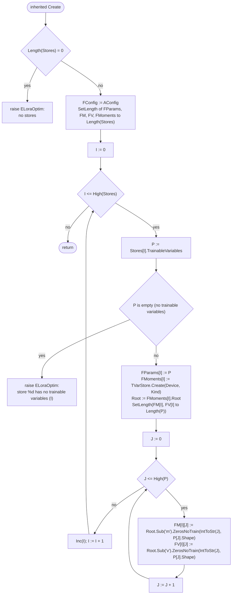
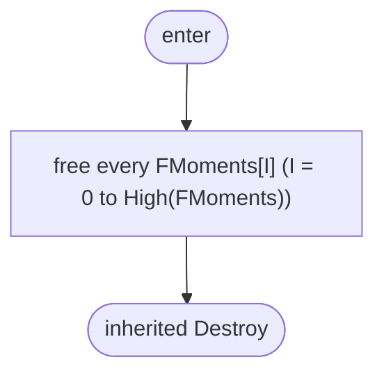
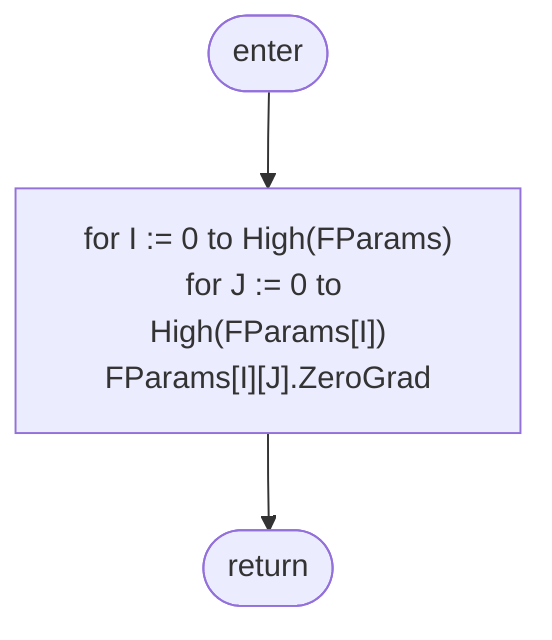
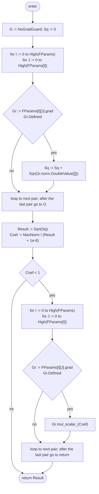
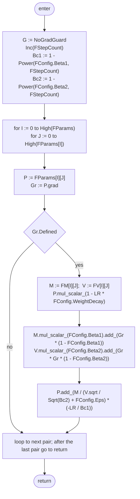

# Program Flow — Unit `LoraOptim` (T14)

Flowcharts per function, from `../detailed-design/T14-detailed.md`. Every
branch is drawn out: they are the ground for the UT cases and the coverage
gate.

## `DefaultAdamWConfig`



## `ScheduleLR(Base, Update, Warmup, Total, MinRatio)`

```mermaid
flowchart TD
  A([enter]) --> B{"(Update < 1) or (Update > Total)"}
  B -- yes --> B1["raise ELoraOptim:<br/>update %d outside 1..%d<br/>(Update, Total)"]
  B -- no --> C{"(Warmup < 0) or (Warmup >= Total)"}
  C -- yes --> C1["raise ELoraOptim:<br/>warm-up %d outside 0..%d<br/>(Warmup, Total - 1)"]
  C -- no --> D{"Update <= Warmup"}
  D -- yes --> D1([return Base * Update / Warmup])
  D -- no --> E["P := (Update - Warmup) / (Total - Warmup)"]
  E --> F([return Base * (MinRatio + (1 - MinRatio) * 0.5 * (1 + Cos(Pi * P)))])
```

## `Create(Stores, AConfig)`



## `Destroy`



## `ZeroGrad`



## `StoreCount`

```mermaid
flowchart TD
  A([enter]) --> B([return Length(FMoments)])
```

## `Moments(I)`

```mermaid
flowchart TD
  A([enter]) --> B{"I < 0 or I > High(FMoments)"}
  B -- yes --> B1["raise ELoraOptim:<br/>store %d out of range (count %d)<br/>(I, Length(FMoments))"]
  B -- no --> C([return FMoments[I]])
```

## `ClipGlobalNorm(MaxNorm)`



## `Step(LR)`


