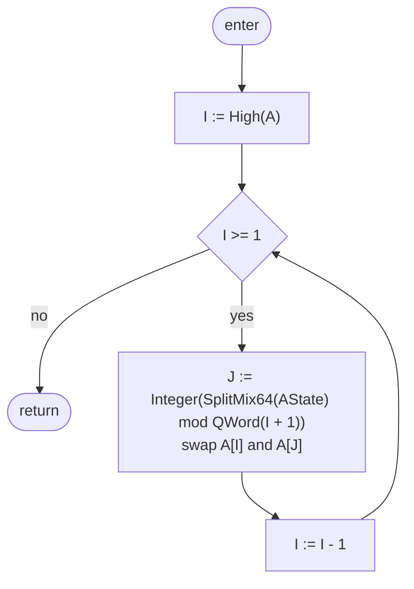
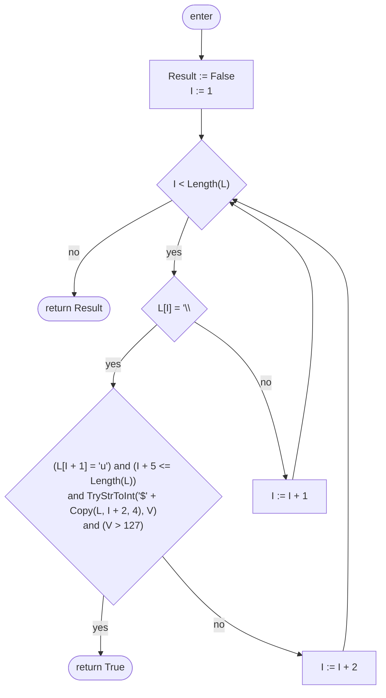
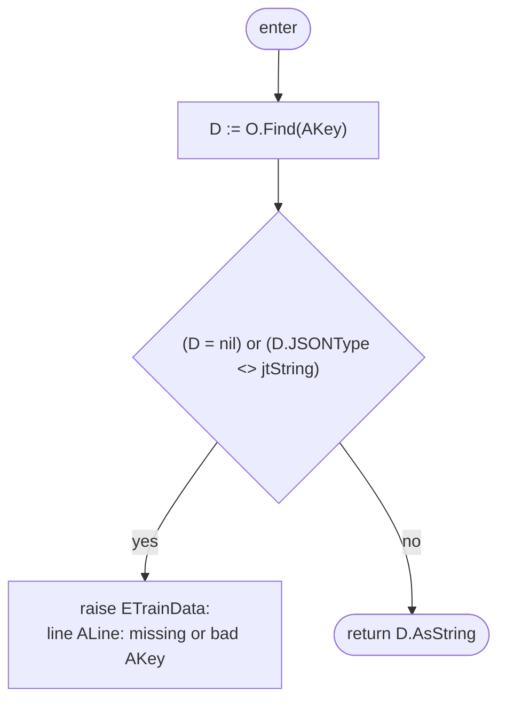
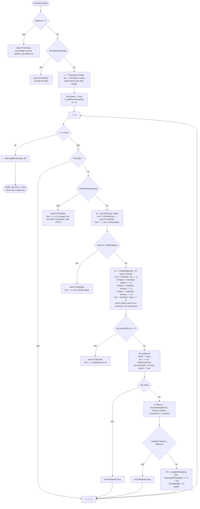
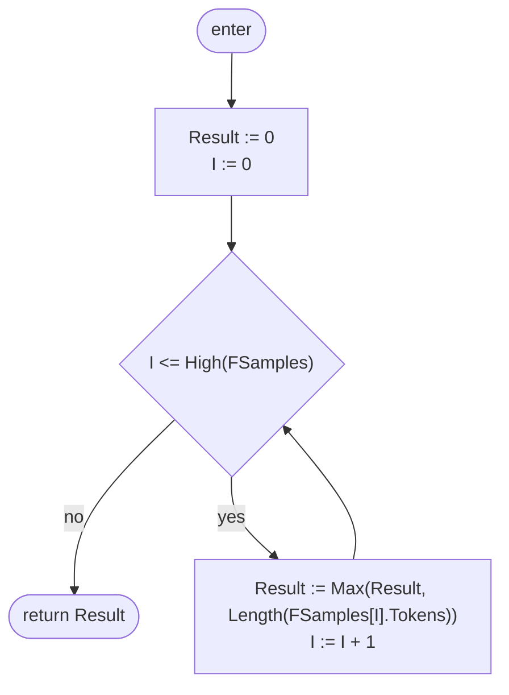
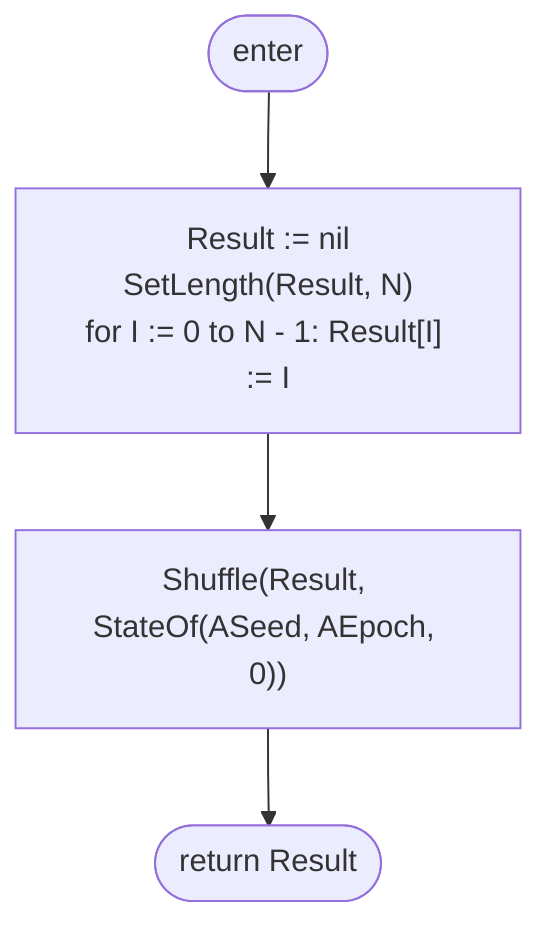
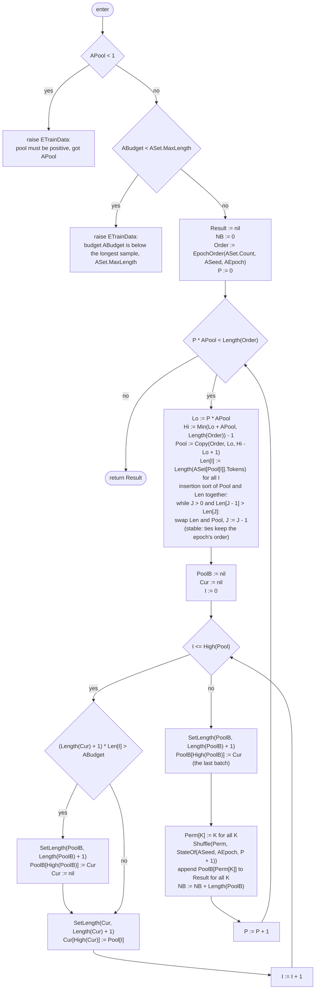
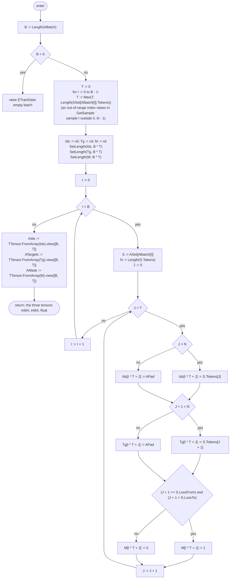

# Program Flow — Unit `TrainData` (T15)

Flowcharts per function, from `../detailed-design/T15-detailed.md`. Every
branch is drawn out: they are the ground for the UT cases and the coverage
gate. Message texts and conditions are the exact ones of the detailed
design (4.10).

## `SplitMix64` (local)

```mermaid
flowchart TD
  A([enter]) --> B["S := S + QWord($9E3779B97F4A7C15)<br/>Z := S<br/>Z := (Z xor (Z shr 30)) * QWord($BF58476D1CE4E5B9)<br/>Z := (Z xor (Z shr 27)) * QWord($94D049BB133111EB)"]
  B --> C([return Z xor (Z shr 31)])
```

## `StateOf` (local)

```mermaid
flowchart TD
  A([enter]) --> B([return QWord(ASeed) + QWord(AEpoch) * QWord($D1B54A32D192ED03) + QWord(APool) * QWord($9E3779B97F4A7C15)])
```

## `Shuffle` (local)



For an empty `A`, `High(A) = -1` and the loop does not run.

## `EncodeSample`

```mermaid
flowchart TD
  A([enter]) --> B["M := nil<br/>SetLength(M, 2)<br/>M[0] := ChatMsg(crUser, APrompt)<br/>M[1] := ChatMsg(crAssistant, AAnswer)<br/>O := DefaultChatOptions<br/>O.EnableThinking := False"]
  B --> C([return EncodeTraining(Tok, M, O, LossFrom, LossTo)<br/>(the loss span comes out of EncodeTraining, T07)])
```

## `HasWideEscape` (local)



A backslash always skips two bytes: an escaped backslash is text and the
sequence `u00e9` after it does not re-trigger; only `\u` with four hex
digits of a value above 127 refuses.

## `GetStr` (local)



## `TTrainSet.Create`



The `finally: D.Free` also covers the `Continue` taken after
`Inc(FSkippedClass)`; only `EJSONParser` out of `GetJSON` is converted to
`ETrainData`, other exceptions pass through.

## `TTrainSet.Count`

```mermaid
flowchart TD
  A([enter]) --> B([return Length(FSamples)])
```

## `TTrainSet.MaxLength`



For an empty set `High(FSamples) = -1`, the loop does not run and the
result is 0.

## `TTrainSet.GetSample`

```mermaid
flowchart TD
  A([enter]) --> B{"(I < 0) or (I >= Length(FSamples))"}
  B -- yes --> B1["raise ETrainData:<br/>sample I outside 0..Length(FSamples) - 1"]
  B -- no --> C([return FSamples[I]])
```

## `EpochOrder`



## `EpochBatches`



The budget test `>` is strict: a batch whose count × longest equals
`ABudget` is admitted. For an empty set the `while` does not run and no
batches are returned.

## `SkipBatches`

```mermaid
flowchart TD
  A([enter]) --> B{"APosition < 0"}
  B -- yes --> B1["raise ETrainData:<br/>position APosition is negative"]
  B -- no --> C["I := 0<br/>Done := 0"]
  C --> D{"(Done < APosition) and (I < Length(AB))"}
  D -- yes --> E["Done := Done + Length(AB[I])<br/>I := I + 1"]
  E --> D
  D -- no --> F{"Done <> APosition"}
  F -- yes --> F1["raise ETrainData:<br/>position APosition is not at the end of a batch<br/>(also for a position beyond the last batch)"]
  F -- no --> G([return Copy(AB, I, Length(AB) - I)<br/>(APosition = 0 gives AB)])
```

## `BatchTensors`


