# Program Flow — Unit `Checkpoint` (T16)

Flowcharts per function, from `../detailed-design/T16-detailed.md`. Every
branch is drawn out: they are the ground for the UT cases and the coverage
gate. Message texts and conditions are the exact ones of the detailed
design (4.7).

## `NewRunState`

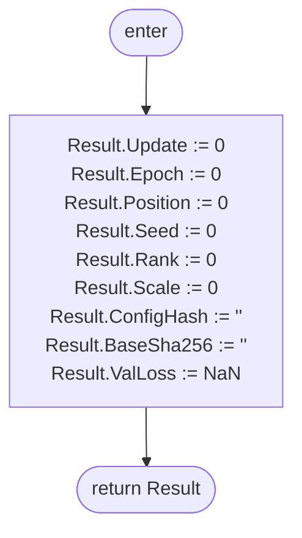

## `CheckAscii(AKey, AValue)` (local)

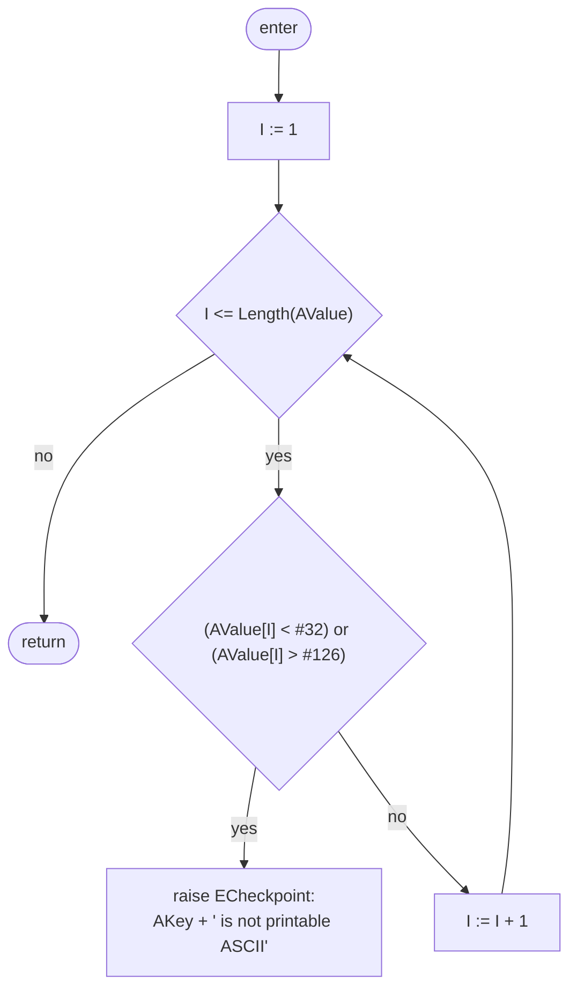

## `RunStateToJson(S)`

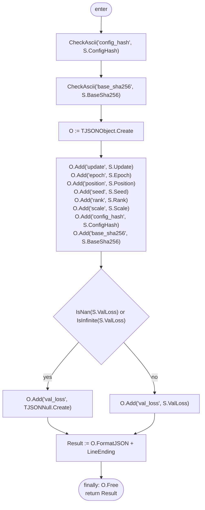

## `GetInt(O, AKey)` (local)

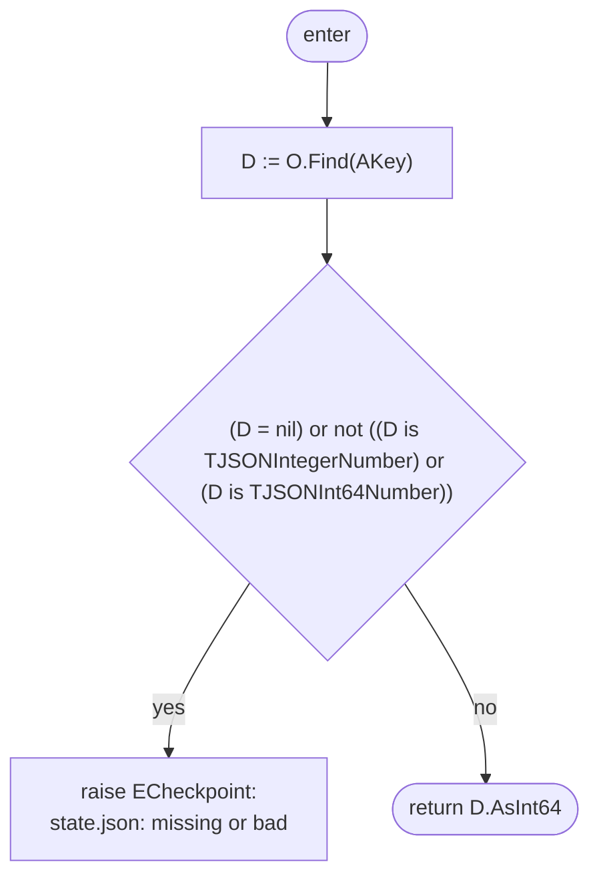

## `GetFloat(O, AKey, AllowNull)` (local)

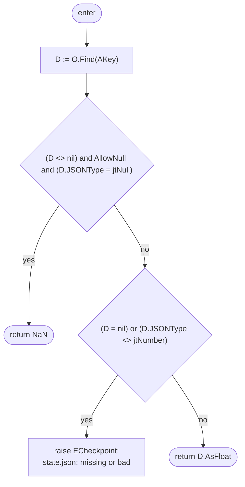

## `GetStr(O, AKey)` (local)

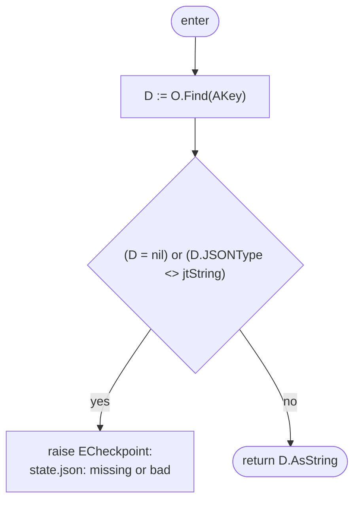

## `RunStateFromJson(AText)`

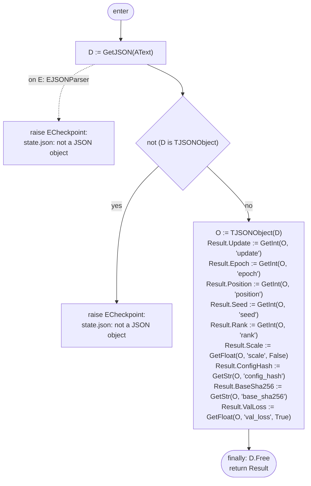

## `ReadText(AFile)` (local)

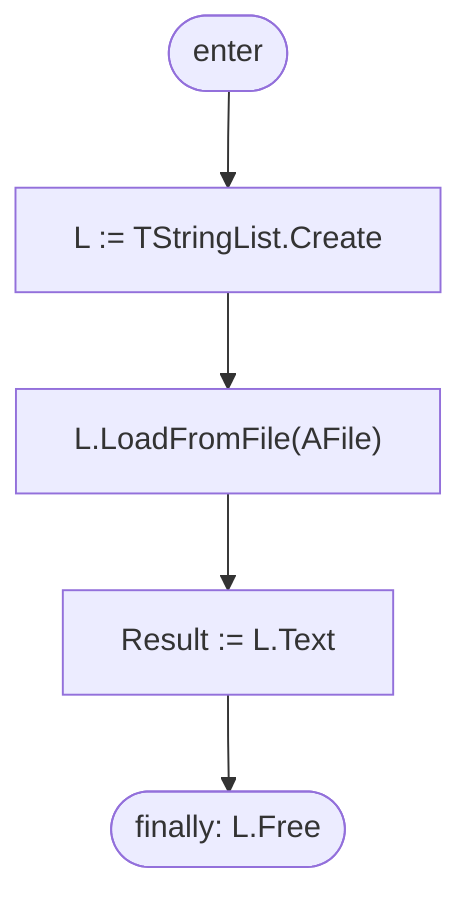

## `WriteText(AFile, AText)` (local)

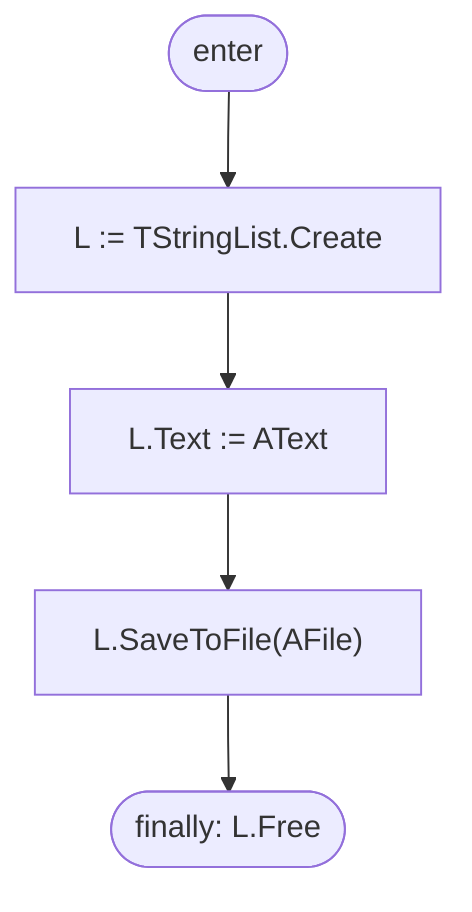

## `ReadRunState(ADir)`

```mermaid
flowchart TD
  A([enter]) --> B["F := IncludeTrailingPathDelimiter(ADir) + StateFile"]
  B --> C{"not FileExists(F)"}
  C -- yes --> C1["raise ECheckpoint:<br/>not a checkpoint: ADir (as given)"]
  C -- no --> D([return RunStateFromJson(ReadText(F))])
```

## `CheckOptim(ASet, AOptim)` (local)

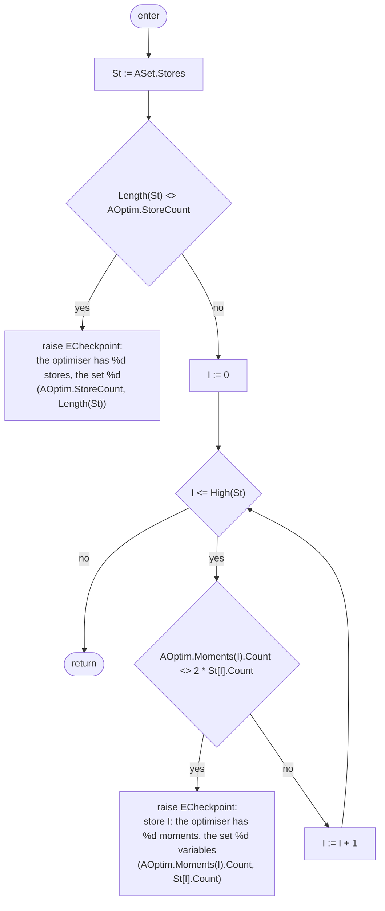

## `MomentsOf(AOptim, I, J, M, V)` (local)

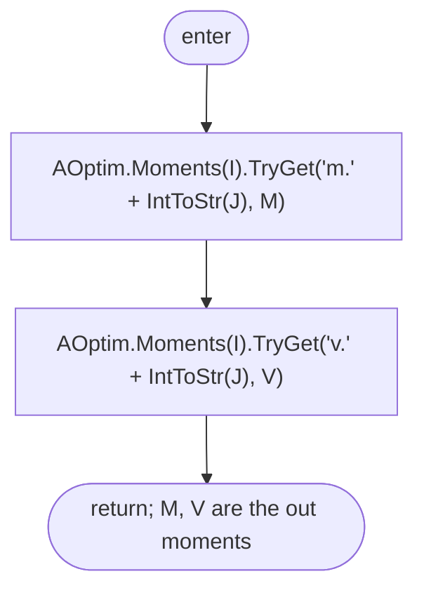

## `SaveMoments(AFile, ASet, AOptim)` (local)

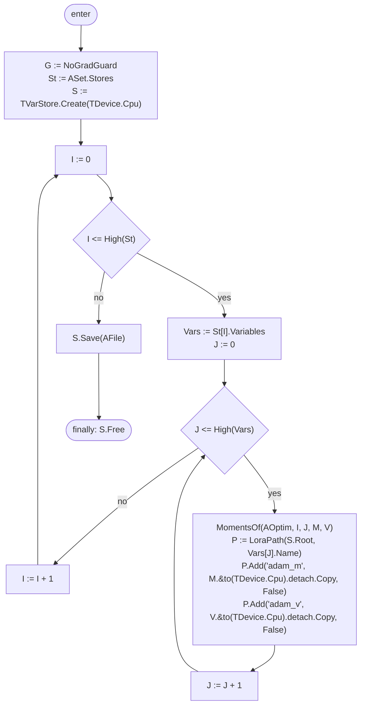

## `LoadMoments(AFile, ASet, AOptim)` (local)

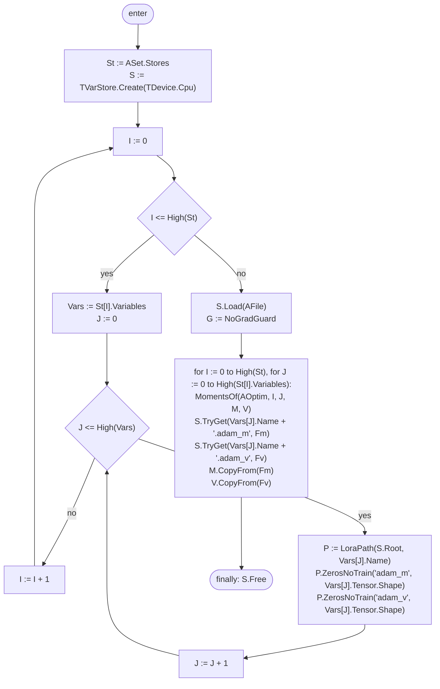

## `TCheckpoints.Create(ARoot, AKeep)`

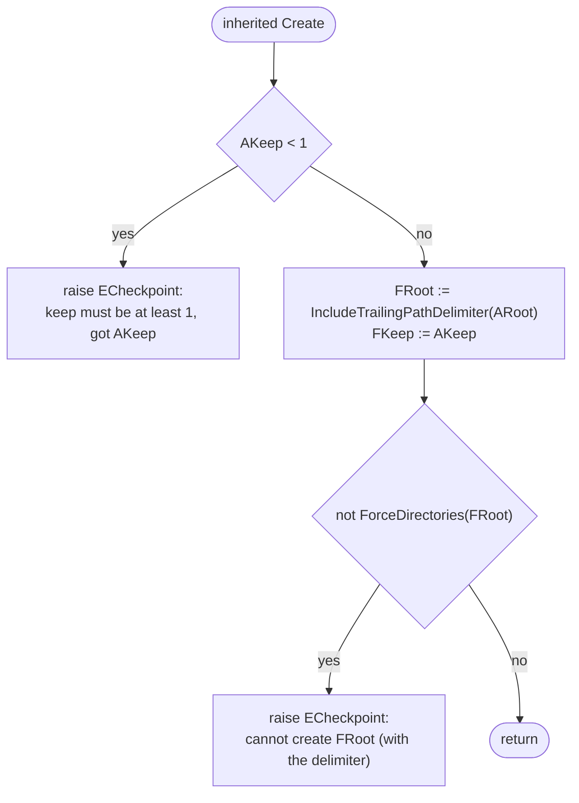

## `TCheckpoints.DirOf(AUpdate)` (private)

```mermaid
flowchart TD
  A([enter]) --> B([return FRoot + Format('ckpt-%.8d', AUpdate)])
```

## `TCheckpoints.RemoveTree(ADir)` (private)

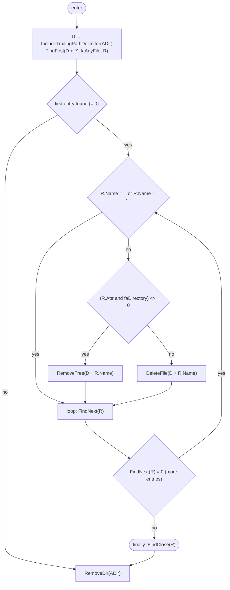

## `TCheckpoints.List`

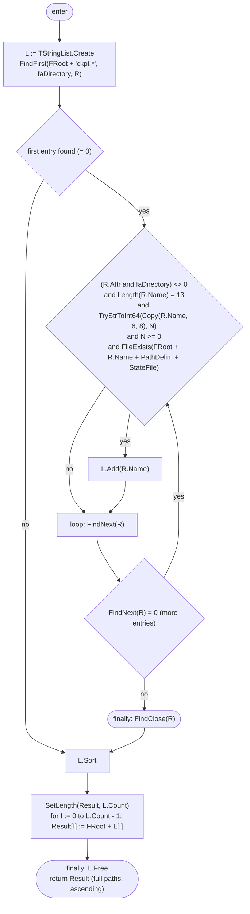

## `TCheckpoints.Latest`

```mermaid
flowchart TD
  A([enter]) --> B["A := List"]
  B --> C{"Length(A) = 0"}
  C -- yes --> Z([return ''])
  C -- no --> D([return A[High(A)]])
```

## `TCheckpoints.Best`

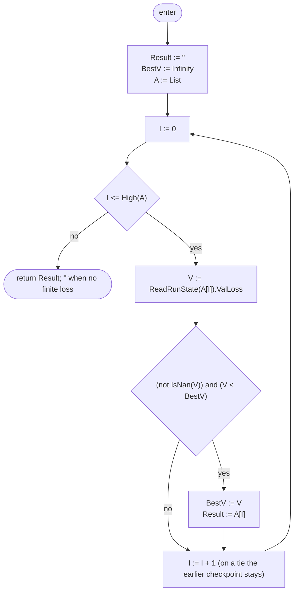

## `TCheckpoints.Prune` (private)

```mermaid
flowchart TD
  A([enter]) --> B["A := List<br/>B := Best"]
  B --> C["I := 0"]
  C --> D{"I <= High(A) - FKeep"}
  D -- no --> F([return])
  D -- yes --> E{"A[I] <> B"}
  E -- yes --> G["RemoveTree(A[I])"]
  E -- no --> H["I := I + 1"]
  G --> H
  H --> C
```

When `High(A) - FKeep < 0` the loop bound is below the start and nothing is
deleted (Pascal `for` does not run).

## `TCheckpoints.Save(AState, ASet, AOptim)`

```mermaid
flowchart TD
  A([enter]) --> B["CheckOptim(ASet, AOptim)"]
  B --> C["Result := DirOf(AState.Update)"]
  C --> D{"DirectoryExists(Result)"}
  D -- yes --> D1["raise ECheckpoint:<br/>checkpoint exists: Result"]
  D -- no --> E["leftovers of an interrupted save:<br/>for each tmp-ckpt-* entry:<br/>directory -> RemoveTree(FRoot + R.Name)<br/>file -> DeleteFile(FRoot + R.Name)"]
  E --> F["T := FRoot + 'tmp-' + ExtractFileName(Result)"]
  F --> G{"not ForceDirectories(T)"}
  G -- yes --> G1["raise ECheckpoint:<br/>cannot create T"]
  G -- no --> H["S := AState<br/>S.Rank := ASet.Rank<br/>S.Scale := ASet.Scale"]
  H --> I["ASet.Save(T + PathDelim + LoraFile)"]
  I --> J["SaveMoments(T + PathDelim + MomentFile, ASet, AOptim)"]
  J --> K["WriteText(T + PathDelim + StateFile, RunStateToJson(S))"]
  K --> L{"not RenameFile(T, Result)"}
  L -- yes --> L1["raise ECheckpoint:<br/>cannot rename T<br/>(the temporary directory stays until the next save)"]
  L -- no --> M["Prune"]
  M --> N([return Result])
```

## `TCheckpoints.Load(ADir, ASet, AOptim)`

```mermaid
flowchart TD
  A([enter]) --> B["Result := ReadRunState(ADir)"]
  B --> C{"(Result.Rank <> ASet.Rank) or (Result.Scale <> ASet.Scale)"}
  C -- yes --> C1["raise ECheckpoint:<br/>ADir: rank Result.Rank scale Result.Scale, the set rank ASet.Rank scale ASet.Scale"]
  C -- no --> D["CheckOptim(ASet, AOptim)"]
  D --> E["D := IncludeTrailingPathDelimiter(ADir)"]
  E --> F["ASet.Load(D + LoraFile)"]
  F --> G["LoadMoments(D + MomentFile, ASet, AOptim)"]
  G --> H["AOptim.StepCount := Result.Update"]
  H --> I([return Result])
```
