# Program flow — `qlora_train` (T17)

Flowcharts per function, from
[`../detailed-design/T17-detailed.md`](../detailed-design/T17-detailed.md).
Every branch is drawn out: they are the ground for the UT cases and the
coverage gate. Message texts and conditions are the exact ones of the
detailed design (4.3).

## Unit `TrainStep`

### `Targets(ASample, AFrom, ACount)`

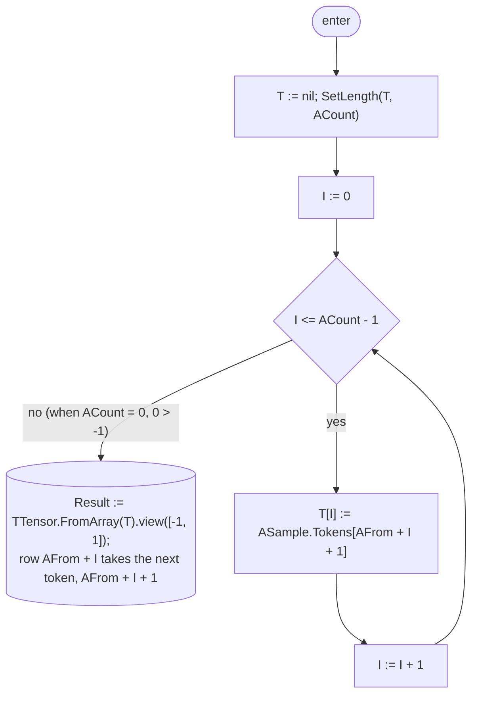

### `SliceLoss(M, H, ASample, AFrom, ACount)`

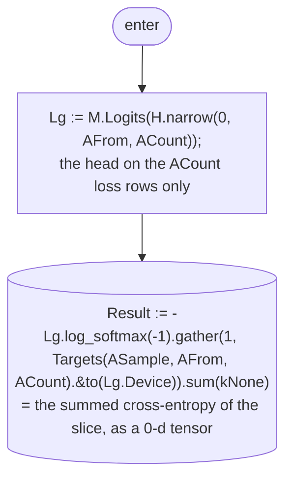

### `CheckSample(ASample, ASlice)`

Checked in this order (detailed design 4.3, #1–#2; called first by both
`SampleLossBackward` and `SampleLoss`):

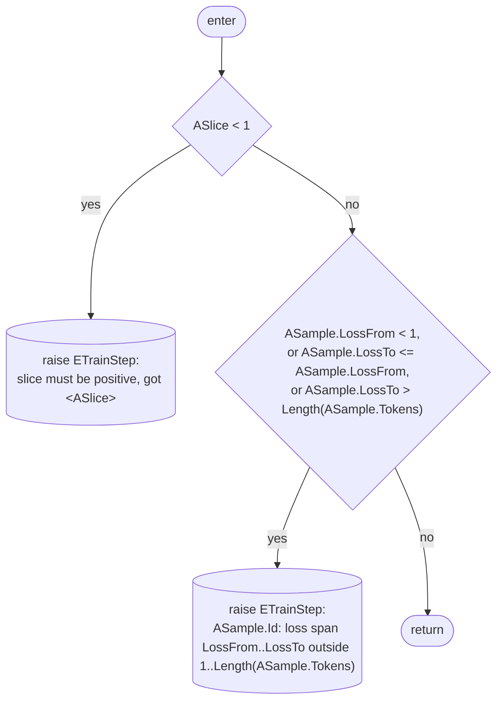

### `SampleLossBackward(M, ASample, ADenom, ASlice)`

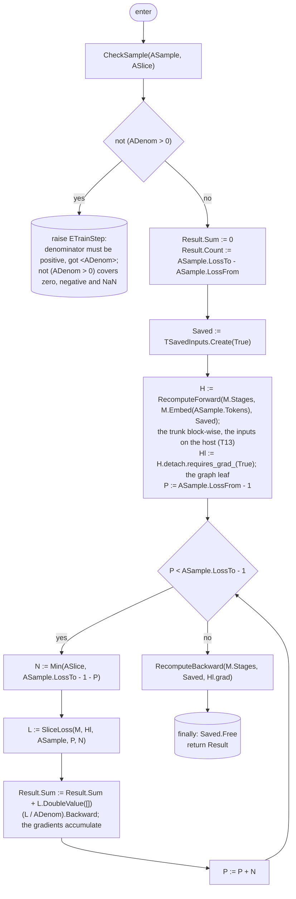

The slice loop walks the loss rows `P = LossFrom - 1 .. LossTo - 2` (the
targets of the tokens `LossFrom .. LossTo - 1`); each slice's summed
cross-entropy is divided by `ADenom` and backward-sent on its own, and
the trunk's backward comes last (the accumulated gradient at the
boundary).

### `SampleLoss(M, ASample, ASlice)`

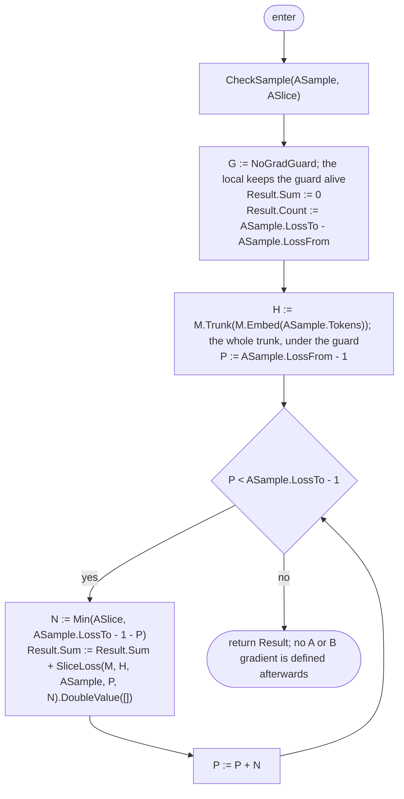

### `ValidationLoss(M, ASet, ASlice)`

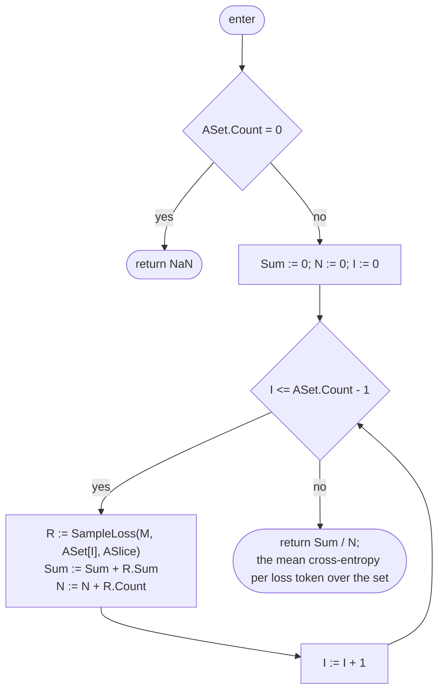

## Unit `TrainCli`

`TTrainConfig` is the record of the detailed design 3 (fields and the
defaults of `DefaultTrainConfig`); the functions below are the flow.

### `DefaultTrainConfig`

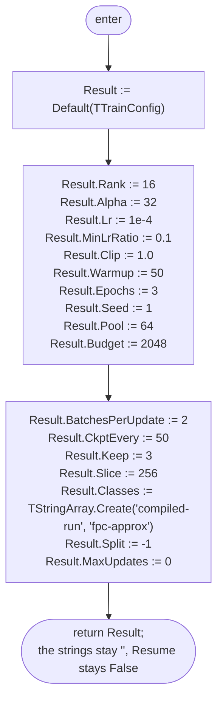

### `ParseTrainArgs(AArgs, C)`

The three positionals are collected in the order given; every option
takes a value (`--resume` is the flag). The dispatch of the options, in
this order: `--valid`, `--base-sha256`, `--classes` (split on `,`), the
integer options, the number options, otherwise the error:

```mermaid
flowchart TD
  A([enter]) --> B["FS := DefaultFormatSettings; FS.DecimalSeparator := '.'<br/>C := DefaultTrainConfig<br/>Result := ''; Pos := nil; I := 0; N := Length(AArgs)"]
  B --> C{"I < N"}
  C -- yes --> D["A := AArgs[I]"]
  D --> E{"A = '--resume'"}
  E -- yes --> E1["C.Resume := True; I := I + 1"]
  E1 --> C
  E -- no --> F{"Copy(A, 1, 2) <> '--' (a positional)"}
  F -- yes --> F1["append A to Pos; I := I + 1"]
  F1 --> C
  F -- no --> G{"I + 1 >= N (the option has no value)"}
  G -- yes --> G1([return A + ': value missing'])
  G -- no --> G2["V := AArgs[I + 1]; I := I + 2"]
  G2 --> Q{"which option is A, in this order?"}
  Q -- "--valid" --> R1["C.Valid := V"]
  Q -- "--base-sha256" --> R2["C.BaseSha256 := V"]
  Q -- "--classes" --> R3["C.Classes := V.Split([','])"]
  Q -- "an integer option<br/>(--rank 1..4096, --warmup 0..MaxInt, --epochs 1..1000,<br/>--seed -MaxInt..MaxInt, --pool 1..MaxInt, --budget 1..MaxInt,<br/>--batches-per-update 1..1000, --ckpt-every 1..MaxInt, --keep 1..1000,<br/>--slice 1..MaxInt, --split 0..1000, --max-updates 0..High(Int64))" --> R4a{"Int(A, lo, hi, K)"}
  Q -- "a number option<br/>(--alpha, --lr, --min-lr-ratio, --clip; all >= 0)" --> R5a{"Num(A, 0, X)"}
  Q -- "nothing else" --> R6([return 'unknown option ' + A])
  R4a -- no --> R4b([return the usage error;<br/>see Int below, 4.3 #5])
  R4a -- yes --> R4c["the option's field := K<br/>(C.Rank / C.Warmup / C.Epochs / C.Seed / C.Pool / C.Budget /<br/>C.BatchesPerUpdate / C.CkptEvery / C.Keep / C.Slice / C.Split / C.MaxUpdates)"]
  R5a -- no --> R5b([return the usage error;<br/>see Num below, 4.3 #6])
  R5a -- yes --> R5c["the option's field := X<br/>(C.Alpha / C.Lr / C.MinLrRatio / C.Clip)"]
  R1 --> C
  R2 --> C
  R3 --> C
  R4c --> C
  R5c --> C
  C -- no --> H{"Length(Pos) <> 3"}
  H -- yes --> H1([return Format('expected MODEL TRAIN OUTDIR, got %d arguments', [Length(Pos)]); 4.3 #8])
  H -- no --> H2["C.Model := Pos[0]<br/>C.Train := Pos[1]<br/>C.OutDir := IncludeTrailingPathDelimiter(Pos[2])"]
  H2 --> H3{"C.BaseSha256 = ''"}
  H3 -- yes --> H4["C.BaseSha256 := ShaFromName(C.Model)"]
  H3 -- no --> H5([return ''  ;  C is then filled])
  H4 --> H5
```

The option's range: the argument is the option's own name (e.g.
`--rank`), the value the text as given; the message is the exact one of
the detailed design 4.3 #5–#6 (the value is wrapped in double quotes).

### `Int(AName, ALo, AHi, R)` (nested in `ParseTrainArgs`)

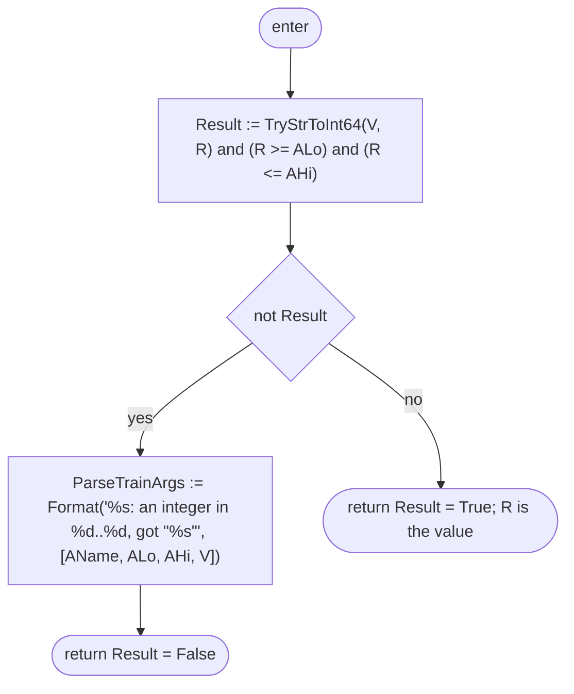

### `Num(AName, ALo, R)` (nested in `ParseTrainArgs`)

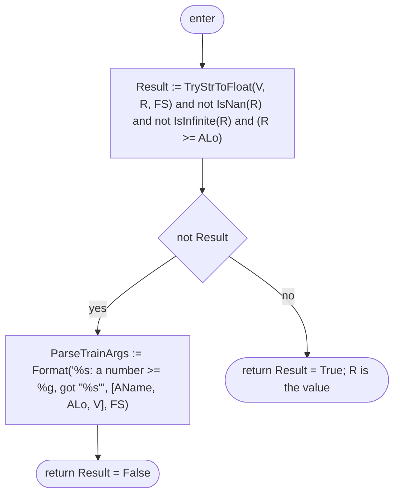

Both call sites use `ALo = 0`; NaN and ±Inf therefore fail at the
`not IsNan(R) and not IsInfinite(R)` of the condition (4.3 #6).

### `ShaFromName(AFile)`

```mermaid
flowchart TD
  A([enter]) --> B["Result := ''<br/>N := ExtractFileName(AFile)"]
  B --> C{"(Length(N) <> 71) or (Copy(N, 1, 7) <> 'sha256-')"}
  C -- yes --> D([return ''])
  C -- no --> E["I := 8"]
  E --> F{"I <= 71"}
  F -- no --> G([return Copy(N, 8, 64)])
  F -- yes --> H{"not (N[I] in ['0'..'9', 'a'..'f'])"}
  H -- yes --> D
  H -- no --> I2["I := I + 1"]
  I2 --> F
```

### `ConfigHash(C)`

```mermaid
flowchart TD
  A([enter]) --> B["FS := DefaultFormatSettings; FS.DecimalSeparator := '.'<br/>T := 'train=' + MD5Print(MD5File(C.Train))"]
  B --> C{"C.Valid <> ''"}
  C -- yes --> D["T := T + ' valid=' + MD5Print(MD5File(C.Valid))"]
  C -- no --> E["T := T + Format(' rank=%d alpha=%g lr=%g warmup=%d min=%g clip=%g epochs=%d<br/>seed=%d pool=%d budget=%d bpu=%d slice=%d classes=%s',<br/>[C.Rank, C.Alpha, C.Lr, C.Warmup, C.MinLrRatio, C.Clip, C.Epochs, C.Seed, C.Pool,<br/>C.Budget, C.BatchesPerUpdate, C.Slice, string.Join(',', C.Classes)], FS)"]
  D --> E
  E --> F([return MD5Print(MD5String(T)); 32 lower-case hex digits])
```

Excluded from the hash by design (detailed design 4.2.5):
`--max-updates`, `--resume`, `--split`, `--ckpt-every`, `--keep`, the
output directory and the base's sha256.

### `TotalUpdates(ASet, C)`

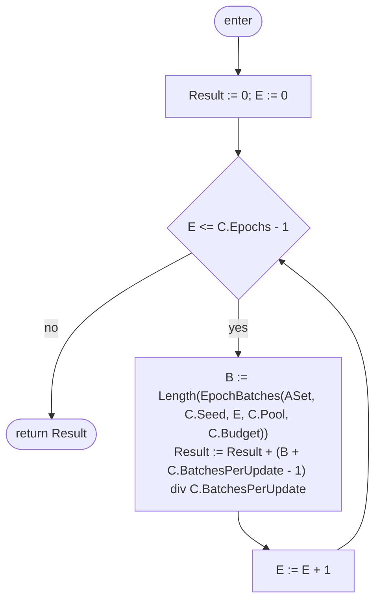

### `AppendLine(AFile, ALine)` (local)

```mermaid
flowchart TD
  A([enter]) --> B["AssignFile(F, AFile)"]
  B --> C{"FileExists(AFile)"}
  C -- yes --> D["Append(F)"]
  C -- no --> E["Rewrite(F)"]
  D --> F["WriteLn(F, ALine)"]
  E --> F
  F --> G([CloseFile(F)])
```

### `G17(X)` (local)

```mermaid
flowchart TD
  A([enter]) --> B["FS := DefaultFormatSettings; FS.DecimalSeparator := '.'"]
  B --> C{"IsNan(X)"}
  C -- yes --> D([return 'nan'])
  C -- no --> E([return FloatToStrF(X, ffGeneral, 17, 0, FS)])
```

### `RunTrainCLI(AArgs, AOut, AErr)`

```mermaid
flowchart TD
  A([enter]) --> B["Msg := ParseTrainArgs(AArgs, C)"]
  B --> C{"Msg <> ''"}
  C -- yes --> C1["AErr.Add(Msg); AErr.Add(Usage)"]
  C1 --> C2([return 2])
  C -- no --> D["G := nil; Tok := nil; M := nil; TrainSet := nil<br/>ValidSet := nil; S := nil; O := nil; Ck := nil"]
  D --> E{"FileExists(C.Model)"}
  E -- no --> E1x[("raise Exception:<br/>no model file &lt;C.Model&gt;")]
  E -- yes --> F["G := TGgufFile.Open(C.Model)<br/>Tok := TQwenTokenizer.Create(G)<br/>TrainSet := TTrainSet.Create(Tok, C.Train, C.Classes, C.Budget)"]
  F --> G{"TrainSet.Count = 0"}
  G -- yes --> G1x[("raise Exception:<br/>no training sample in &lt;C.Train&gt;")]
  G -- no --> H{"C.Valid <> ''"}
  H -- yes --> H1["ValidSet := TTrainSet.Create(Tok, C.Valid, C.Classes, C.Budget)"]
  H -- no --> I2
  H1 --> I2["Total := TotalUpdates(TrainSet, C)"]
  I2 --> J{"C.Warmup >= Total"}
  J -- yes --> J1x[("raise Exception via CreateFmt:<br/>warm-up &lt;C.Warmup&gt; must be below the &lt;Total&gt; updates")]
  J -- no --> K{"C.Split < 0"}
  K -- yes --> K1["M := TQwenModel.Load(G, TDevice.Cpu, TDevice.Cpu, 0)"]
  K -- no --> K2["M := TQwenModel.Load(G, TDevice.Cuda(0), TDevice.Cuda(1), C.Split)"]
  K1 --> L["ManualSeed(C.Seed)  ;  before AttachLora: it seeds A<br/>S := TLoraSet.Create(C.Rank, C.Alpha / C.Rank)<br/>M.AttachLora(S)<br/>O := TLoraAdamW.Create(S.Stores, DefaultAdamWConfig)"]
  K2 --> L
  L --> M2["ForceDirectories(C.OutDir)<br/>Ck := TCheckpoints.Create(C.OutDir + 'ckpt', C.Keep)<br/>Hash := ConfigHash(C)<br/>LogFile := C.OutDir + 'train-log.tsv'<br/>Epoch := 0; Pos := 0; U := 0"]
  M2 --> N2{"C.Resume"}
  N2 -. no .-> R1
  N2 -- yes --> N3["Dir := Ck.Latest"]
  N3 --> N4{"Dir = ''"}
  N4 -- yes --> N4x[("raise Exception:<br/>nothing to resume in &lt;Ck.Root&gt;")]
  N4 -- no --> N5["St := Ck.Load(Dir, S, O)"]
  N5 --> N6{"St.ConfigHash <> Hash"}
  N6 -- yes --> N6x[("raise Exception:<br/>the configuration differs from the checkpoint's: &lt;Dir&gt;")]
  N6 -- no --> N7{"St.BaseSha256 <> C.BaseSha256"}
  N7 -- yes --> N7x[("raise Exception:<br/>the base model differs from the checkpoint's: &lt;Dir&gt;")]
  N7 -- no --> N8["Epoch := St.Epoch<br/>Pos := St.Position<br/>U := St.Update"]
  N8 --> N9["AOut.Add(Format('resumed from %s at update %d', [Dir, U]))"]
  N9 --> R1["B := SkipBatches(EpochBatches(TrainSet, C.Seed, Epoch, C.Pool, C.Budget), Pos)<br/>I := 0"]
  R1 --> S2{"I < Length(B)"}
  S2 -- no --> T1["Epoch := Epoch + 1<br/>Pos := 0"]
  T1 --> T2{"Epoch < C.Epochs"}
  T2 -- no --> Z1["AOut.Add(Format('done: %d updates, best %s', [U, Ck.Best]))"]
  Z1 --> Z2([return 0])
  T2 -- yes --> R1
  S2 -- yes --> U1["T0 := Now<br/>Denom := 0<br/>for J := I .. Min(I + C.BatchesPerUpdate, Length(B)) - 1:<br/>  for K := 0 .. High(B[J]):<br/>    Denom := Denom + TrainSet[B[J][K]].LossTo - TrainSet[B[J][K]].LossFrom"]
  U1 --> U2["Sum := 0; Tokens := 0<br/>for J := I .. Min(I + C.BatchesPerUpdate, Length(B)) - 1:<br/>  for K := 0 .. High(B[J]):<br/>    R := SampleLossBackward(M, TrainSet[B[J][K]], Denom, C.Slice)<br/>    Sum := Sum + R.Sum<br/>    Tokens := Tokens + Length(TrainSet[B[J][K]].Tokens)<br/>    Pos := Pos + 1"]
  U2 --> U4["Loss := Sum / Denom"]
  U4 --> U5{"IsNan(Loss) or IsInfinite(Loss)"}
  U5 -- yes --> U6["AErr.Add(Format('non-finite loss at update %d; stopped without updating', [U + 1]))<br/>AppendLine(LogFile, Format('%d'#9'%d'#9'%d'#9'%s', [U + 1, Epoch, Pos, G17(Loss)]))"]
  U6 --> U7([return 3])
  U5 -- no --> V1["U := U + 1<br/>Norm := O.ClipGlobalNorm(C.Clip)<br/>Lr := ScheduleLR(C.Lr, U, C.Warmup, Total, C.MinLrRatio)<br/>O.Step(Lr); O.ZeroGrad"]
  V1 --> V2["I := I + C.BatchesPerUpdate<br/>EndOfEpoch := I >= Length(B)"]
  V2 --> V3["AppendLine(LogFile, the update line, 8 tab fields:<br/>U  Epoch  Pos  G17(Loss)  G17(Lr)  G17(Norm)  Tokens  SecondSpan(Now, T0)  %.1f"]
  V3 --> W1{"EndOfEpoch or (U mod C.CkptEvery = 0)"}
  W1 -- no --> Y1
  W1 -- yes --> W2["Val := NaN<br/>if ValidSet <> nil: Val := ValidationLoss(M, ValidSet, C.Slice)<br/>St := NewRunState<br/>St.Update := U<br/>St.Epoch := Epoch + Ord(EndOfEpoch)  ;  at an epoch's end the state is the next epoch's start<br/>St.Position := 0 if EndOfEpoch else Pos<br/>St.Seed := C.Seed<br/>St.ConfigHash := Hash<br/>St.BaseSha256 := C.BaseSha256<br/>St.ValLoss := Val"]
  W2 --> W3["Dir := Ck.Save(St, S, O)<br/>AppendLine(LogFile, the ckpt line, 4 tab fields: 'ckpt'  U  G17(Val)  Dir)"]
  W3 --> Y1{"C.MaxUpdates > 0 and U >= C.MaxUpdates"}
  Y1 -- yes --> Y2["AOut.Add(Format('stopped after update %d of %d', [U, Total]))"]
  Y2 --> Z3([return 0])
  Y1 -- no --> S2
```

Notes:

- Every raise branch (`no model file`, `no training sample`, `warm-up …`,
  the resume ones `nothing to resume` / `the configuration differs` /
  `the base model differs`, and the pass-throughs of
  `TGgufFile.Open`, `TQwenTokenizer.Create`, `TTrainSet.Create`,
  `TQwenModel.Load` and `Ck.Load`, plus any file error of the log or
  `Ck.Save`) is caught by the single `except on E: Exception` of the
  detailed design: `AErr.Add(E.Message)` — the message alone, one line —
  and `Result := 1` (4.3 #9–#14).
- On every path, also the exits 0 (both return branches), 2 and 3, the
  `finally` frees the eight objects in reverse creation order: `Ck, O, M,
  S, ValidSet, TrainSet, Tok, G`.
- The `--resume` branch (the `N` nodes) is skipped without `--resume`
  (dashed edge into `R1`).
- The non-finite branch (`U5 -- yes`) exits before `Inc(U)`, `O.Step`
  and the checkpoint: no update is applied (4.3, the exit-3 row).
- The update loop walks the epoch's batches `B` from `I`, consuming
  `C.BatchesPerUpdate` per update; the last update of an epoch may be
  shorter (`Min(I + C.BatchesPerUpdate, Length(B))`).

## Program `qlora_train`

The harness owner's thin wrapper (the detailed design 1; nobody changes
it):

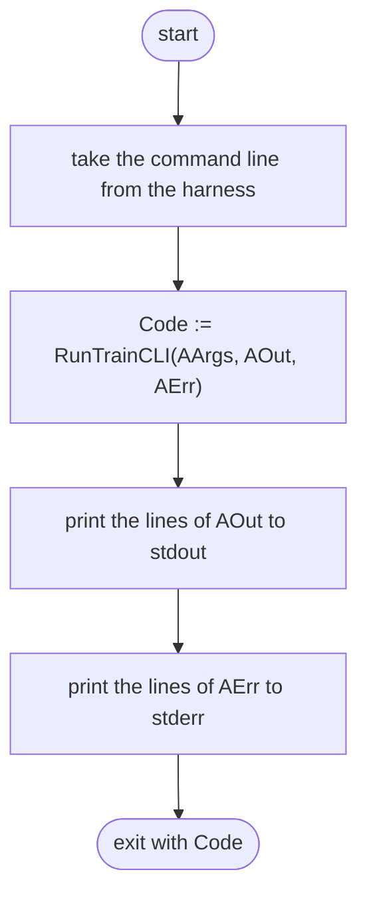
