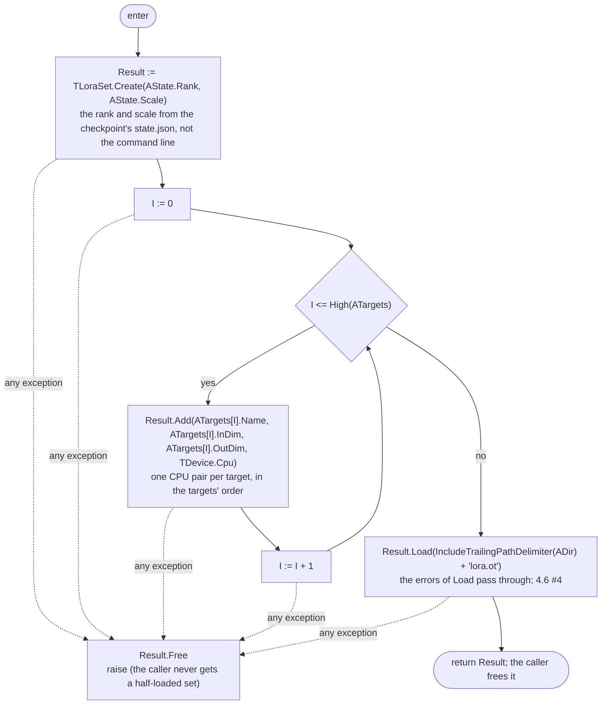
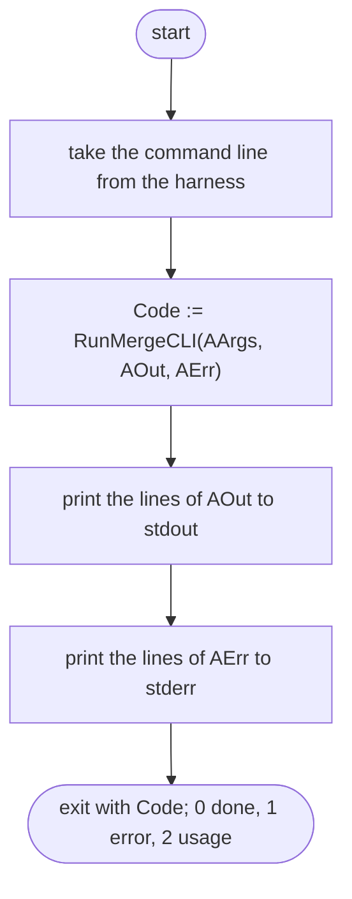

# Program flow — `qlora_merge` (T18)

Flowcharts per function, from
[`../detailed-design/T18-detailed.md`](../detailed-design/T18-detailed.md).
Every branch is drawn out: they are the ground for the UT cases and the
coverage gate. Message texts and conditions are the exact ones of the
detailed design (4.6).

## Unit `GgufMerge`

### `AddTarget(AGguf, AName, R)` (local)

```mermaid
flowchart TD
  A([enter]) --> B["T := AGguf.FindTensor(AName + '.weight')"]
  B --> C{"T < 0"}
  C -- yes --> C1[(\"raise EGgufMerge:<br/>no tensor &lt;AName&gt;.weight;\br/>4.6 #1\")]
  C -- no --> D["Info := AGguf.Tensor[T]"]
  D --> E{"Info.NDims <> 2"}
  E -- yes --> E1[(\"raise EGgufMerge:<br/>&lt;AName&gt;.weight has &lt;NDims&gt; dimensions, expected 2;\br/>4.6 #2\")]
  E -- no --> F["append to R:<br/>Name := AName<br/>Tensor := T<br/>InDim := Info.Dims[0]<br/>OutDim := Info.Dims[1]"]
  F --> G([return])
```

### `MergeTargets(AGguf)`

The trunk is the blocks minus the MTP count (the key
`qwen35.nextn_predict_layers`); per trunk block the kind's targets, in
this order: full `attn_q`, `attn_k`, `attn_v`, `attn_output`; linear
`attn_qkv`, `attn_gate`, `ssm_out`.

```mermaid
flowchart TD
  A([enter]) --> B["Result := nil<br/>D := ReadQwenDims(AGguf);<br/>the EQwenBlock of a missing key passes through; 4.6 #3"]
  B --> C["Trunk := D.Blocks"]
  C --> D2["K := AGguf.FindKey('qwen35.nextn_predict_layers')"]
  D2 --> E{"K >= 0"}
  E -- yes --> E1["Trunk := D.Blocks - AGguf.KV[K].IntVal;<br/>blocks Trunk..Blocks-1 are the MTP block(s), not targets"]
  E -- no --> G
  E1 --> G["B := 0"]
  G --> H{"B <= Trunk - 1"}
  H -- no --> Z([return Result;<br/>one TMergeTarget per target, in block order])
  H -- yes --> I["P := 'blk.' + B + '.'"]
  I --> J{"IsFullBlock(D, B)"}
  J -- yes --> K[\"AddTarget(P + 'attn_q', Result)<br/>AddTarget(P + 'attn_k', Result)<br/>AddTarget(P + 'attn_v', Result)<br/>AddTarget(P + 'attn_output', Result)\"]
  J -- no --> L[\"AddTarget(P + 'attn_qkv', Result)<br/>AddTarget(P + 'attn_gate', Result)<br/>AddTarget(P + 'ssm_out', Result)\"]
  K --> M["B := B + 1"]
  L --> M
  M --> H
```

### `LoadAdapters(ATargets, ADir, AState)`



### `MergeTensor(ATType, ABytes, AIn, AOut, AP)`

```mermaid
flowchart TD
  A([enter]) --> B{"(AP.InDim <> AIn) or (AP.OutDim <> AOut)"}
  B -- yes --> B1[(\"raise EGgufMerge, before anything else; 4.6 #5:<br/>&lt;AP.Name&gt;: adapter &lt;AP.InDim&gt; -&gt; &lt;AP.OutDim&gt;,<br/>tensor &lt;AIn&gt; -&gt; &lt;AOut&gt;\")]
  B -- no --> C["NG := NoGradGuard;<br/>assigned to a local IInterface so the guard lives for the call"]
  C --> D["W := DequantizeBytes(ATType, ABytes, AIn * AOut)<br/>the EGgufError of T02 passes through; 4.6 #6"]
  D --> E["W := (TTensor.FromSingleArray(W).reshape([AOut, AIn]) + AP.MergedDelta).ToSingleArray<br/>the base (fp32) plus s·B·A, elementwise"]
  E --> F([return QuantizeQ8_0(W)<br/>the EGgufError of T02 passes through; 4.6 #6])
```

### `WriteMerged(AGguf, ATargets, ASet, AOutPath)`

```mermaid
flowchart TD
  A([enter]) --> B["Result := 0<br/>Pairs := nil; SetLength(Pairs, AGguf.TensorCount)<br/>indexed by tensor-directory index: nil = copy byte for byte"]
  B --> C{"ASet <> nil"}
  C -- no --> F
  C -- yes --> D["for I := 0 to High(ATargets):<br/>Pairs[ATargets[I].Tensor] := ASet.Find(ATargets[I].Name)"]
  D --> E{"Pairs[ATargets[I].Tensor] = nil (the first target, in order, without a pair)"}
  E -- yes --> E1[(\"raise EGgufMerge, before anything is written; 4.6 #7:<br/>no adapter &lt;ATargets[I].Name&gt;\")]
  E -- no --> F["Part := AOutPath + '.part'"]
  F --> G["W := TGgufWriter.Create(AGguf)<br/>the writer copies the metadata as bytes; the directory in the base's order<br/>the base's alignment preserved"]
  G --> H["for I := 0 to High(Pairs):<br/>if Pairs[I] <> nil: W.SetTensorType(AGguf.Tensor[I].Name, GgufTypeQ8_0)<br/>the retyping, before BeginWrite"]
  H --> I2["W.BeginWrite(Part)<br/>the writer's EGgufError passes through; 4.6 #8"]
  I2 --> J["I := 0"]
  J --> K{"I <= AGguf.TensorCount - 1"}
  K -- no --> O["W.Finish"]
  K -- yes --> L["AGguf.ReadTensorBytes(I, B)"]
  L --> M{"Pairs[I] <> nil"}
  M -- no --> N2["W.WriteTensor(B)<br/>a non-target tensor, byte for byte"]
  M -- yes --> N["Info := AGguf.Tensor[I]<br/>B := MergeTensor(Info.TType, B, Info.Dims[0], Info.Dims[1], Pairs[I])<br/>Inc(Result)<br/>W.WriteTensor(B)"]
  N2 --> P["I := I + 1"]
  N --> P
  P --> K
  O --> Q["finally: W.Free<br/>the writer removes the part file when not finished"]
  Q --> R{"RenameFile(Part, AOutPath)"}
  R -- "no (rename(2) failed)" --> R1["DeleteFile(Part)"]
  R1 --> R2[(\"raise EGgufMerge; 4.6 #9:<br/>cannot rename &lt;Part&gt; to &lt;AOutPath&gt;\")]
  R -- "yes (rename(2) replaces an existing file)" --> Z([return Result;<br/>the number of merged tensors])
```

### `RunMergeCLI(AArgs, AOut, AErr)`

The usage errors have the **message alone on `AErr`** (no `Usage` line);
the runtime errors have the message alone on `AErr` and return 1; the
success line goes to `AOut` and returns 0.

```mermaid
flowchart TD
  A([enter]) --> B["Args := nil; Sha := ''; I := 0"]
  B --> C{"I <= High(AArgs) (an empty array does not run)"}
  C -- no --> H0{"Length(Args) <> 3"}
  C -- yes --> D["A := AArgs[I]"]
  D --> E{"A = '--base-sha256'"}
  E -- yes --> E2{"I = High(AArgs) (the value is missing)"}
  E2 -- yes --> E3[\"AErr.Add('--base-sha256: value missing')\"]
  E3 --> E4([exit 2; 4.6 #10])
  E2 -- no --> E5["Sha := AArgs[I + 1]; I := I + 2"]
  E5 --> C
  E -- no --> F{"(Length(A) > 1) and (A[1] = '-')<br/>any argument longer than one character<br/>that starts with -, compared literally"}
  F -- yes --> F1[\"AErr.Add('unknown option ' + A)\"]
  F1 --> F2([exit 2; 4.6 #11])
  F -- no --> G2["append A to Args (a positional)<br/>I := I + 1"]
  G2 --> C
  H0 -- yes --> H1[\"AErr.Add(Format('expected BASE CKPT OUT, got %d arguments', [Length(Args)]))\"]
  H1 --> H3([exit 2; 4.6 #12])
  H0 -- no --> I1["Result := 1;<br/>every later Exit without a code returns 1"]
  I1 --> J{"FileExists(Args[0])"}
  J -- no --> J1["AErr.Add('no model file ' + Args[0])"]
  J1 --> J2([exit; 4.6 #13])
  J -- yes --> K{"ExpandFileName(Args[2]) = ExpandFileName(Args[0])"}
  K -- yes --> K1["AErr.Add('the output must not be the base model')"]
  K1 --> K2([exit; 4.6 #14])
  K -- no --> L2{"Sha = ''"}
  L2 -- yes --> L3["Sha := ShaFromName(Args[0])<br/>the file name sha256-&lt;64 hex&gt; (T17), not computed"]
  L2 -- no --> M0
  L3 --> M0["G := nil; S := nil"]
  M0 --> M1["St := ReadRunState(Args[1])<br/>its error passes through: not a checkpoint: &lt;ckpt&gt;; 4.6 #15"]
  M1 --> N1{"(St.BaseSha256 <> '') and (Sha <> '') and (St.BaseSha256 <> Sha)"}
  N1 -- yes --> N2["AErr.Add('the base model differs from the checkpoint''s: ' + Args[1])"]
  N2 --> N3([exit; 4.6 #16; compared literally])
  N1 -- no --> O1["G := TGgufFile.Open(Args[0])<br/>its errors pass through; 4.6 #17"]
  O1 --> O2["T := MergeTargets(G); 4.1<br/>S := LoadAdapters(T, Args[1], St); 4.2"]
  O2 --> O3["N := WriteMerged(G, T, S, Args[2]); 4.4"]
  O3 --> O4["AOut.Add(Format('merged %d tensors (rank %d, scale %g) into %s',<br/>[N, St.Rank, St.Scale, Args[2]]))"]
  O4 --> O5([Result := 0; 4.6 #18])
  M1 -. "any raise (GGUF, targets,<br/>adapters, writing; 4.6 #17)" .-> P1["except on E: Exception:<br/>AErr.Add(E.Message)<br/>the message alone, one line"]
  O5 --> P2
  P1 --> P2["finally: S.Free; G.Free<br/>on every path"]
```

## Program `qlora_merge`

The harness owner's thin wrapper (the detailed design 1; nobody changes
it):


