# Program flow — `qlora_dataset` (T19)

Flowcharts per function, from
[../detailed-design/T19-detailed.md](../detailed-design/T19-detailed.md).
Every branch is drawn; the `N: message` labels are the facts' check and
message numbers (4.1–4.5 of the detailed design). T19a is documents
only: no source code and no tests are written in this task.

## Unit `DatasetFilter`

### `InList(AValue, AList)` (local)

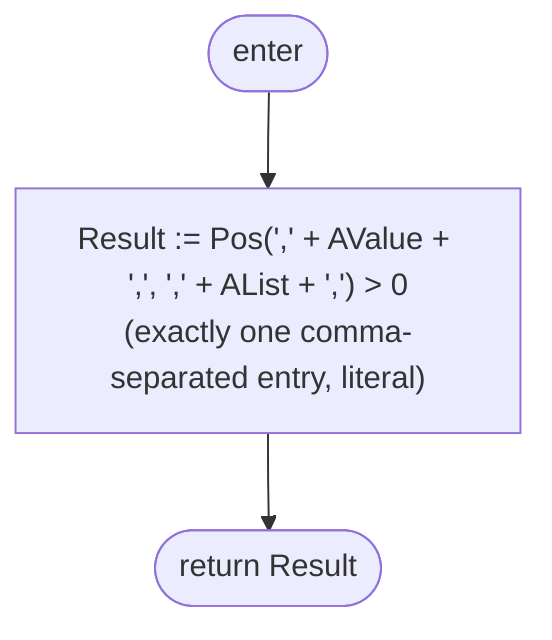

### `ParseRecord(ALine, R)`

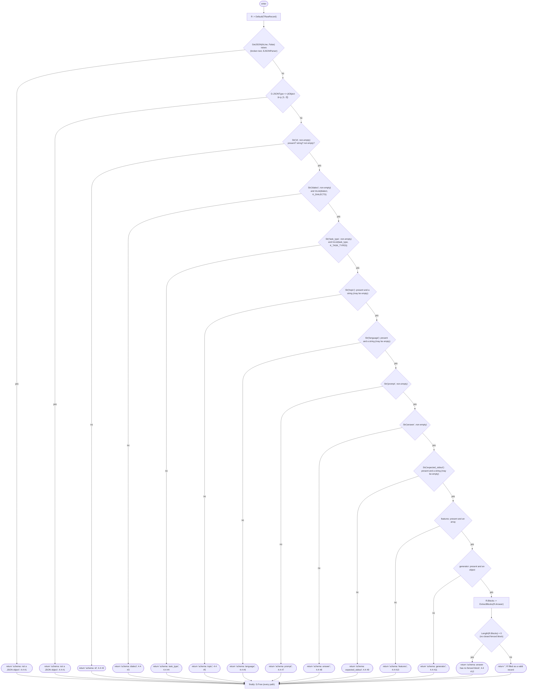

`Str(key, nonEmpty, value)`: the key must be present and a string (then
the value is read out; else empty), and — when `nonEmpty` — not empty.

### `ExtractBlocks(AText)`

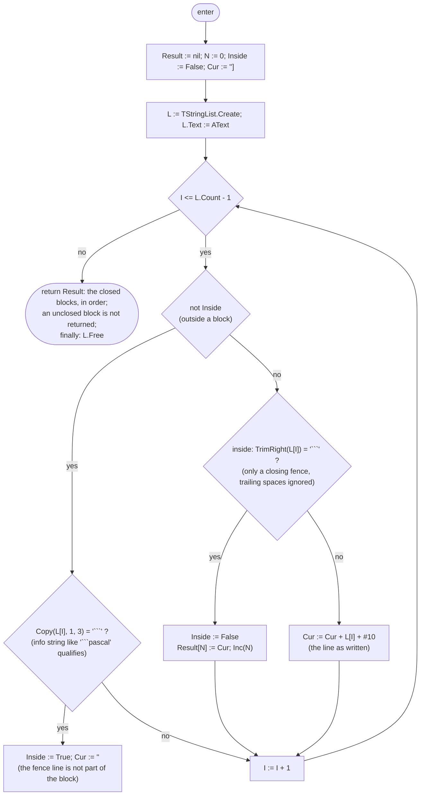

### `NormalizeSource(ASrc)`

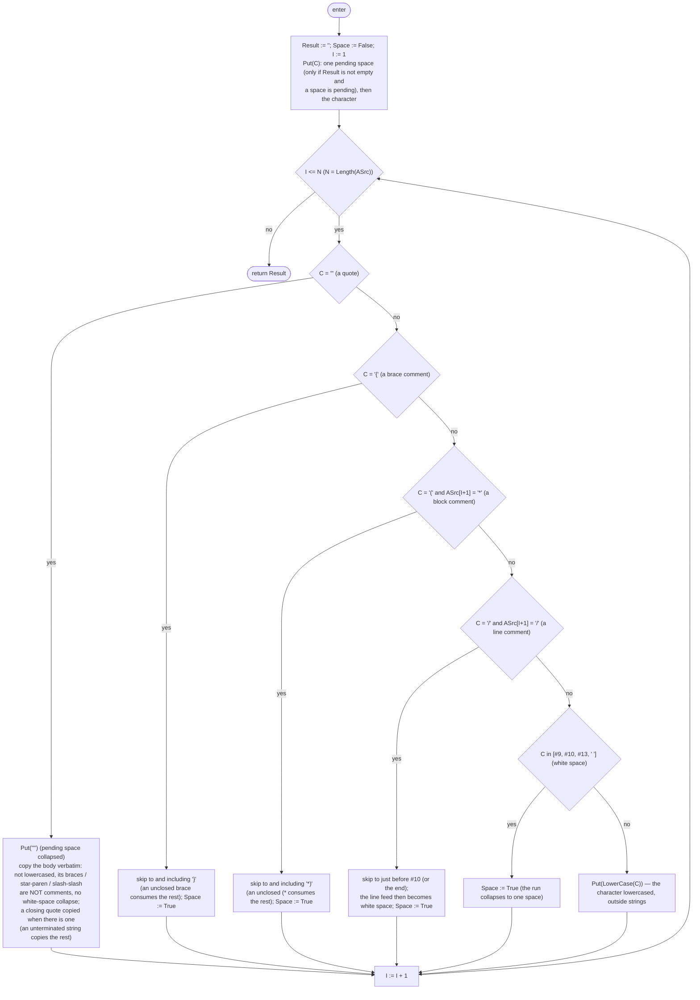

### `SourceKey(ABlocks)`

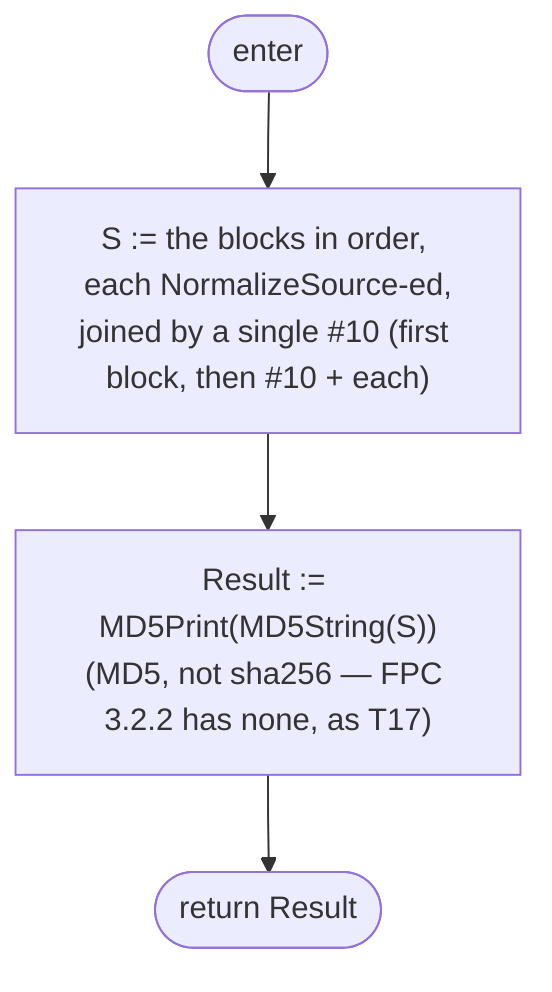

### `LexTokens(AText)`

```mermaid
flowchart TD
  A([enter]) --> B["Result := nil; K := 0; T := LowerCase(AText); I := 1"]
  B --> C{"I <= N (N = Length(T))"}
  C -- no --> Z([return Result (nil for empty / white-space-only input)])
  C -- yes --> D{"T[I] in ['a'..'z', '_'] (a word starts)"}
  D -- yes --> E["J := I; extend J while T[J] in ['a'..'z','0'..'9','_']"]
  D -- no --> F{"T[I] in ['0'..'9'] (a number starts)"}
  F -- yes --> G["J := I; extend J while T[J] in ['0'..'9']"]
  F -- no --> H{"T[I] in [#9,#10,#13,' '] (white space)"}
  H -- yes --> I1["Inc(I) — white space is not a token"]
  H -- no --> J1["J := I + 1 — one other character (a ':', an '=', a ';', ...)"]
  E --> K["append := Copy(T, I, J - I); Inc(K); I := J"]
  G --> K
  J1 --> K
  I1 --> C
  K --> C
```

### `Fnv1a(S)` (local)

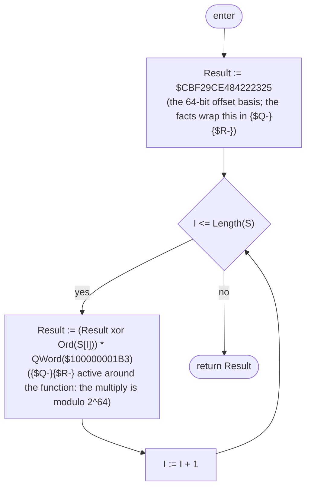

### `Shingles(ATokens)`

```mermaid
flowchart TD
  A([enter]) --> B["Result := nil; N := 0"]
  B --> C{"I from 0 to Length(ATokens) - K_NGRAM<br/>(the loop does not run with fewer than 5 tokens)"}
  C -- no --> Z([return Result (the ascending, unique hashes)])
  C -- yes --> D["S := ATokens[I] + ' ' + ATokens[I+1] + ' ' + ... + ATokens[I+4]<br/>(the 5-token gram, joined by one space)"]
  D --> E["H := Fnv1a(S)"]
  E --> F["J := N; scan down to the first Result[J-1] &lt;= H"]
  F --> G{"J > 0 and Result[J-1] = H ?"}
  G -- yes --> J1["the gram is dropped (unique array)"]
  G -- no --> K["shift the tail from N down to J+1; Result[J] := H; Inc(N)<br/>(the array stays ascending)"]
  J1 --> L["I := I + 1"]
  K --> L
  L --> C
```

### `Jaccard(A, B)`

```mermaid
flowchart TD
  A([enter]) --> B{"Length(A) = 0 and Length(B) = 0 ?"}
  B -- yes --> Z1([return 0])
  B -- no --> C["I := 0; J := 0; Both := 0"]
  C --> D{"I &lt; Length(A) and J &lt; Length(B)"}
  D -- yes --> E{"A[I] = B[J] (the sorted, unique hashes)"}
  E -- yes --> F["Inc(Both); Inc(I); Inc(J)"]
  E -- no --> G{"A[I] &lt; B[J]"}
  G -- yes --> H["Inc(I)"]
  G -- no --> H2["Inc(J)"]
  F --> D
  H --> D
  H2 --> D
  D -- no --> Z([return Both / (Length(A) + Length(B) - Both);<br/>i.e. |A intersection B| / |A union B| — 0 when one side is empty])
```

### `ValidCount(AN, APercent)`

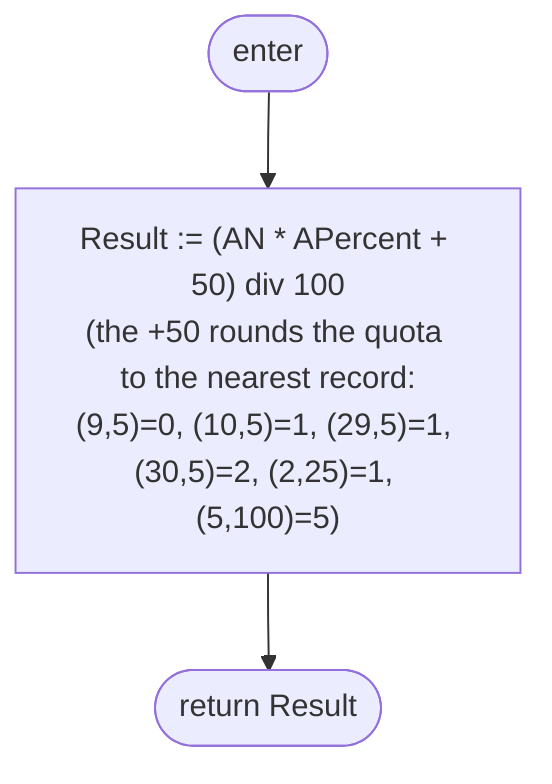

### `SplitKey(ASeed, AId)`

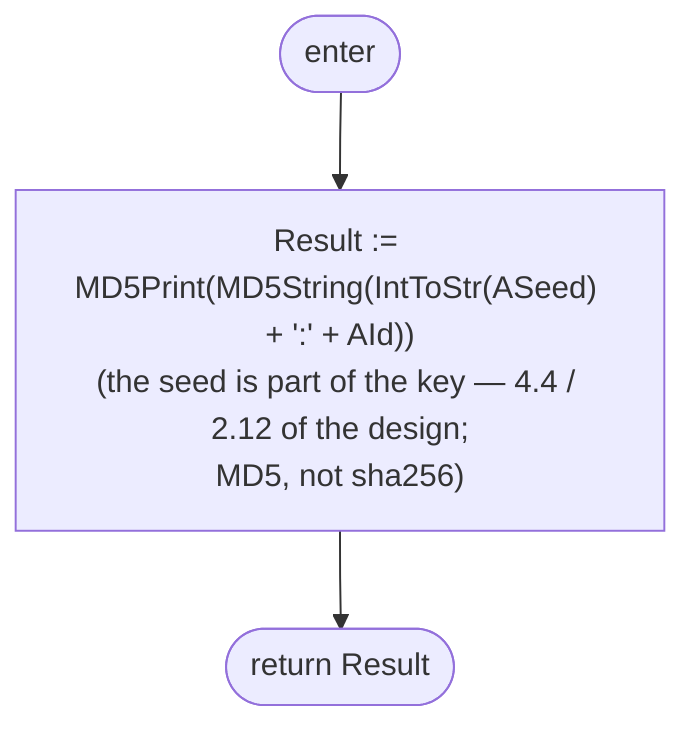

## Unit `DatasetCli`

### `DefaultDatasetConfig`

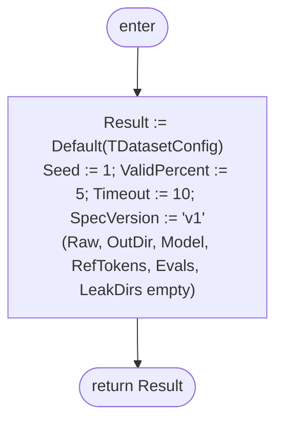

### `Push(A, S)` (local)

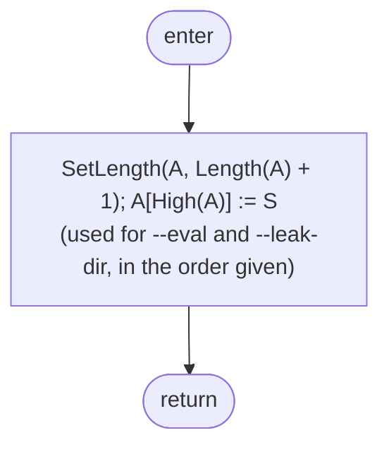

### `ParseDatasetArgs(AArgs, C)`

```mermaid
flowchart TD
  A([enter]) --> B["C := DefaultDatasetConfig; Pos2 := nil; I := 0"]
  B --> C{"I <= High(AArgs)"}
  C -- no --> H0
  C -- yes --> D["A := AArgs[I]"]
  D --> E{"A = --model or --ref-tokens or --eval or --leak-dir<br/>or --seed or --valid-percent or --timeout or --spec-version"}
  E -- no --> G{"Length(A) > 1 and A[1] = '-' ?<br/>(literal, case-sensitive — --Seed is unknown;<br/>a one-character dash is a positional)"}
  G -- yes --> U1([return 'unknown option &lt;arg&gt;'; 4.2 #5])
  G -- no --> K["Push(Pos2, A); Inc(I)"] --> C
  E -- yes --> F{"I = High(AArgs)<br/>(the option is the last argument)"}
  F -- yes --> U0([return '&lt;option&gt;: value missing'; 4.2 #1])
  F -- no --> V["V := AArgs[I+1]; Inc(I, 2)"]
  V --> W{"which option?"}
  W -- "--model" --> M1["C.Model := V"] --> C
  W -- "--ref-tokens" --> M2["C.RefTokens := V"] --> C
  W -- "--eval" --> M3["Push(C.Evals, V) (repeatable)"] --> C
  W -- "--leak-dir" --> M4["Push(C.LeakDirs, V) (repeatable)"] --> C
  W -- "--spec-version" --> M5["C.SpecVersion := V"] --> C
  W -- "--seed / --valid-percent / --timeout" --> M6["N := TryStrToInt64(V), else -1"]
  M6 --> S1{"A = --seed ?"}
  S1 -- yes --> S2{"TryStrToInt64(V, C.Seed) (a negative value is legal)"}
  S2 -- no --> U2([return '--seed: an integer, got "&lt;v&gt;"'; 4.2 #2])
  S2 -- yes --> C
  S1 -- no --> S3{"A = --valid-percent ?"}
  S3 -- yes --> S4{"(N &lt; 0) or (N &gt; 100) ?"}
  S4 -- yes --> U3([return '--valid-percent: an integer in 0..100, got "&lt;v&gt;"'; 4.2 #3])
  S4 -- no --> S5["C.ValidPercent := N"] --> C
  S3 -- no --> S6{"(N &lt; 1) or (N &gt; 3600) ?"}
  S6 -- yes --> U4([return '--timeout: an integer in 1..3600, got "&lt;v&gt;"'; 4.2 #4])
  S6 -- no --> S7["C.Timeout := N"] --> C
  H0{"Length(Pos2) <> 2 ?"}
  H0 -- yes --> U5([return 'expected RAW OUTDIR, got &lt;n&gt; arguments'; 4.2 #6])
  H0 -- no --> H1{"(C.Model = '') <> (C.RefTokens = '') ?<br/>(exactly one of the two given)"}
  H1 -- yes --> U6([return '--model and --ref-tokens go together'; 4.2 #7])
  H1 -- no --> H2["C.Raw := Pos2[0]<br/>C.OutDir := IncludeTrailingPathDelimiter(Pos2[1])"]
  H2 --> Z([return ''])
```

### `MainBlock(ABlocks)`

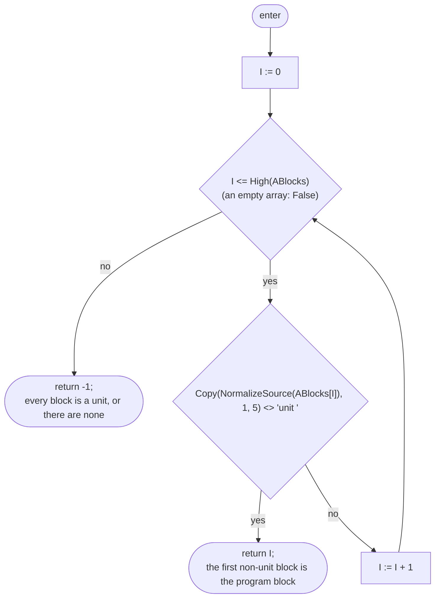

### `UnitNameOf(ABlock)`

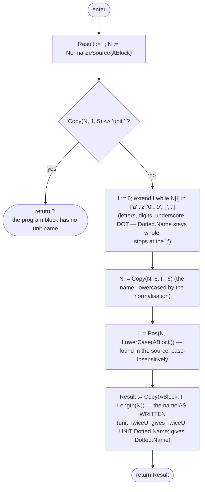

### `SaveText(APath, AText)` (local)

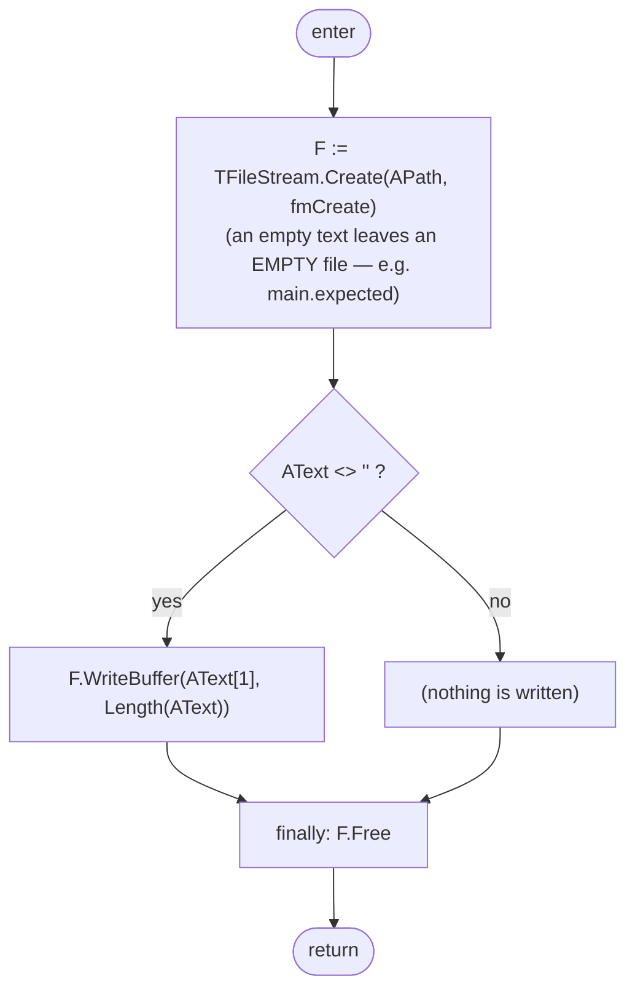

### `VerifyRecord(R, ADir, ATimeout, AEnv, AClass, AOutcome, ADetail)`

```mermaid
flowchart TD
  A([enter]) --> B["ForceDirectories(ADir) — the record's working directory"]
  B --> C["M := MainBlock(R.Blocks)"]
  C --> D["for each block I, as raw:<br/>I = M → ADir + 'main.pas'<br/>else → ADir + UnitNameOf(R.Blocks[I]) + '.pas'<br/>(the units next to main.pas)"]
  D --> E["SaveText(ADir + 'main.expected', R.Expected)"]
  E --> F["Line := VerifyFile(ADir + 'main.pas', R.Dialect, ATimeout, AEnv, ADir + 'build', OK).Split([#9])<br/>(T06, on the record's dialect)"]
  F --> G["AClass := Line[2]; AOutcome := Line[3]; ADetail := Line[4]"]
  G --> H{"(AOutcome = OUT_ACCEPTED)<br/>and ((AClass = VS_COMPILED_RUN) or (AClass = VS_FPC_APPROX))<br/>and (ExtractExpectErrorText(R.Blocks[M]) = '')<br/>the program block demands no compile error (no expect-error: marker)"}
  H -- yes --> Z([return True;<br/>AClass, AOutcome, ADetail as outputs])
  H -- no --> Z2([return False;<br/>the run rejects 'verify: &lt;outcome&gt;' (e.g. verify: static-ok for Oxygene<br/>until its filter row, M3); AClass / ADetail still out])
```

### `ShOf(AText, ASource)`

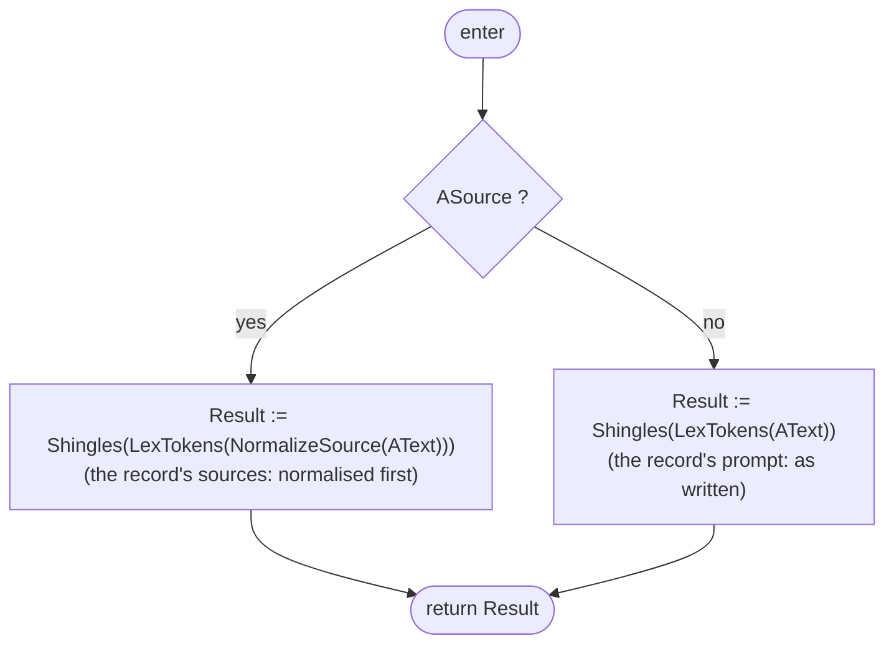

### `JoinBlocks(ABlocks)`

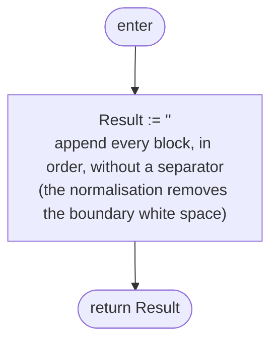

### `ReadLines(APath)`

```mermaid
flowchart TD
  A([enter]) --> B{"FileExists(APath) ?"}
  B -- no --> X([raise Exception: 'no file ' + APath;<br/>4.3 #2 — passes through to the run's handler])
  B -- yes --> C["Result := TStringList.Create; Result.LoadFromFile(APath)"] --> Z([return Result])
```

### `LoadEvals(AFile, APrompts, ASources)`

```mermaid
flowchart TD
  A([enter]) --> B["L := ReadLines(AFile) (its 'no file' raise passes through)"]
  B --> C{"I <= L.Count - 1"}
  C -- no --> Z
  C -- yes --> D{"Trim(L[I]) = '' ?"}
  D -- yes --> F["I := I + 1"]
  D -- no --> E["O := GetJSON(L[I], False) as TJSONObject<br/>append one PROMPT text: Name = id, Sh = ShOf(prompt, False) (as written)<br/>append one REFERENCE text: Name = id, Sh = ShOf(reference, True) (normalised)<br/>finally: O.Free"]
  E --> F
  F --> C
  Z([return;<br/>finally: L.Free;<br/>the two leak texts of each eval are both named with its id])
```

### `LoadExamples(ADir, AFiles)`

```mermaid
flowchart TD
  A([enter]) --> B{"CollectPascalFiles(ADir, F)<br/>(the *.pas / *.dpr files, recursively)"}
  B -- no --> X([raise Exception: 'no leak directory ' + ADir;<br/>4.3 #3 — passes through to the run's handler])
  B -- yes --> C["SortStrings(F)"]
  C --> D["for each file, in sorted order:<br/>ReadTextFile(F[I], T)<br/>Name := ExtractRelativePath(dir with trailing delimiter, F[I])<br/>Sh := ShOf(T, True) — normalised"] --> Z([return])
```

### `Near(ASh, A)`

```mermaid
flowchart TD
  A([enter]) --> B["I := 0"]
  B --> C{"I <= High(A)"}
  C -- no --> Z1([return '';<br/>no text reached the threshold])
  C -- yes --> D{"Jaccard(ASh, A[I].Sh) >= K_NEAR (0.5) ?"}
  D -- yes --> Z([return A[I].Name;<br/>the FIRST text in the order of A that reaches 0.5])
  D -- no --> E["I := I + 1"] --> C
```

### `TokensOf(O, AKey)`

```mermaid
flowchart TD
  A([enter]) --> B["Result := ''<br/>A := O.Arrays[AKey]<br/>append IntToStr(A.Integers[I]) + ' ' for each element<br/>(the token array as space-separated integers, trailing space)"] --> Z([return Result])
```

### `EncodeText(T, AText)`

```mermaid
flowchart TD
  A([enter]) --> B["A := T.Encode(AText)<br/>Result := '' — append IntToStr(A[I]) + ' ' for each token<br/>(the same shape as TokensOf, so both sides compare as strings)"] --> Z([return Result])
```

### `JsonStr(S)`

```mermaid
flowchart TD
  A([enter]) --> B["Result := '\"' + StringToJSONString(S) + '\"'<br/>(a JSON string literal, properly escaped)"] --> Z([return Result])
```

### `RunDatasetCLI(AArgs, AEnv, AWorkRoot, AOut, AErr)`

```mermaid
flowchart TD
  A([enter]) --> B["Msg := ParseDatasetArgs(AArgs, C)"]
  B --> C{"Msg <> '' ?"}
  C -- yes --> C1["AErr.Add(Msg)<br/>AErr.Add(K_DATASET_USAGE)"] --> C2([exit 2;<br/>the usage error: the message followed by<br/>'usage: qlora_dataset [options] RAW OUTDIR (see the unit header)'])
  C -- no --> D["Result := 1 (success is the only 0)<br/>the lists / objects start nil (freed in finally, 7)"]
  D --> E{"FileExists(C.Raw) ?"}
  E -- no --> E1(["raise 'no raw file ' + C.Raw (4.3 #1) → handler 7"])
  E -- yes --> F["Raw := ReadLines(C.Raw)"]
  F --> G["for each --eval file (in order): LoadEvals — EvalP, EvalS<br/>(a missing file raises 'no file ' + path, 4.3 #2 → handler 7)"]
  G --> H["for each --leak-dir (in order): LoadExamples — Examples<br/>(a missing directory raises 'no leak directory ' + dir, 4.3 #3 → handler 7)"]
  H --> I{"C.Model <> '' ?<br/>(the pairing made both options present)"}
  I -- no --> I1["(G and Tok stay nil — the tokenizer check is not run;<br/>the card says 'not run', the facts)"] --> L0
  I -- yes --> J["G := TGgufFile.Open(C.Model) — T01<br/>Tok := TQwenTokenizer.Create(G) — T05<br/>(their errors pass through, 4.3 #4 → handler 7)"]
  J --> K["read the reference file C.RefTokens (its missingness: the same 'no file', 4.3 #2 → handler 7):<br/>skip the blank lines; each line a JSON object {id, prompt, answer}<br/>the FIRST line of an id counts: Refs (sorted, dupIgnore)<br/>Refs.Add(id + '=' + line) only when the id is not present yet"]
  K --> L0["Ids := sorted list; Rejects := list; Reasons := list; Total := 0"]
  L0 --> M{"I <= Raw.Count - 1"}
  M -- no --> SPLIT
  M -- yes --> N{"Trim(Line) = '' ? (a blank line)"}
  N -- yes --> Q["I := I + 1 (skipped, not counted)"]
  N -- no --> O["Inc(Total); Detail := ''; Cls := '']"]
  O --> P1["Reason := ParseRecord(Line, R) — the schema reasons, 4.1"]
  P1 --> P2{"Reason = '' and MainBlock(R.Blocks) &lt; 0 ?"}
  P2 -- yes --> PJ["Reason := 'schema: answer has no program block' (4.4 #13)"] --> REJ
  P2 -- no --> P3{"Reason = '' and Ids contains R.Id ?  (the ids of records<br/>that passed the schema checks only)"}
  P3 -- yes --> PK["Reason := 'duplicate-id' (4.4 #14)"] --> REJ
  P3 -- no --> P4{"Reason = '' ?"}
  P4 -- no --> REJ
  P4 -- yes --> P5["Ids.Add(R.Id)<br/>Key := DetectDialect(R.Blocks[MainBlock(R.Blocks)], 'main.pas') — T06"]
  P5 --> P6{"Key <> R.Dialect ?"}
  P6 -- yes --> PL["Reason := 'dialect: ' + Key (4.4 #15)"] --> REJ
  P6 -- no --> P7["Sh := ShOf(JoinBlocks(R.Blocks), True) — the record's sources, normalised<br/>(reused by check 8)"]
  P7 --> P8["Dup := Near(Sh, EvalS) — the eval REFERENCES<br/>when '': Dup := Near(ShOf(R.Prompt, False), EvalP) — the eval PROMPTS"]
  P8 --> P9{"Dup <> '' ?"}
  P9 -- yes --> PM["Reason := 'leak-eval: ' + Dup (4.4 #16)"] --> REJ
  P9 -- no --> P10["Dup := Near(Sh, Examples) — the example files"]
  P10 --> P11{"Dup <> '' ?"}
  P11 -- yes --> PN["Reason := 'leak-example: ' + Dup (4.4 #17)"] --> REJ
  P11 -- no --> P12["Key := SourceKey(R.Blocks)<br/>scan Acc in order: the first record with Acc[J].Key = Key"]
  P12 --> P13{"a hit?"}
  P13 -- yes --> PO["Reason := 'duplicate: ' + Acc[J].Id (4.4 #18) — keep the earlier"] --> REJ
  P13 -- no --> P14["scan Acc in order: the first record with Jaccard(Sh, Acc[J].Sh) >= K_NEAR"]
  P14 --> P15{"a hit?"}
  P15 -- yes --> PP["Reason := 'near-duplicate: ' + Acc[J].Id (4.4 #19)"] --> REJ
  P15 -- no --> P16{"Reason = '' and Tok <> nil ?<br/>(the tokenizer ran — both options given)"}
  P16 -- no --> P20
  P16 -- yes --> P17{"Refs.IndexOfName(R.Id) &lt; 0 ? (no reference line)"}
  P17 -- yes --> PQ["Reason := 'tokenizer: no reference' (4.4 #20)"] --> REJ
  P17 -- no --> P18["Ref := the first reference line of the id<br/>{prompt and answer token arrays, in order, special tokens, no BOS}"]
  P18 --> P19{"TokensOf(Ref, 'prompt') <> EncodeText(Tok, R.Prompt)<br/>or TokensOf(Ref, 'answer') <> EncodeText(Tok, R.Answer) ?"}
  P19 -- yes --> PR["Reason := 'tokenizer' (4.4 #21)"] --> REJ
  P19 -- no --> P20["if Reason = '', the VERIFICATION (the slowest, last):<br/>Dir := AWorkRoot + (I + 1) + PathDelim (a directory per record, its 1-based line)<br/>VerifyRecord(R, Dir, C.Timeout, AEnv, Cls, Outcome, Detail) — 3.6<br/>writes main.pas, the unit files, main.expected; runs the verifier<br/>on failure → Reason := 'verify: ' + Outcome (4.4 #22); Cls, Detail out"]
  P20 --> REJ{"Reason <> '' ? (any of the 22 checks failed)"}
  REJ -- yes --> RJ["Rejects.Add the JSON line {line: I + 1, id, reason, detail}<br/>(detail: the verifier's when it ran, '' for the earlier checks)<br/>count the reason up to its colon in Reasons<br/>(duplicate-id, which has no colon, counts whole)"] --> Q
  REJ -- no --> RA["O := the line as a JSON object; O.Add('class', Cls); O.Free<br/>append to Acc: Line := O.AsJSON (the raw object plus class)<br/>Id, Dialect, TaskType, Cls (the verifier's class),<br/>Key := SourceKey(R.Blocks), Sh (the sources' shingles), Valid := False"]
  RA --> Q
  Q --> M
  SPLIT["the split, per dialect × task type cell:<br/>Cells := the sorted, unique 'dialect tasktype'<br/>for each cell: its records sorted by SplitKey(C.Seed, Id) (the seed in the key)<br/>the first ValidCount(n, C.ValidPercent) = (n·p + 50) div 100 → Valid := True"]
  SPLIT --> OUT1["NV := 0<br/>for I := 0 to High(Acc) (RAW ORDER):<br/>Valid → Valid.Add(Acc[I].Line), Inc(NV); else Train.Add(Acc[I].Line)<br/>Manifest.Add the JSON line {id, record_md5 (MD5 of the output line),<br/>source_md5 (the source key), class, split (valid/train), spec (C.SpecVersion),<br/>generator (the object, as-is from the raw line)}"]
  OUT1 --> OUT2["card.md:<br/># Data set card<br/>Raw records &lt;n&gt;. Accepted &lt;a&gt; (train &lt;t&gt;, valid &lt;v&gt;). Rejected &lt;r&gt;. Yield x.x %. (yield = 100·a/Max(Total,1), one decimal)<br/>Specification &lt;spec&gt;. Seed &lt;seed&gt;. Valid &lt;p&gt; % per dialect × task type.<br/>Tokenizer check: 'QwenTokenizer against &lt;the file name of --ref-tokens&gt;' or 'not run'.<br/>| Dialect | Task type | Class | Train | Valid | — one row per cell (class from the cell's records; the train and valid counts)<br/>| Reject reason | Count | — the reasons up to their colon, in NAME order (Reasons.Sort), with the counts"]
  OUT2 --> OUT3["ForceDirectories(C.OutDir)<br/>write, in this order: train.jsonl, valid.jsonl, manifest.jsonl, rejects.jsonl, card.md"]
  OUT3 --> OK["AOut.Add('&lt;a&gt; of &lt;n&gt; records accepted (train &lt;t&gt;, valid &lt;v&gt;) into &lt;outdir&gt;' — 4.5)<br/>Result := 0"]
  E1 --> EXC
  any raise of F..OUT3 --> EXC["except on E: Exception:<br/>AErr.Add(E.Message) — the message alone (4.3); Result stays 1 (4.3 #2/#3/#4)"]
  OK --> FIN["finally, in order (every path that entered the try):<br/>Tok.Free; G.Free; Refs.Free; Ids.Free; Cells.Free; Reasons.Free;<br/>Card.Free; Rejects.Free; Manifest.Free; Valid.Free; Train.Free; Raw.Free"]
```

## Program `qlora_dataset`

The thin wrapper, **complete** (like `qlora_verify`; nobody changes it).

```mermaid
flowchart TD
  A([start]) --> B["read the verifier's compilers from the environment:<br/>QLORA_FPC, QLORA_FPC_UNLEASHED and HOME (as with qlora_verify)"]
  B --> C["Code := RunDatasetCLI(AArgs, AEnv, '&lt;temp&gt;/qlora-dataset-&lt;pid&gt;', AOut, AErr)<br/>(the work root is per process, under the temp directory)"]
  C --> D["print the AOut lines to stdout"]
  D --> E["print the AErr lines to stderr"]
  E --> F([exit with Code;<br/>0 done · 1 error (a message) · 2 usage (the message and the usage line)])
```
