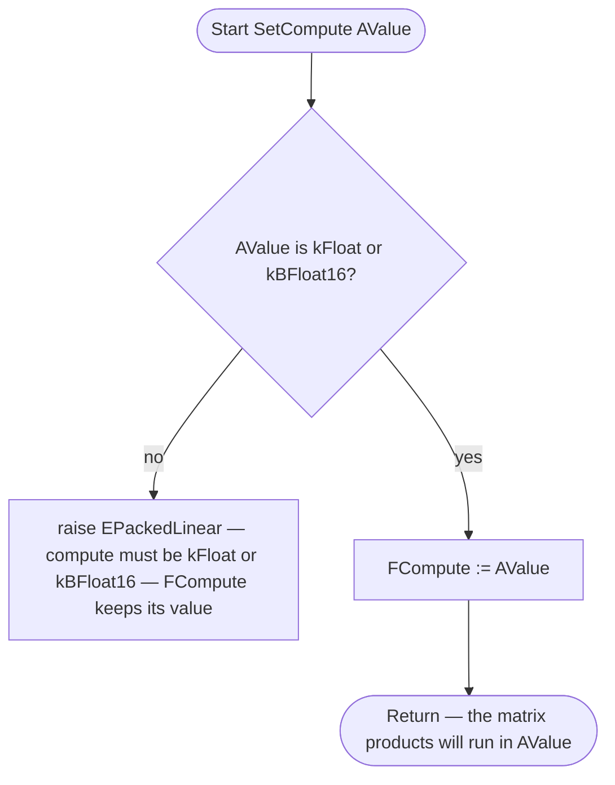
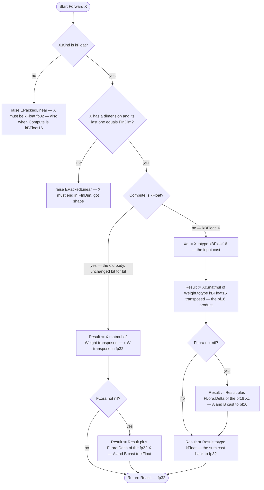
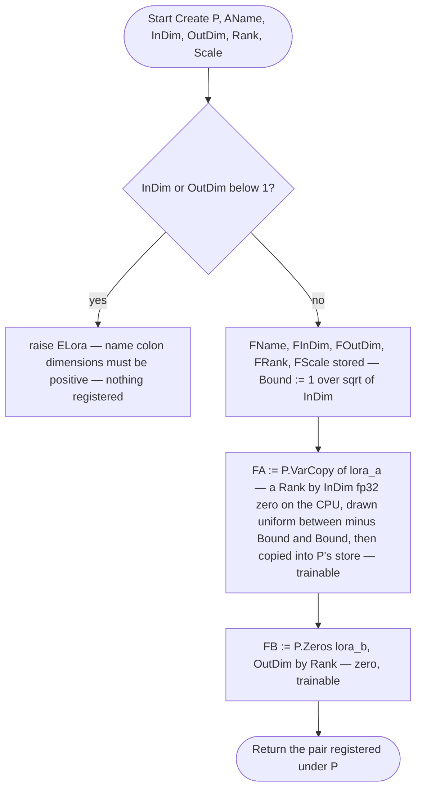
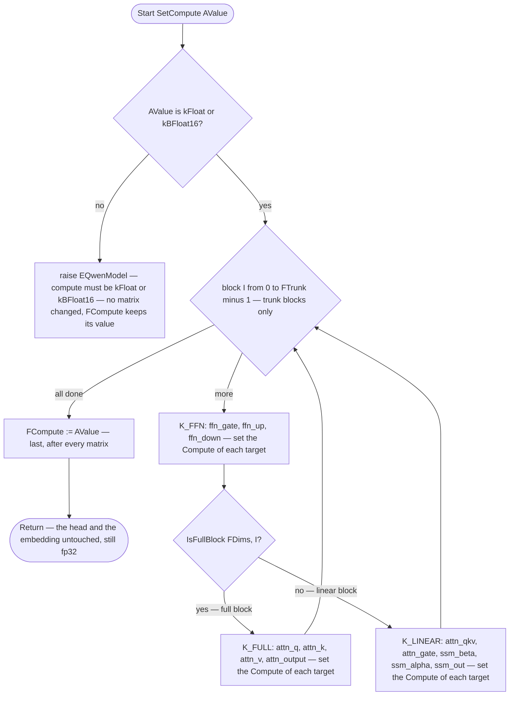
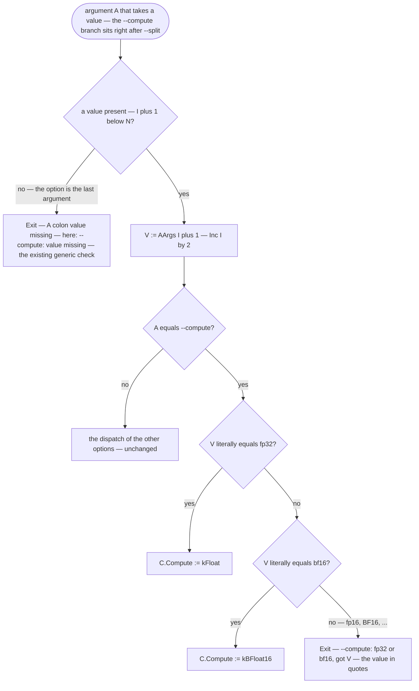
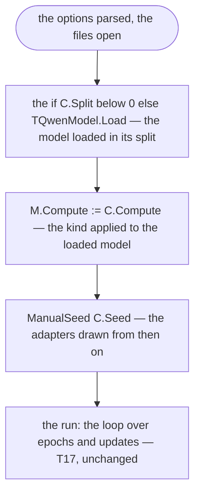
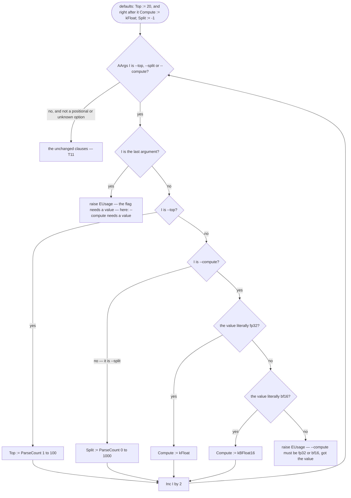
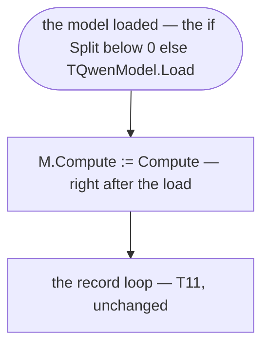

# Program flow — bf16 compute and the CPU adapter draw (T21)

Step-by-step control flow of `TPackedLinear.SetCompute` / `Forward` (unit `PackedLinear`), the
`lora_a` draw of `TLoraPair.Create` (unit `Lora`), `TQwenModel.SetCompute` (unit `QwenModel`), the
`--compute` branch of `ParseTrainArgs` and the kind line of `RunTrainCLI` (unit `TrainCli`), and the
`--compute` option and kind line of `RunLogprobsCLI` (unit `LogprobsCli`). The full tensor-op lists
and the exact code are in `docs/detailed-design/T21-detailed.md` (§2–6); the messages are in §7
there. Tensors are managed records (no `Free`). Stages (T21-facts): stage 1 (T21b1) covers
`PackedLinear` + `Lora` (rows `UT-PackedLinear-301`..304, `UT-Lora-301`); stage 2 (T21b2) covers
`QwenModel` + `TrainCli` + `LogprobsCli` (rows `UT-QwenModel-301`..302, `UT-TrainCli-301`..302,
`UT-LogprobsCli-301`..302); T21c is the ITa run (`ITa-T21-001`..006).

## `TPackedLinear.SetCompute` flow

UT-PackedLinear-301: starting from `kFloat`, set `kBFloat16` (kept), then `kHalf` and `kDouble`
(both raise, `Compute` still `kBFloat16`), then `kFloat` again (kept).

## `TPackedLinear.Forward` flow (both branches)

Checks first and unchanged (T10), so `UT-PackedLinear-304` — `Forward` of a bf16 `X` under
`Compute := kBFloat16` — still raises `X must be kFloat (fp32)`. The fp32 branch runs the old body,
so every earlier row and oracle holds. UT-PackedLinear-302: the bf16 result is fp32 [5, 6], equals
`X.totype(kBFloat16).matmul(Weight.totype(kBFloat16).transpose(0, 1)).totype(kFloat)` exactly,
differs from the fp32 result by more than 0 and at most 0.02, and switching back to `kFloat`
reproduces the fp32 result exactly. UT-PackedLinear-303: with a pair attached (`SetB(P)`) the bf16
`Forward` equals `(Xc·Wᵀ + P.Delta(Xc))` cast back, exactly, and `A.grad` / `B.grad` come out fp32
with a sum of squares > 0 (the delta must take the bf16 `X`; a mutant using the fp32 `X` is caught).

## `TLoraPair.Create` flow (the CPU draw)

The only change of T12's `Create` is the `FA` line: the draw happens on the **CPU** generator — the
same operation as `TVarPath.Uniform` on a CPU store, the T12 values — and `VarCopy` copies the
tensor into the pair's store (whatever device that is), so a run starts from the same adapter
whatever the device map (M2g-a: drawn on P's own (GPU) generator, the two-card run started from
another `A`, gradient norm 3.44 against 3.77 at update 1). `UT-Lora-301`: with the same seed, `A`
equals a CPU-store `.Uniform` draw of the same rank/shape exactly, and the next `rand` afterwards
equals the next `rand` after that uniform draw exactly (the CPU generator is consumed alike);
`P.A.RequiresGrad`, the store holds 2 variables and `B` is all zero. On the CPU the mutant "draw on
P's device" cannot be seen; M2g-b checks it by the gradient norm at update 1.

## `TQwenModel.SetCompute` flow (the three name lists)

Per block: 3 FFN + 4 (full) or 5 (linear) matrices; on the tiny fixture (block 0 linear, block 1
full) 15. `UT-QwenModel-301`: loaded at split 1, `Compute` is `kFloat` and all 15 matrices are
kFloat; after setting `kBFloat16` all 15 are kBFloat16; `kHalf` raises `compute must be kFloat or
kBFloat16` and the model still reports `kBFloat16` with 15 of 15 in bf16 (checked before any matrix
is changed); back to `kFloat` gives 15 of 15 in fp32. A mutant leaving the full block's or the FFN
matrices out, or not storing `FCompute`, is caught by the 15-of-15 / read-back checks; "any kind
accepted" by the raise.

## `ParseTrainArgs` flow (the `--compute` branch)

`UT-TrainCli-301`: `--compute bf16 …` → `C.Compute = kBFloat16`; `--compute fp32 …` → `kFloat`;
`--compute fp16 …` → `--compute: fp32 or bf16, got "fp16"`; `--compute BF16 …` → `--compute: fp32
or bf16, got "BF16"` (compared literally); `… --compute` (last) → `--compute: value missing`. The
config with `Compute := kBFloat16` has the same `ConfigHash` as without (the kind is not in the
hash).

## `RunTrainCLI` flow (where the kind is set)

`UT-TrainCli-302`: 8-update run (`--max-updates 2`) in fp32 and in bf16 (both exit 0, `stopped
after update 2 of 8`, the same number of update lines); the first update's loss (fourth column)
differs by more than 0 from the fp32 run's and at most 0.01 in relative terms. A mutant not setting
`M.Compute` (the model left at its `kFloat` from `Load`) is caught because the bf16 run then
reproduces the fp32 losses exactly.

## `RunLogprobsCLI` flow (the option, and where the kind is set)

Every `EUsage` is reported as two lines (`'qlora_logprobs: ' + E.Message`, then the new `K_USAGE`
with `[--compute K]`) and the function returns exit 2. `UT-LogprobsCli-301`:
`--compute bf16 --top 3` exits 0 with 3 lines; line 1 equals the `Want` of the model with
`Compute := kBFloat16` and differs from the fp32 `Want`; `--top 3 --compute fp32` exits 0 with line
1 equal to the fp32 `Want`. `UT-LogprobsCli-302`: `--compute` alone → `--compute needs a
value`; `--compute fp16 …` → `--compute must be fp32 or bf16, got fp16`.

## Branch / check coverage (UT and ITa rows)

| Branch / check | Condition in the UTs | UT / ITa case |
|----------------|----------------------|---------------|
| `TPackedLinear.SetCompute`: kind check, value kept on the raise | from `kFloat`: set `kBFloat16`, then `kHalf`, then `kDouble` (raise), then `kFloat` | UT-PackedLinear-301 |
| `TPackedLinear.Forward` fp32 branch: the old body, unchanged bit for bit | `NewLinear`, `FixX.totype(kFloat)`; `Y32`; switch `kFloat`/`kBFloat16` and back | UT-PackedLinear-302 |
| `Forward` bf16 branch: casts on X and W, exact expected product, difference in (0, 0.02] | `Y` against `X.totype(kBFloat16).matmul(Weight.totype(kBFloat16).transpose(0, 1)).totype(kFloat)` | UT-PackedLinear-302 |
| `Forward` bf16 branch: the `Delta` of the bf16 X; the grades back in fp32 | pair `NewPair(S, 8, 6)`, `SetB(P)`, `L.Lora := P`; `Y.sum(kNone).Backward`; `A.grad` / `B.grad` kFloat, sum of squares > 0 | UT-PackedLinear-303 |
| `Forward`: the input check even in bf16 mode | `Forward(FixX.totype(kBFloat16))` | UT-PackedLinear-304 |
| `TLoraPair.Create`: `A` of the CPU draw — value, generator consumption, `RequiresGrad`, `B` zero | `ManualSeed(7)` twice; S1 via `Create` vs S2 via `.Uniform`; a `rand` after each | UT-Lora-301; (the GPU mutant: M2g-b) |
| `TQwenModel.SetCompute`: all 15 matrices of the tiny model, every kind, raise before any change | `TiedPath` split 1; the `Target` of `ffn_*` and of the block's kind; `kHalf` refused | UT-QwenModel-301 |
| `TQwenModel`: the bf16 trunk moves the logits (≤ 5 % relative); the head exact in fp32 | `L32` / `L16` via `NoGradLogits`; `A` / `B` via `M.Logits` under `NoGradGuard` | UT-QwenModel-302 |
| `ParseTrainArgs --compute`: the literal values, `BF16` refused, the missing value | the six argument lists of the row; equal `ConfigHash` for `kFloat` and `kBFloat16` | UT-TrainCli-301 |
| `RunTrainCLI`: `M.Compute` set — the bf16 run's first loss differs from fp32 within 0.01, the output unchanged | `Run(RunArgs(O, ['--max-updates', '2']))` vs `+ ['--compute', 'bf16']` | UT-TrainCli-302; ITa-T21-004, 005 |
| `RunLogprobsCLI --compute`: the bf16 line against the fp32 `Want` | `--compute bf16 --top 3` vs `--top 3 --compute fp32` | UT-LogprobsCli-301; ITa-T21-002, 003, 006 |
| `RunLogprobsCLI --compute`: the two usage errors | `--compute` alone; `--compute fp16 TinyPath PromptPath` | UT-LogprobsCli-302 |
| ITa-T21-001: the default kind byte-identical to the code before T21 | the T11 prompts (top 20) and the 4 update lines vs `work/oracle/T21/` | ITa-T21-001 |
| ITa-T21-002..006: the bf16 logprobs/loss/resume/determinism limits | `QLORA_MODEL=<rehearsal GGUF> <project root>/tests/ita/T21-run.sh` → `<project root>/work/ita/T21/summary.tsv` | ITa-T21-002 to 006 |
