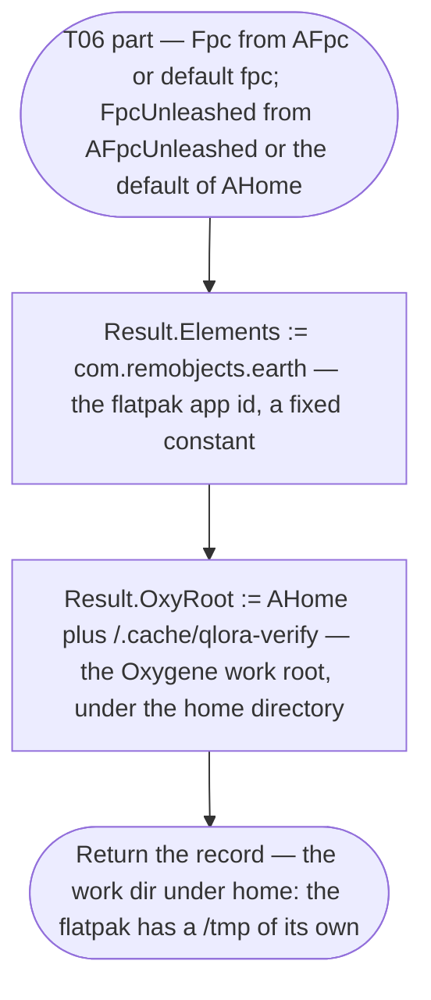
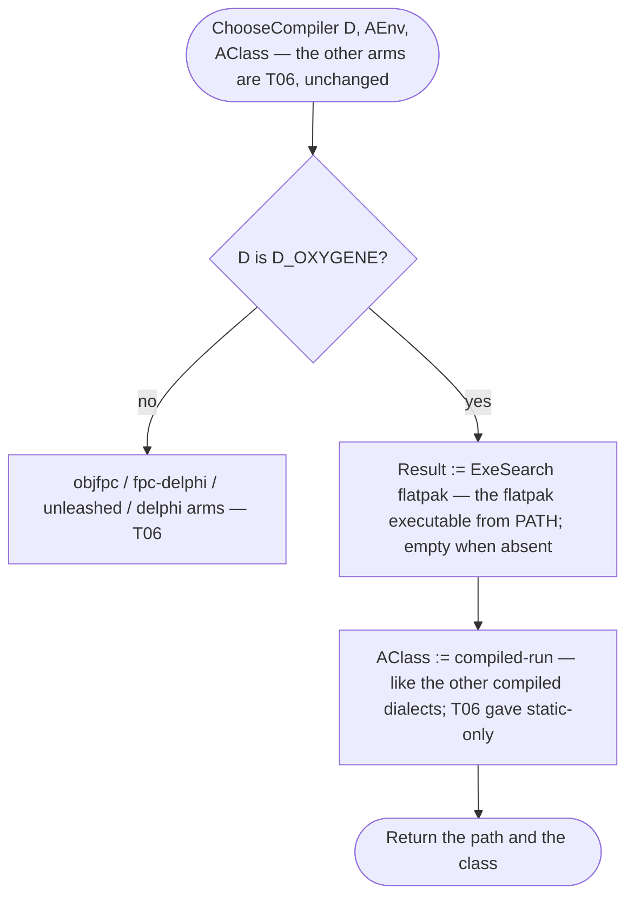
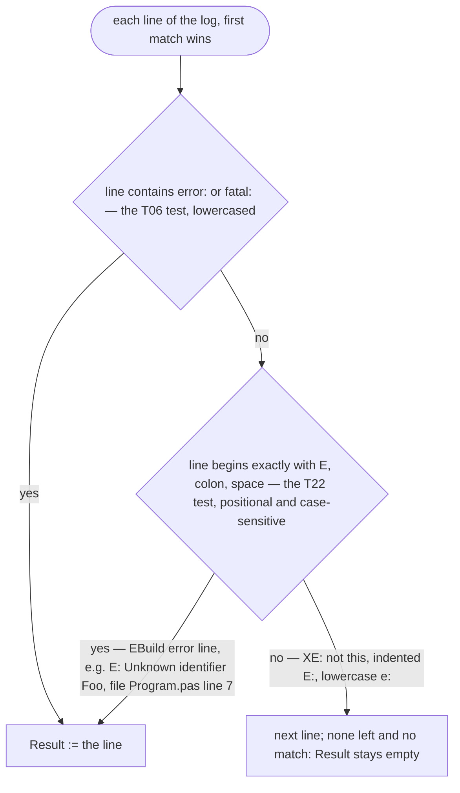
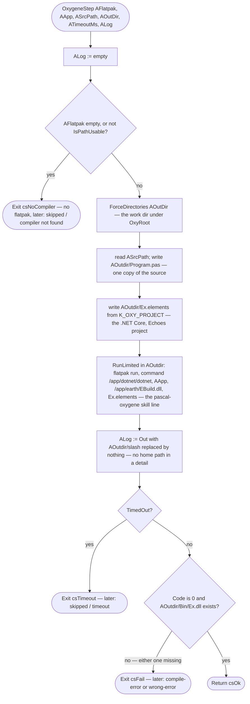
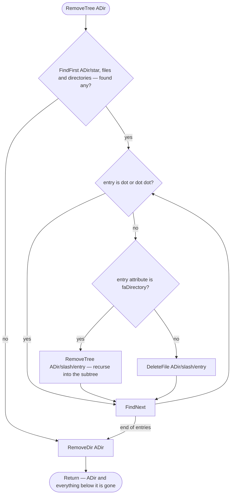
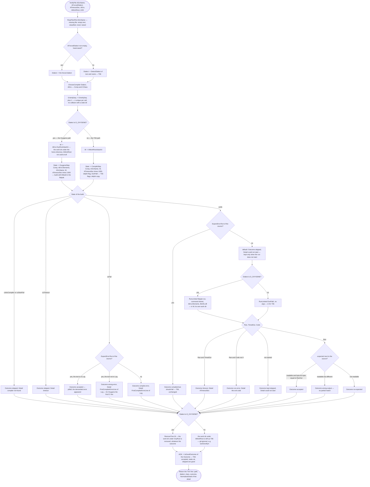

# Program flow — Oxygene build and run in the filter (T22)

Step-by-step control flow of the T22 changes in the unit `DialectVerify` (T06): `ReadEnvRec`
(the Oxygene part), the Oxygene branch of `ChooseCompiler`, `FirstCompilerErrorLine`,
`OxygeneStep`, `RemoveTree` and `VerifyFile` (both the Oxygene and the non-Oxygene path). The
exact code is in `docs/detailed-design/T22-detailed.md` (§2–8) with the outcome table in §9;
the external design is `docs/external-design/T22-external.md`; the facts are
`tasks/T22-facts.md`. The T06 functions that stay unchanged are `DetectDialect`, `CompileStep`,
`ExtractExpectErrorText`, `ExpectedPathFor`, `RunLimited`, `ReadTextFile`, `NormalizeDetail`,
`IsGoodOutcome`. A build is good only when EBuild exits 0 **and** `Bin/Ex.dll` exists
(`T22-detailed.md` §6). Stages (T22-facts): stage 1 (T22b) is the implementation with rows
`UT-DialectVerify-013`, `103`, `104` (changed) and `301` to `305`; T22c is the ITa
(`ITa-T22-001` to `006`).

## `ReadEnvRec` flow (the Oxygene part)

`UT-DialectVerify-301`: `ReadEnvRec('', '', '/h')` → `Elements` `com.remobjects.earth`,
`OxyRoot` `/h/.cache/qlora-verify`.

## `ChooseCompiler` flow (the Oxygene branch)

`UT-DialectVerify-013` (changed): `ChooseCompiler('oxygene', ReadEnvRec('', '', '/h'), Cls)`
→ `ExeSearch('flatpak')`, `Cls` `compiled-run`. An empty path flows through `OxygeneStep` to
`csNoCompiler` → `skipped` / `compiler not found`.

## `FirstCompilerErrorLine` flow (the `E: ` prefix)

`UT-DialectVerify-302`: of the lines `Building`, `XE: not this`,
`E: Unknown identifier "Foo" [Program.pas (7)]` → the `E: ` line; of ` E: indented`,
`e: lower` → `''`.

## `OxygeneStep` flow

`UT-DialectVerify-303`: the good source into `<OxyRoot>/a` → `csOk`, and `a` holds
`Program.pas`, `Ex.elements`, `Bin/Ex.dll`; the bad one into `/b` → `csFail`,
`FirstCompilerErrorLine(Log)` = `E: Unknown identifier "Foo" [Program.pas (8)]`, the directory
not in `Log`; `''` as the flatpak → `csNoCompiler`; `/nonexistent/flatpak` → `csNoCompiler`;
the good source with a 1 ms limit → `csTimeout`.

## `RemoveTree` flow

Bottom-up: subtrees first, files, then `ADir` itself; nothing below the parent is touched.
`UT-DialectVerify-304`: `t/a.txt`, `t/s/b.txt`, `t/s/u/c.txt` under it — after
`RemoveTree('.../t')`, `t` is gone and the parent (`work/ut/dv-304`) is still there.

## `VerifyFile` flow (both paths)

Notes on the run step: the program runs **inside its fresh work directory** (run it where the
compiler put it) — for Oxygene, `dotnet Bin/Ex.dll` with `W` as the working directory. The
`skipped` / `could not start` default is the defensive keep-alive for a run that never starts.

## Branch / check coverage (UT and ITa rows)

| Branch / check | Condition in the UTs | UT / ITa case |
|----------------|----------------------|---------------|
| `ReadEnvRec`: `Elements` the app id, `OxyRoot` under `AHome` | `ReadEnvRec('', '', '/h')` | UT-DialectVerify-301 |
| `ChooseCompiler` Oxygene arm: `ExeSearch('flatpak')`, class `compiled-run` | `ChooseCompiler('oxygene', ReadEnvRec('', '', '/h'), Cls)` | UT-DialectVerify-013 |
| `FirstCompilerErrorLine`: the `E: ` prefix, positional and case-sensitive | the six fixture lines, `XE:`, indented, lowercase rejected | UT-DialectVerify-302 |
| `OxygeneStep`: `csOk` with `Program.pas`, `Ex.elements`, `Bin/Ex.dll` in the work dir | the good source into `<OxyRoot>/a`, `ExeSearch('flatpak')` | UT-DialectVerify-303 |
| `OxygeneStep`: `csFail`, `E: ` line in the detail, work dir not in the log | the bad source into `<OxyRoot>/b` | UT-DialectVerify-303 |
| `OxygeneStep`: no flatpak → `csNoCompiler`; 1 ms limit → `csTimeout` | `''` and `/nonexistent/flatpak`; 1 ms | UT-DialectVerify-303 |
| `RemoveTree`: recursive, parent kept | three levels of files under `t` | UT-DialectVerify-304 |
| `VerifyFile` Oxygene: accepted, wrong-output, no-expected, run-error `3`, pitfall accepted, wrong-error `E: … (8)` | the six sources under `work/ut/dv-305/s`, `AWorkRoot` `work/ut/dv-305/w` | UT-DialectVerify-305 |
| `VerifyFile` Oxygene clean-up: no entry under `OxyRoot`, `AWorkRoot` neither created nor deleted | afterwards, after the six runs of the previous row | UT-DialectVerify-305 |
| `VerifyFile` Oxygene `compile-error`: detected dialect and forced dialect | `namespace Demo; type T = class of object end; end.`; `program p; begin end.` with forced `oxygene` | UT-DialectVerify-103, 104 |
| Oxygene record through the dataset CLI: `compiled-run`, `compile-error`, detail `E: Could not find a "Main" method in this project` | the record `namespace N; end.` | UT-DatasetCli-105 |
| Oxygene reply through the eval CLI: `compile-error`, not compiled, not passed | the reply `namespace N;` | UT-EvalCli-105 |
| 11 Oxygene files: outcome as planted, class `compiled-run` | `tests/ita/T22/files`, `--dialect oxygene` | ITa-T22-001 |
| details free of the home and work directory paths | the TSV detail column | ITa-T22-002 |
| no work directories left under `~/.cache/qlora-verify` | after the run | ITa-T22-003 |
| seconds per Oxygene file (build and run) ≤ 5 | ~0.9 s measured | ITa-T22-004 |
| the T19 ITa again with this `src/`: 6 OK, 0 NG; `x-oxygene` rejected with `verify: wrong-output` | `tests/ita/T19-run.sh` with the T22 `src/` | ITa-T22-005, 006 |

## Change history

| Date | Change |
|------|--------|
| 2026-11-25 | Initial program flow |
