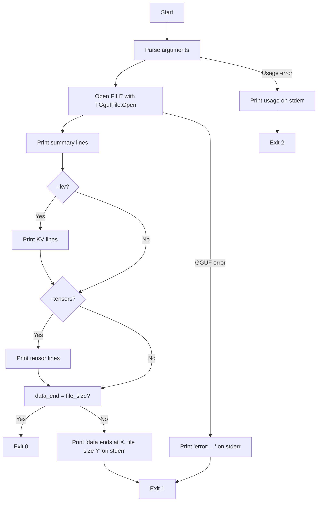

# T01 `qlora_inspect` system flow

## Overview

1. Parse command-line arguments.
2. Open the GGUF file using `TGgufFile.Open`.
3. Collect and print summary data.
4. If `--kv`, print key-value metadata.
5. If `--tensors`, print tensor directory.
6. Validate `data_end` and exit with the appropriate code.

## Flow

## Key routines

- **`RunInspectCLI`** (`InspectCli` unit):
  - Input: `AArgs: array of string` (command-line arguments), `AOut: TStrings` (stdout), `AErr: TStrings` (stderr).
  - Output: Exit code.
  - Steps:
    1. Check argument count and parse `--kv`/`--tensors`.
    2. Call `TGgufFile.Open` with the file path.
    3. Gather summary data (version, alignment, KV/tensor counts, data offsets, file size).
    4. Print summary lines to `AOut`.
    5. If `--kv`, iterate `KV[]` and print key-type lines.
    6. Print the `type` lines (per-type counts, by type id) after the summary, always; if `--kv`, the KV lines follow, then if `--tensors` the tensor lines.
    7. Check `data_end = file_size`; set exit code and error message if not.

- **`main`** (`qlora_inspect.pas`):
  - Copy `ParamStr` to `AArgs`.
  - Call `RunInspectCLI`.
  - Write `AOut`/`AErr` to stdout/stderr.
  - Call `Halt` with the exit code.