# System flow — unit `Recompute` (T13)

```mermaid
flowchart TD
    subgraph "T17 Training Step"
        A[Start training step] --> B[Create TSavedInputs]
        B --> C[RecomputeForward: 64 trunk blocks]
        C --> D[Saved inputs: 64 tensors on host]
        D --> E[RecomputeBackward: 64 blocks, last to first]
        E --> F[Parameter gradients accumulated in each stage]
        F --> G[Input gradient dL/dX0 returned]
    end

    subgraph "UT (fixture)"
        H[Hand: two scale stages] --> I[RecomputeForward]
        I --> J[Verify: result, saved inputs, no graph built]
        J --> K[RecomputeBackward]
        K --> L[Verify: input gradient, parameter gradients, graph built]
        L --> M[Compare with hand values]
    end

    subgraph "UT (WholeGraphBackward oracle)"
        N[MakeStages: N affine stages] --> O[CloneStages]
        O --> P[RecomputeForward/Backward on A]
        P --> Q[WholeGraphBackward on B]
        Q --> R[Verify: input and parameter gradients match exactly]
    end

    subgraph "ITa driver"
        S[tests/ita/T13/recompute_check.pas] --> T[8 and 64 stages on CPU]
        T --> U[WholeGraphBackward oracle]
        U --> V[Compare: max diff vs limit]
        V --> W[Write summary.tsv]
    end
```

## 呼び出し元コンテキスト

### T17 Training Step

- 64 個のトランクブロックを 2 つの GPU (cuda:0, cuda:1) で実行
- TSavedInputs は OnHost=True で作成、保存入力はホストメモリ上
- ステージはデバイス間で分割 (一部 cuda:0、残り cuda:1)
- フォワード後にバックワードを実行し、パラメータ勾配を取得

### UT フィクスチャ

- tests/ut/RecomputeFixture.pas が提供する TScaleStage (y = x·w) と
  TAffineStage (y = tanh(xW + b))
- Hand 関数: w=2, w=3 の 2 つのスケールステージ
- WholeGraphBackward: オラクル (通常のグラフ付きフォワード + バックワード)
- 手計算値: dL/dw = Σ x·g, dL/dx = w·g

### ITa ドライバ

- tests/ita/T13/recompute_check.pas
- 8 ステージ (幅 16, 4 行) と 64 ステージ (幅 64, 32 行) を fp64 でテスト
- WholeGraphBackward との比較、差分の上限チェック
- 結果を work/ita/T13/summary.tsv に出力
