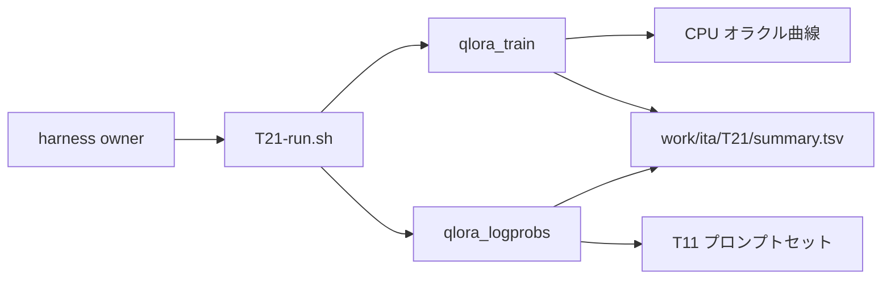
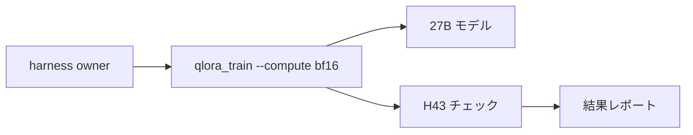
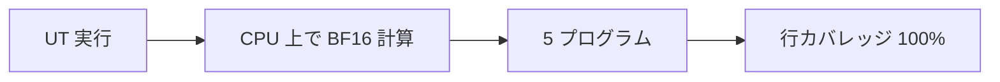
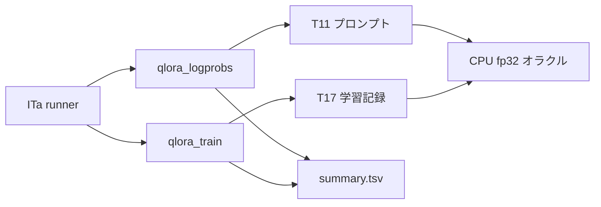

# T21 システムフロー

## 利用者とジョブ

本タスクの機能は以下の測定・検証ジョブで使用される:

### M2g-b: 2枚カードの BF16 分割検証

- **目的**: BF16 分割の精度・速度を CPU 学習曲線と比較
- **比較対象**: FP32 2枚分割 (M2g-a) の結果
- **実施者**: harness owner
- **環境**: 2枚 GPU、CPU

### M4: 27B モデル検証 (H43)

- **目的**: Qwen3.8 27B の BF16 学習を検証
- **環境**: H43 (2 GPU)

### UT: 単体テスト

- **環境**: CPU、stock fpc (GPU 非表示)
- **対象**: PackedLinear, Lora, QwenModel, TrainCli, LogprobsCli

### ITa: 結合テスト

- **実行**: `QLORA_MODEL=<rehearsal GGUF> <project root>/tests/ita/T21-run.sh`
- **結果**: `<project root>/work/ita/T21/summary.tsv`
- **オラクル**: T21 以前のコードの fp32 出力
- **環境**: CPU のみ
